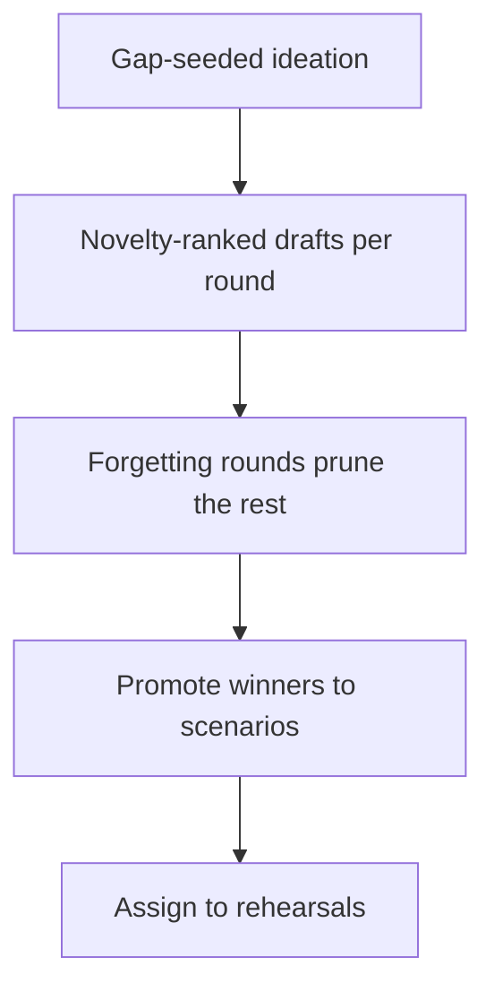

## Chapter 12: Discovery lab: gap-seeded rounds, promoted winners

Start a gap-seeded run and watch the rounds: candidates proposed from catalog gaps, novelty-ranked, with forgetting rounds pruning the rest. Promote winners into catalog-shaped scenarios, export the run with its drafts, and assign every promoted shape to a rehearsal.

Forgetting is a designed operation here, not context overflow — rounds structure convergence so the draft pile cannot grow forever. Backlog labs that accumulate drafts nobody reads are writing clubs; the rounds force the choice the pile avoids. Promote one draft or delete three: the promotion gate is the only exit that matters, because drafts that survive become catalog-shaped scenarios, exportable with the run, living in the browser until they earn catalog status. Everything else is compost.

**Definition 1 (Gap-seeded round).** A discovery round is *gap-seeded* if every candidate draft cites the catalog gap it addresses, carries a novelty score against existing scenarios, and survives only by outranking the forgetting threshold for its round.

**Theorem 1 (Convergence without accumulation).** Under gap-seeded rounds with forgetting, the draft inventory stays bounded while genuine gap coverage grows monotonically.

*Proof.* Forgetting removes every draft below threshold each round, so inventory after round $k$ is at most the number of above-threshold survivors — bounded by construction, regardless of how many rounds run. Coverage grows monotonically because promoted winners (genuine gap fills, audited against existing scenarios) are never un-promoted: the promoted set only gains members. Novelty scoring is a filter, not a virtue — audit one promoted draft for genuine gap coverage, because a metric gamed becomes brainstorming with extra steps. The two mechanisms compose: forgetting bounds the pile, promotion grows the coverage, and neither can substitute for the other. ∎

A discovery program disconnected from rehearsal is the failure the counsel names: every round should name the drill its winners will stock. Assign one promoted draft to a specific rehearsal, and the lab feeds the bench, the rogue tab, and the scenario catalog instead of itself.

**Counsel of architects.**

- **Continual-learning architect:** I see discovery as gap-seeded ideation with forgetting built in: rounds propose candidate scenarios from catalog gaps, score novelty, keep winners and forget the rest. Forgetting is a designed operation, not context overflow. My dispute is with backlog labs that accumulate drafts nobody reads; the rounds structure forces convergence. Monday morning, run one forgetting round on your stalest draft pile.
- **Memory-systems architect:** I emphasize promotion as the only exit that matters: drafts that survive become catalog-shaped scenarios, exportable with the run, living in the browser until they earn catalog status. Everything else is compost. Others celebrate ideation volume; I insist the promotion gate is the workflow. Monday morning, promote one draft or delete three.
- **Evaluation architect:** I value novelty scoring as the anti-redundancy control: gap-seeded, scored against what exists, with rounds recorded so the process is auditable. Ideation without a metric is brainstorming with extra steps. My caution is metric gaming; novelty is a filter, not a virtue. Monday morning, audit one promoted draft for genuine gap coverage.
- **Safety architect:** I map discovery to rehearsal supply: the lab exists to feed the bench, the rogue tab and the scenario catalog with fresh shapes. A discovery program disconnected from rehearsal is a writing club. My disagreement is with ideation for its own sake; every round should name the drill its winners will stock. Monday morning, assign one promoted draft to a specific rehearsal.
