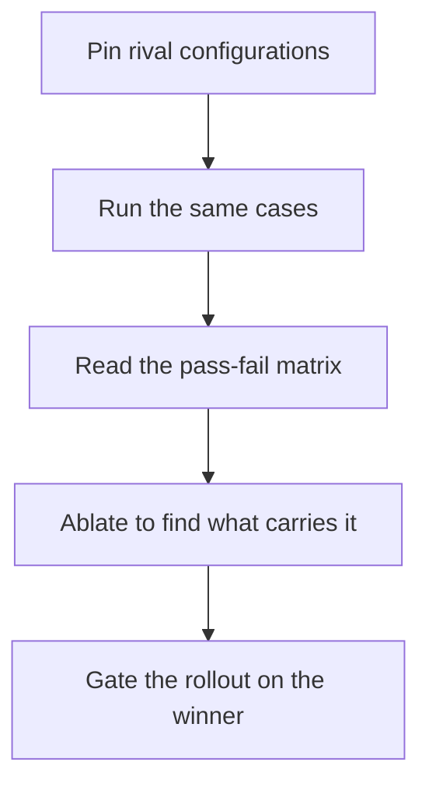
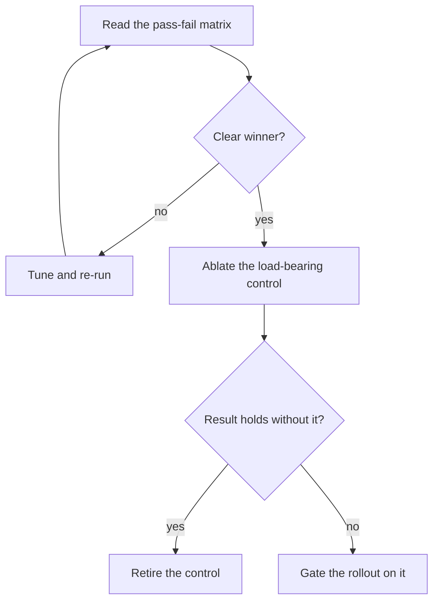

## Chapter 13: Battle bench: configure, run, ablate, gate

Pin two or more configurations, run the same cases, read the pass-fail matrix — scenarios down, configurations across, one cell per case. Then ablate: remove one control, re-run, and watch which failures return. That control carries the result and earns its budget.

Arguments end where matrices begin. Architecture by seniority, by loudest opinion, by vendor deck — all of it surrenders to the same cases run against rival stacks with one cell per case. The matrix is the durable artifact: scenarios down, configurations across, a result you can revisit when the stack changes. Opinions fade; matrices persist. Archive one matrix with its configuration, and next quarter's argument starts from evidence instead of memory.

**Definition 1 (Load-bearing control).** Given a passing matrix $M$ over cases $C$ for configuration $K$ with controls $\{c_1, \dots, c_n\}$, control $c_i$ is *load-bearing* for $C$ if the matrix over the same cases for $K \setminus \{c_i\}$ fails at least one case that $M$ passes.

**Theorem 1 (Ablation verdict).** Full-stack passing proves nothing about any part; ablation decides what carries the result. If removing $c_i$ breaks the matrix, $c_i$ earns its budget; if the matrix holds without it, $c_i$ retires.

*Proof.* The passing full-stack matrix is consistent with every subset of controls carrying the result — including the empty subset (the cases might pass for unrelated reasons). Ablation tests each control counterfactually: $K \setminus \{c_i\}$ failing where $K$ passes proves $c_i$ necessary for those cases (load-bearing); holding proves it unnecessary for them (retireable). The verdict is per-control and empirical, which is why benchmark overfitting is the counsel's caution — rotate cases and re-run before decommissioning anything, because a control load-bearing on a stale case set is load-bearing on history. ∎

Gate the rollout on the winner and on nothing else: no configuration ships without a passing matrix, no control retires without an ablation showing nothing breaks. The bench is the gate with numbers — ship-then-measure cultures get the order backwards, and the matrix is the correction. Bench one decision you already made and check the matrix agrees; ablate the control everyone assumes is essential; gate one rollout on a fresh bench run.

**Counsel of architects.**

- **Continual-learning architect:** I read the bench as the question what carries the result, asked with configurations instead of opinions: set up rival stacks, run the same cases, read the pass-fail matrix, and ablate to find the load-bearing piece. Arguments end where matrices begin. My dispute is with architecture by seniority; run the bench and let the loser concede. Monday morning, bench one decision you already made and check the matrix agrees.
- **Memory-systems architect:** I focus on the matrix as the durable artifact: scenarios down, configurations across, one cell per case — a result you can revisit when the stack changes. Opinions fade; matrices persist. Others watch the run; I insist the saved matrix is the product. Monday morning, archive one matrix with its configuration.
- **Evaluation architect:** I treat ablation as the load-bearing analysis: remove one control, re-run, and watch which failures return — that control carries the result and earns its budget. Full-stack passing proves nothing about any part. My caution is benchmark overfitting; rotate cases and re-run before decommissioning anything. Monday morning, ablate the control everyone assumes is essential.
- **Safety architect:** I staff the bench as pre-deployment proof: no configuration ships without a passing matrix, and no control retires without an ablation showing nothing breaks. The bench is the gate with numbers. My disagreement is with ship-then-measure cultures; the bench runs before the grant, not after the incident. Monday morning, gate one rollout on a fresh bench run.
