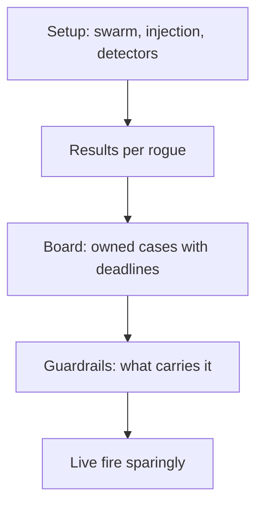
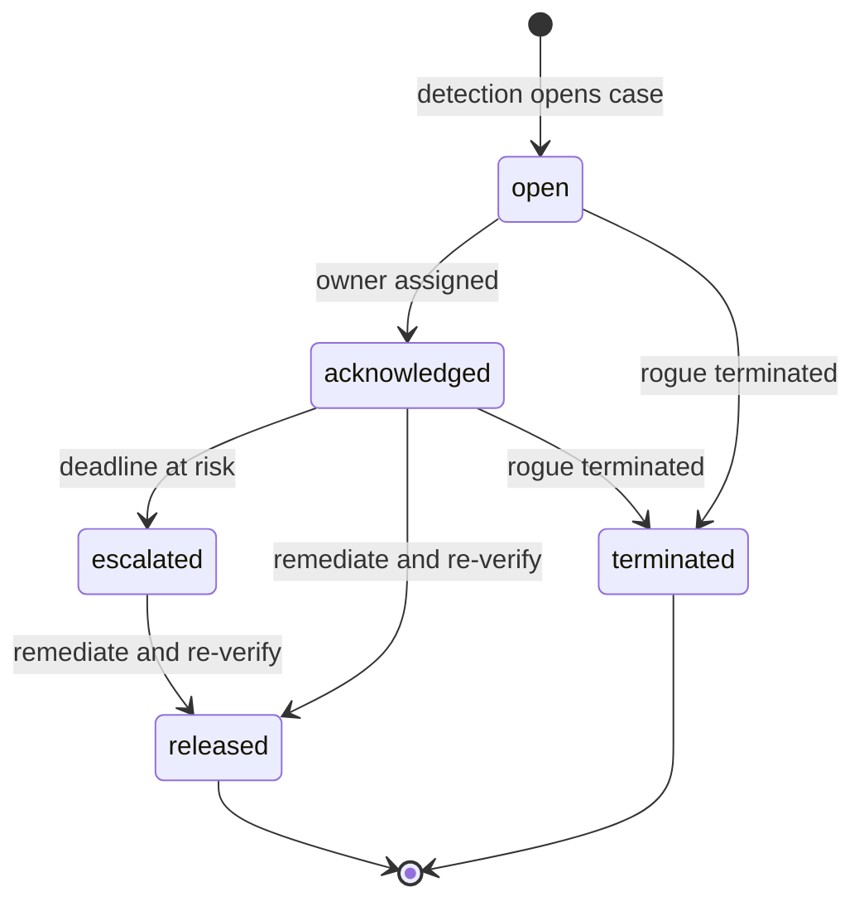

## Chapter 14: Rogue ops: setup, results, board, guardrails

Configure the swarm and the injection; read per-rogue outcomes; open owned cases with deadlines on the board; verify what carries the result with counterfactuals. Run the guarded preset first and change nothing — it is the control group for every later claim. Live fire sparingly, for new shapes, with caps on and fallbacks flagged.

The state diagram is the board's lifecycle made formal: detection opens the case, ownership acknowledges it, risk escalates it, remediation releases it — and termination is a first-class transition from any active state, because killing the rogue is always an option and sometimes the only one. Cases that cannot be terminated from their current state are traps; the diagram has no traps. Every run should open or close a case — simulation as spectacle opens neither, which is why the loop from simulation to owned case is the whole point.

**Definition 1 (Preset control group).** The *guarded preset* run — unmanaged (blast shown), detect-only (found but unstopped), enforce-only (bounded but unfound), guarded (mechanism working) — is the control group: every later claim about a rogue shape is measured as a delta against these four baselines.

**Theorem 1 (No claim without a baseline).** Any statement of the form "control $X$ stops rogue shape $Y$" is meaningful only relative to the preset matrix: it must specify which baseline it beats and by which cells.

*Proof.* Without baselines, "stops $Y$" is uninterpretable: stopped relative to what — the unmanaged blast, the detect-only observation, the enforce-only bound? The preset matrix supplies all three reference points plus the guarded mechanism, so the claim becomes checkable: the cells where $X$ passes and the baselines fail are the claim's content, and empty content means an empty claim. Synthetic presets compare fairly while live campaigns surprise — use each for its job, run the full preset matrix before changing anything, and let counterfactuals (what carries it) verify the guardrails behind the board. ∎

The halt is the load-bearing control: pausing the fleet stops the exponential before attribution finishes, and the kill switch must be tested like a fire alarm — on purpose, on a schedule. Detection without a halt is observation; response plans that end at alerts end before the workflow does. The workflow ends at release from a clean image, with the case owned, deadlined, and closed.

**Counsel of architects.**

- **Continual-learning architect:** I see rogue ops as setup, results, board, guardrails: configure the swarm and the injection, read per-rogue outcomes, open cases with deadlines, and verify which controls carry the result. The loop from simulation to owned case is the whole point. My dispute is with simulation as spectacle; every run should open or close a case. Monday morning, seed the board from your last run.
- **Memory-systems architect:** I emphasize the board as incident memory: cases with owners, clocks, steps and evidence, persisting across runs so the same rogue does not get re-learned every quarter. The board is where simulation becomes operations. Others admire detection rates; I insist the owned case is the output. Monday morning, open one case with a real owner and a real deadline.
- **Evaluation architect:** I value the preset matrix as the control group for every claim: unmanaged shows the blast, detect-only shows found-but-unstopped, enforce-only shows bounded-but-unfound, guarded shows the mechanism working. Without the matrix, results are anecdotes. My caution is live-fire mystique; synthetic presets compare fairly, live campaigns surprise — use each for its job. Monday morning, run the full preset matrix before changing anything.
- **Safety architect:** I staff the halt as the load-bearing control: pausing the fleet stops the exponential before attribution finishes, and the kill switch must be tested like a fire alarm. Detection without a halt is observation. My disagreement is with response plans that end at alerts; the workflow ends at release from a clean image. Monday morning, test the halt on purpose, on a schedule.
