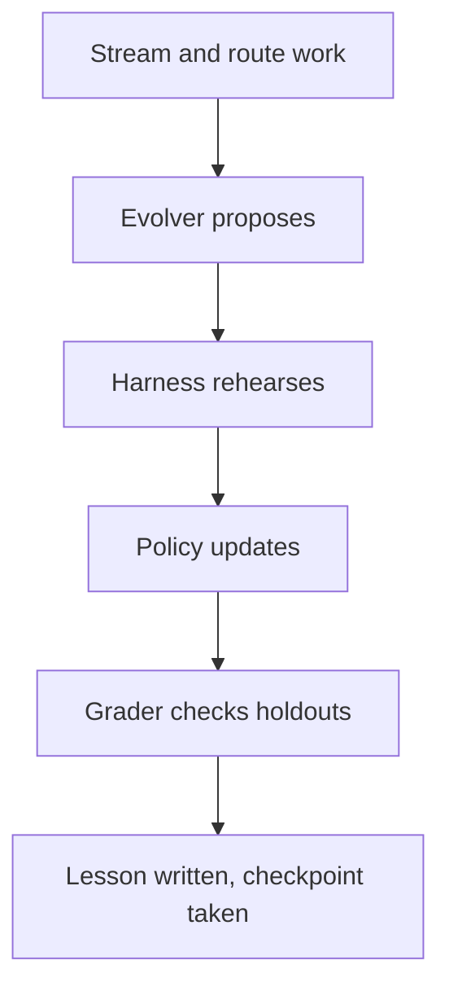

## Chapter 15: Self-learning loop: stream to checkpoint

Point the loop at a stream and read the first lesson file: router, evolver, harness, policy, grader, lesson, checkpoint. Improvement with a ledger — and forgetting as a designed operation, with TTLs and eviction keeping context honest. Learn in rehearsal, promote deliberately, gate every policy update like a deploy.

Each lap improves the agent and writes down what changed and what it cost — improvement without a ledger is anecdote. The evolver proposes, the harness rehearses, the policy updates, the grader checks holdouts the learner never saw, and the lesson plus checkpoint make the improvement durable and attributable. Self-graded homework is the failure the harness exists to prevent: the grader must be independent of the evolver, with disjoint holdouts and per-boundary checkpoints, or plasticity without a stability number is marketing.

**Definition 1 (Ledgered learning step).** A learning step is *ledgered* if it records the tuple $(\mathrm{stream}, \mathrm{proposal}, \mathrm{harness}, \mathrm{grader}, \Delta, \mathrm{checkpoint})$ — what was seen, what was proposed, how it was rehearsed, who graded it, what changed and at what cost, and the checkpoint the system can return to.

**Theorem 1 (Reversibility bounds plasticity risk).** If every policy update is a ledgered step gated like a deployment, then any harmful update is reversible to its checkpoint with its cost known — the loop can afford to learn because every lesson carries its undo.

*Proof.* Gating treats the update as a release: it ships only with the ledger entry complete. The checkpoint pins the pre-update policy, so reversal is restoration, not re-derivation. The ledger records $\Delta$ and its cost, so the harm is measured rather than mysterious. A learning agent is a system that rewrites its own behavior on a schedule — always-on learning in production rewrites without the gate, which is why the discipline is learn in rehearsal, promote deliberately. The loop needs the same gates as any release pipeline, and with them, plasticity is an asset instead of a liability. ∎

Forgetting is the designed counterpart: TTLs, redundancy pruning, and preemptive summaries keep the context honest, because a memory that only grows is a liability wearing a graduation cap. Learn deliberately, forget deliberately — audit what your longest-lived memory has not proven lately, and verify every improvement against a holdout the learner never saw.

**Counsel of architects.**

- **Continual-learning architect:** I read the self-learning loop as stream, router, evolver, harness, policy, grader, lesson, checkpoint: each lap improves the agent and writes down what changed and what it cost. Improvement without a ledger is anecdote. My dispute is with learn-and-hope loops; the lesson and the checkpoint are what make it learning. Monday morning, read one lesson file end to end before trusting its policy.
- **Memory-systems architect:** I focus on forgetting as the designed counterpart to learning: TTLs, redundancy pruning and preemptive summaries keep the context honest, because a memory that only grows is a liability wearing a graduation cap. Learn deliberately, forget deliberately. Others celebrate accumulation; I insist the eviction policy is half the system. Monday morning, audit what your longest-lived memory has not proven lately.
- **Evaluation architect:** I treat the harness and grader as the honesty layer: disjoint holdouts, per-boundary checkpoints, and metric families that measure forgetting alongside improvement. Plasticity without a stability number is marketing. My caution is self-graded homework; the grader must be independent of the evolver. Monday morning, verify one improvement against a holdout the learner never saw.
- **Safety architect:** I map continual learning to change control: every policy update is a deployment, gated, reviewed and reversible, because a learning agent is a system that rewrites its own behavior on a schedule. The loop needs the same gates as any release pipeline. My disagreement is with always-on learning in production; learn in rehearsal, promote deliberately. Monday morning, gate one policy promotion like a deploy.
