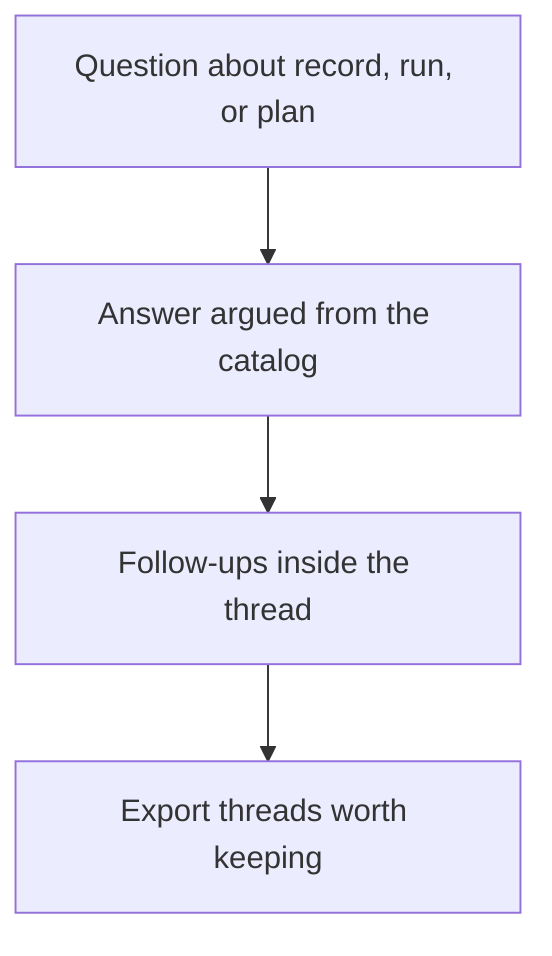
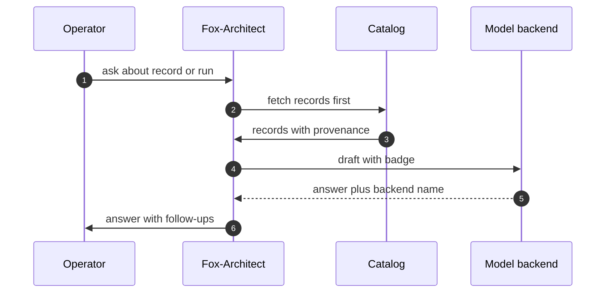

# Part V — Counsel and knowledge workflows

## Chapter 16: Asking Fox-Architect

Ask about a pattern, a scenario, a cascade, a blueprint or a run — start from a suggested prompt or bring your own. Answers argue from catalog records with follow-ups attached; threads persist and export. Check the backend badge: it always says which model spoke, and the deterministic fallback answers from local analysis when nothing is reachable.

Use Fox-Architect to go safer, not just faster: stress-test the blueprint, red-team the deployment plan, second-guess the guardrail set — before granting anything. An adversary will ask these questions; better Fox-Architect first.

The sequence matters more than the interface: records first, draft second, badge always. Fetching records before drafting grounds the answer in the catalog rather than in the model's priors; the backend badge names which model spoke so provenance travels with every claim. When nothing is reachable, the deterministic fallback answers from local analysis — weaker, but honest about what it is, and the badge says so. A brilliant answer you cannot find next week never happened, which is why threads persist, follow-ups build, and the good answers get exported before the session ends.

**Definition 1 (Grounded answer).** An answer is *grounded* if every material claim cites the catalog record it derives from, the backend badge names the model, and the thread (question, records, answer, follow-ups) is exportable as a unit.

**Theorem 1 (Badge-bound trust).** Under grounded answers, trust in any Fox-Architect output reduces to trust in the cited records plus the named backend — never to trust in the chat interface.

*Proof.* The answer's claims each carry record citations by Definition 1, so verifying the answer is verifying the records — the same records readable in their own tabs. The badge fixes the backend, so model-mystique ("the AI said so") is replaced by a named, versioned component whose outputs are checkable against the same records. The interface contributes nothing to the trust equation: it fetches, drafts, and displays, while evidence lives in records and threads. Ask about the control you trust most and check its citations; check which backend answered your last three questions. ∎

**Counsel of architects.**

- **Continual-learning architect:** I see Fox-Architect as the analyst on call: ask about a pattern, a scenario, a cascade, a blueprint or a run, and get an answer argued from catalog records with follow-ups attached. The suggested prompts are the fastest onboarding in the app. My dispute is with chatbots that answer from vibes; every Fox-Architect claim should trace to a record. Monday morning, ask about the control you trust most and check its citations.
- **Memory-systems architect:** I emphasize conversation as working memory: threads persist, follow-ups build, and the good answers get exported before the session ends. A brilliant answer you cannot find next week never happened. Others chat; I insist the exported thread is the artifact. Monday morning, export one thread worth keeping.
- **Evaluation architect:** I value the deterministic fallback as the honesty baseline: with no backend reachable, Fox-Architect still answers from local analysis, and the backend badge always says which model spoke. Provenance travels with every claim. My caution is model-mystique; the badge matters more than the brand. Monday morning, check which backend answered your last three questions.
- **Safety architect:** I staff Fox-Architect as the pre-mortem partner: stress-test the blueprint, red-team the deployment plan, second-guess the guardrail set — before granting anything. An adversary will ask these questions; better Fox-Architect first. My disagreement is with using AI assistance only to go faster; use it to go safer. Monday morning, ask Fox-Architect to break one plan.
