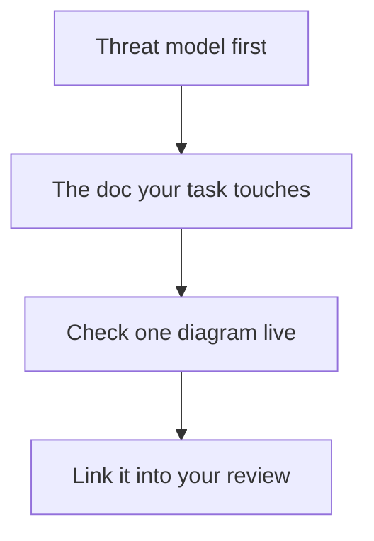

## Chapter 17: Reading the design docs

Eleven documents, each answering one question completely — start at the threat model, then open the doc the task touches:

- 01-system-context — System Context
- 02-uml — UML — Components & Classes
- 03-control-flow — Control Flow & Runtime
- 04-guardrails — Financial Guardrail Architecture
- 05-data-model — Data Model
- 06-threat-model — Threat Model & Protections Map
- 07-architect-analysis — Architect Value Map & Cascade Taxonomy
- 08-runtime-offline — Runtime, Offline & Delivery
- 09-battle-bench — Battle Bench — Testing Agents
- 10-rogue-agents — Rogue Agents — Detection & Quarantine
- 11-self-learning-addon — Self-Learning Add-On — Bridging the Lab

The docs ship with the app, so verify them like code: check one diagram against the running tab, and link docs into reviews instead of reconstructing context from code archaeology.

The reading order is the chapter's first lesson: threat model first, because it names what the guardrails guard, what the bench tests, and what the rogue tab rehearses — read it and the rest of the app makes sense. Then the doc the task touches, not the whole shelf: eleven documents answering one question each reward targeted reading and punish cover-to-cover completionism. Docs that drift from code are worse than no docs, so the verification step is structural, not optional — the docs ship with the app, which means every diagram is checkable against the running tab it describes.

**Definition 1 (Verified doc).** A design document is *verified* for task $T$ if (i) its threat-model claims match the implementation's behavior as observed in the running tab, (ii) at least one of its diagrams has been checked live, and (iii) the review citing it links the specific section, not the document.

**Theorem 1 (Documentation without rot).** If every review links verified docs and verification is re-done per task, then documentation drift is bounded by one task cycle: any drift is caught the next time the drifted section is cited.

*Proof.* Citing a doc for task $T$ requires re-verifying its claims against the running tab (Definition 1), so a drifted section fails verification at its next citation — it cannot be cited successfully while drifted. The bound follows: drift survives at most until the section's next use, and sections in active use are verified continuously. Oral-tradition engineering — decisions that were never written — fails the definition at step (i) and is excluded from reviews by construction. If it is not written, it was not decided; if it is written but unverified, it is not cited. ∎

Brief one teammate from the threat model alone: if the model cannot carry a briefing by itself, the model — not the teammate — needs work.

**Counsel of architects.**

- **Continual-learning architect:** I read the design docs as the apps own architecture, written down where decisions live: system context, UML, control flow, guardrails, data model, threat model and the rest. Eleven documents, each answering one question completely. My dispute is with oral-tradition engineering; if it is not written, it was not decided. Monday morning, read the one design doc closest to your current task.
- **Memory-systems architect:** I focus on the docs as onboarding that scales: every new teammate reads the same context, the same threat model, the same data shapes, instead of reconstructing them from code archaeology. Written context compounds; hallway context evaporates. Others grep code; I insist the doc explains why the code is shaped that way. Monday morning, link one design doc from your next review.
- **Evaluation architect:** I treat the design set as the audit surface: threat model against implementation, data model against stored reality, control flow against rendered behavior. Docs that drift from code are worse than no docs. My caution is documentation rot; the docs ship with the app, so verify them like code. Monday morning, check one diagram against the running tab.
- **Safety architect:** I map the threat model doc to every other workflow: it names what the guardrails guard, what the bench tests, what the rogue tab rehearses. Read it first and the rest of the app makes sense. My disagreement is with security as a later chapter; the threat model is chapter zero. Monday morning, brief one teammate from the threat model alone.
