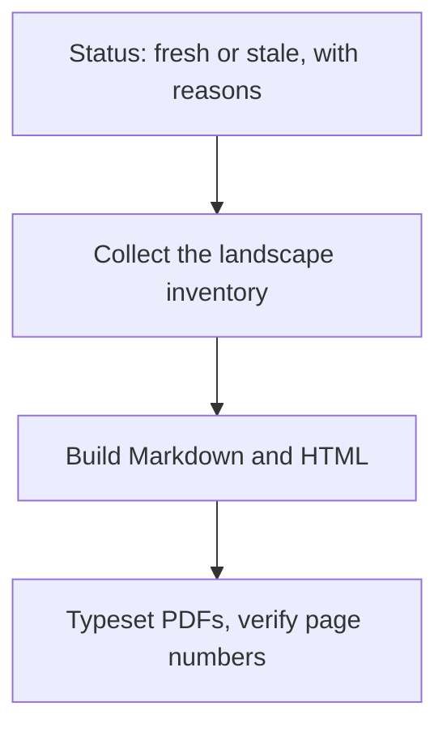
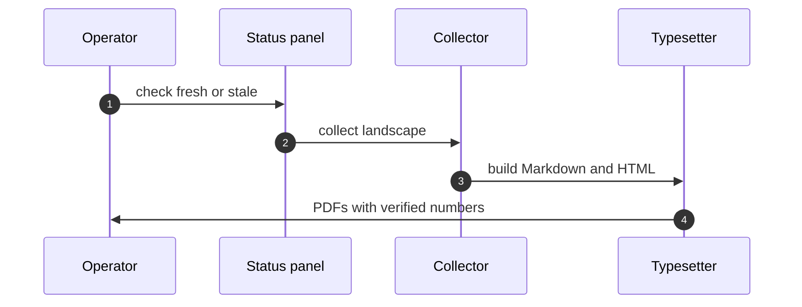

## Chapter 18: Bookshelf: status, collect, build, typeset

The pipeline made visible: the status panel says fresh or stale with reasons, one action collects the landscape inventory, rebuilds Markdown and print HTML, and typesets the PDFs with page numbers verified and bookmarks checked. The build proves its own output — read the log, not just the file.

Cite version and seed with every figure: generated books version themselves, and a changed tab yields a changed edition automatically. Stale books are flagged, not silently shelved.

The bookshelf is the pipeline made visible, and visibility is a control: the status panel says fresh or stale with reasons, one button rebuilds all, and the two-pass typesetting verifies itself — contents page numbers read back from the PDF, bookmarks checked, link targets confirmed. A pipeline that does not verify itself is a rumor mill; a build log nobody reads is a verification nobody performed. Trust the verification line, not the file size.

**Definition 1 (Self-proving build).** A book build is *self-proving* if (i) every figure carries its version and seed, (ii) the typeset PDF's contents page numbers are read back and confirmed, (iii) bookmarks and link targets resolve, and (iv) staleness (catalog newer than output) is flagged with reasons.

**Theorem 1 (Staleness is visible).** Under self-proving builds, no stale book can present as fresh: either the output matches the current catalog (fresh) or the status panel names the drift (stale with reasons).

*Proof.* Freshness is computed, not asserted: the panel compares catalog version against the versions stamped in the output (i, iv). A catalog change after the build makes the comparison fail, and the panel reports stale with the specific reasons — changed tabs, new scenarios, moved counts. A changed tab yields a changed edition automatically on rebuild, so the only way to hold a fresh-looking stale book is to never look at the panel — which the one-button rebuild exists to prevent. Rebuild one book after a catalog change and diff the result: the diff is the proof the pipeline tracks the territory. ∎

Generated documents version themselves; cite one book figure with its version and seed; rebuild after every catalog change. The colophon states methods, limits, and provenance in every edition — evidence infrastructure auditors and reviewers can actually rely on, instead of screenshot-and-slide.

**Counsel of architects.**

- **Continual-learning architect:** I see the bookshelf as the pipeline made visible: landscape inventory collected, Markdown generated, print HTML emitted, PDFs typeset with page numbers verified — for every book, from the same data. The status panel says fresh or stale with reasons, and one button rebuilds all. My dispute is with manual publishing rituals; the pipeline is the publisher. Monday morning, check the freshness panel before quoting any book.
- **Memory-systems architect:** I emphasize generated artifacts as memory that cannot drift: the books are compiled from the catalog, so a changed tab yields a changed edition automatically. Stale books are flagged, not silently shelved. Others version documents; I insist generated documents version themselves. Monday morning, rebuild one book after a catalog change and diff the result.
- **Evaluation architect:** I value the two-pass typesetting with verification: contents page numbers read back from the PDF, bookmarks checked, link targets confirmed — the build proves its own output. A pipeline that does not verify itself is a rumor mill. My caution is PDF complacency; trust the verification line, not the file size. Monday morning, read the build log, not just the PDF.
- **Safety architect:** I staff the bookshelf as evidence infrastructure: versioned, seeded, attributable books are what auditors and reviewers can actually rely on. The colophon states methods, limits and provenance in every edition. My disagreement is with screenshot-and-slide evidence; ship the deterministic artifact. Monday morning, cite one book figure with its version and seed.
