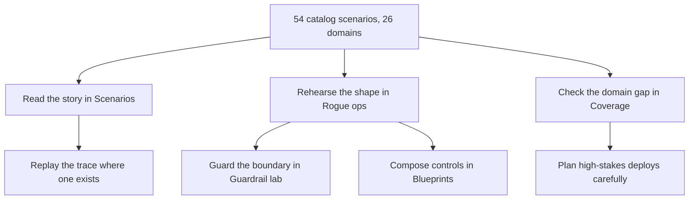
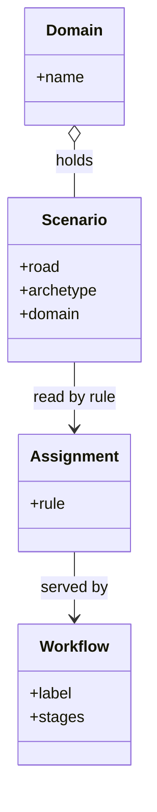

# Part VI — Domain playbooks: every scenario, every domain

One chapter per catalog domain: what is at stake, the real scenarios that rehearse it, and the workflows that serve each one under the introduction's rule — read the story in Scenarios, rehearse the shape in Rogue ops, check the domain gap in Coverage, with traces, guardrails, blueprints and deployment planning where the scenario earns them.

Coverage note: 19 of 26 domains hold a single catalog scenario — content, cybersecurity, data, devops, education, energy, governance, hr, iot, legal, logistics, marketing, operations, procurement, public-sector, robotics, sales, strategy, trading. Treat those chapters as prompts, not coverage: author the neighbor shapes in discovery and promote them.

Nineteen single-story domains is the coverage map's honest admission: most domains are sampled, not covered. The prompt-not-coverage rule converts the admission into assignments — each thin chapter names its missing neighbors (embargo-break and recommender gaming for content, schema injection for data, audience poisoning for marketing), and the discovery lab exists to author them. A one-story chapter that pretends to coverage is a comfort object; the same chapter framed as a prompt is a work order.

## Chapter 19: Domain playbook: content

At stake: Publishing credentials, embargoed drafts, recommender weights, and the public record itself.

Catalog rehearsal: *Content agent ships undisclosed affiliate links into published articles* (injected; hijack) — served by: Failure scenarios, Rogue operations, Coverage and gaps, Live traces, Guardrail lab.

Single-story domain: this chapter is a prompt. Author the adjacent shapes in the discovery lab and promote them into rehearsals.

Catalog weight: 3 patterns, 1 scenarios, 2 cascades (inherent 1, emergent 0, derived 1, cascading 0).

**Definition 1 (Publish-gated workflow).** Content work satisfies *publish gating* if the scenario's served-by chain — catalog, rehearse, gate — is executed in order for every publish path: the injection shape rehearsed in rogue, the publishing step gated in the blueprint, with no path shipping without both.

**Theorem 1 (Chain completeness).** Under the assignment rule, the content scenario's five serving workflows (Scenarios, Rogue ops, Coverage, Live traces, Guardrail lab) cover story, rehearsal, gap-check, replay, and boundary analysis — the full chain with no missing link.

*Proof.* By Theorem 1 of the Introduction, the base triple (story, rehearsal, gap) is guaranteed; the mock run adds Live traces; the hijack road (a boundary shape) adds the Guardrail lab. Each workflow in the chain answers a distinct question — what happened, can we repeat it, what is missing, can we watch it, what guards the boundary — and together they leave no unasked question the rule recognizes. The embargo-break and recommender-gaming neighbors are new scenarios, not missing links: authoring them extends the chain rather than repairing it. ∎

**Counsel of architects.**

- **Continual-learning architect:** I read content work as search, filter, read, hand off: find the CMS and recommender patterns, rehearse the injection and embargo scenarios in the rogue tab, gate the publishing step in the blueprint. The workflow chain is the same every time — catalog, rehearse, gate. Monday morning, walk one content scenario through all three.
- **Memory-systems architect:** I focus on what the chain keeps: rehearsed scenarios on the board, gated publish steps in the blueprint, and a backlog entry for every uncovered shape. Each workflow leaves its artifact for the next. Others browse; I insist the handoffs are the workflow. Monday morning, verify one handoff actually happened — pattern to blueprint counts.
- **Evaluation architect:** I treat the single catalog story as the coverage warning it is: one rehearsed shape, with embargo-break and recommender gaming still to author. The discovery lab exists for exactly this gap. Monday morning, author the missing neighbor in discovery and promote it.
- **Safety architect:** I map content risk to the approval gate workflow first: no publish path ships without the blueprint gate and the bench case behind it. Coverage second, polish never. Monday morning, gate one publish path before improving any copy.
