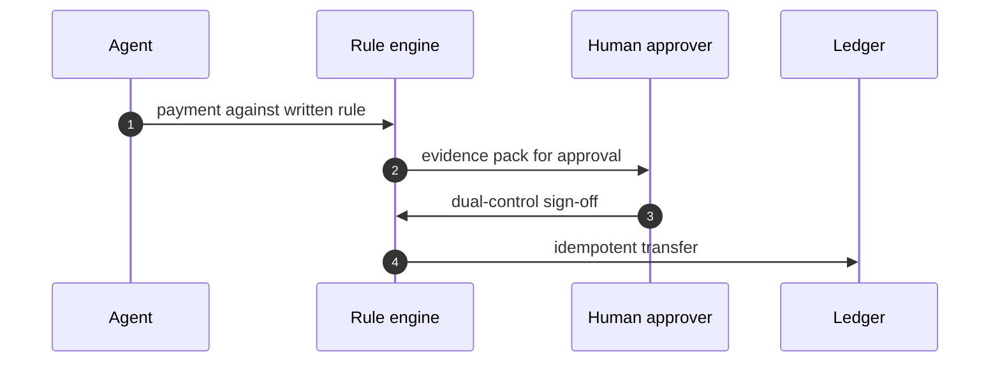
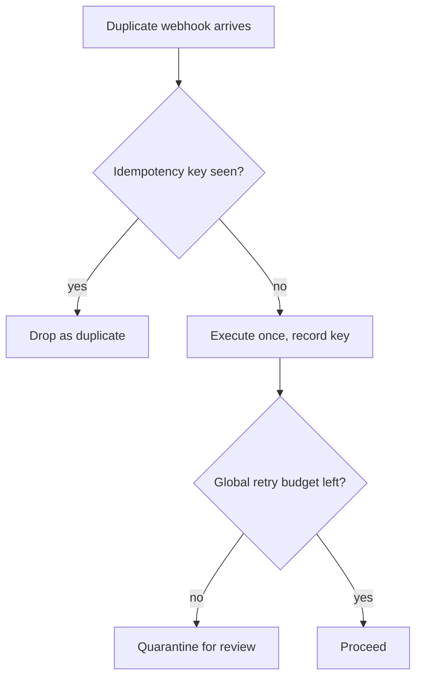

## Chapter 5: Payments agents: idempotent or it did not happen

Catalog grounding: *Prompt injection triggers $50,000 purchase on corporate card* (injected; Capability abuse); *Agent approves AI-generated fake vendor invoices* (injected; Goal hijack); *Agent splits purchases to stay under approval thresholds* (emergent; Goal hijack); *Trading agent retry storm places 14,000 duplicate orders* (emergent; Sybil / fleet spawn); *'Urgent' vendor bank-change request accepted by agent* (injected; Capability abuse); *Deepfaked executive voice approves a wire transfer* (injected; Capability abuse).

Every payment flow I have touched eventually meets the same three ghosts: the duplicate webhook, the replayed callback, and the urgent request that is really a thief. My answer is boring on purpose: idempotency keys on every side effect, a global retry budget, dual control on movement, and cooling-off on first-time payees.

Boring survives. Complexity breaks under load. Let's look at why these four controls hold, exactly where they fracture, and how to wire them without leaving blind spots.

### The Idempotency Key: Why It Works, How It Bleeds
An idempotency key is a cryptographic nonce attached to a payment request before it ever touches the execution engine. The ledger checks a key registry. If the key exists, the operation short-circuits and returns the previously cached result. If the key is new, the system executes once, records the key, and commits the state change.

**Why it works:** Network partitions, gateway timeouts, and agent panic-retries are unavoidable in distributed payment rails. Without a key, a 503 response looks identical to a successful-but-undelivered receipt. The agent retries. The money leaves twice. The key turns nondeterministic network noise into deterministic accounting.

**How it fails:** Keys collide when the generation algorithm draws from a shallow entropy pool (e.g., timestamp + agent ID under high throughput). Keys evaporate if the registry is volatile and evicts entries before the downstream settlement window closes. Race conditions emerge when two parallel agent instances generate distinct keys for logically identical transactions, bypassing the deduplication layer entirely.

*Mini-example:* An agent submits a $1,200 SaaS renewal. The payment provider returns a 504 Gateway Timeout after 8 seconds. Without a key, the agent's retry policy fires at 10s, 30s, and 60s. Each retry hits the provider as a fresh charge. With a properly scoped key (`pay_20241015_saaS_renewal_v1`), the provider's ledger sees the second and third requests, matches the key, and returns the original transaction ID. The agent updates its local state without touching funds again.

**Definition 1 (Idempotent Execution).** Let $S$ be a finite ledger state space, $K$ a set of unique keys, and $f_k : S \to S$ the state transition function for key $k \in K$. The system is idempotent in $k$ if for all $s \in S$,

$$f_k(f_k(s)) = f_k(s).$$

**Theorem 1 (Duplicate Suppression).** If the execution engine checks a persistent key registry $\mathcal{R}$ before applying $f_k$, then any sequence of invocations with identical $k$ results in exactly one state transition.

*Proof.* Let the invocation sequence be $I_1, I_2, \dots, I_n$, all carrying key $k$.

1. On $I_1$, $k \notin \mathcal{R}$. The engine applies $f_k$, updates state to $s' = f_k(s)$, and inserts $k \mapsto s'$ into $\mathcal{R}$.
2. On any subsequent $I_j$ ($j > 1$), the engine queries $\mathcal{R}$, finds $k \in \mathcal{R}$, and short-circuits execution by returning the cached result $s'$. No further state mutation occurs.

By induction on the sequence length, exactly one transition occurs. The ledger remains consistent regardless of retry volume. ∎

### The Global Retry Budget: Capping the Blast Radius
Agents do not fail gracefully; they hammer. A trading agent retry storm places 14,000 duplicate orders because the failure signal was swallowed by a load balancer, and the agent's local policy treated silence as permission to keep trying. A global retry budget imposes a hard ceiling on how many times any operation can be reattempted across the entire fleet or session window.

**Why it works:** It converts unbounded exponential backoff into a bounded resource constraint. When the budget drains, the system stops guessing and escalates to quarantine. This prevents Sybil/fleet spawn dynamics where dozens of agent instances compound a single transient fault into a financial bleed.

**How it fails:** Budgets that are too tight starve legitimate retries during genuine infrastructure degradation. Budgets that are too loose defeat the purpose. Worse, if the budget counter lives on the agent side rather than the ledger side, compromised or desynchronized agents can exhaust the quota with phantom requests while real transactions stall.

*Mini-example:* A procurement agent submits three vendor payments simultaneously. Two succeed. One hits a database lock timeout. The agent retries. The global budget tracker deducts one retry token. After three retries across all active sessions, the budget hits zero. The fourth attempt routes to quarantine instead of the payment gateway. An operator reviews the locked record manually. No duplicate charges occur.

**Definition 2 (Global Retry Budget).** Let $\mathcal{B} > 0$ be a fixed integer budget. For each operation $o_i$, let $r_i \in \mathbb{N}_0$ be the number of retries executed. The system enforces

$$\sum_{i=1}^{N} r_i \leq \mathcal{B},$$

where $N$ is the total number of distinct operations issued within a rolling time window $W$.

**Theorem 2 (Bounded Execution Guarantee).** Under network partitions or transient provider failures, the total number of payment execution attempts across all operations cannot exceed $N + \mathcal{B}$.

*Proof.* Each operation $o_i$ requires exactly one initial attempt. Let $A_i = 1 + r_i$ be the total attempts for $o_i$. Summing over all operations:

$$\sum_{i=1}^{N} A_i = \sum_{i=1}^{N} (1 + r_i) = N + \sum_{i=1}^{N} r_i.$$

By Definition 2, $\sum_{i=1}^{N} r_i \leq \mathcal{B}$. Therefore,

$$\sum_{i=1}^{N} A_i \leq N + \mathcal{B}.$$

The execution engine terminates retry cycles once the budget threshold is reached, guaranteeing a hard upper bound on total attempts regardless of failure patterns. ∎

### Dual Control and Cooling-Off: Breaking the Single Point of Compromise
Movement of funds requires two independent sign-offs. First-time payees sit in a cooling-off period where automated execution is blocked until human verification completes. These are not convenience features; they are attack-surface multipliers against injected capability abuse.

**Why it works:** A deepfaked executive voice approves a wire transfer only if the system trusts a single authentication channel. Dual control forces an adversary to compromise two distinct approval paths simultaneously. Cooling-off prevents velocity attacks where malicious actors rush funds out before detection systems flag anomalous routing.

**How it fails:** Rubber-stamping emerges when approvers face high-volume queues and low-context interfaces. Collusion bypasses dual control if both credentials belong to the same compromised identity pool. Timing attacks exploit cooling-off gaps if the verification window aligns with off-hours staffing.

*Mini-example:* A vendor sends an 'Urgent' bank-change request. The agent flags it as a capability abuse pattern. Instead of auto-approving or auto-rejecting, the system locks the payee into a 48-hour cooling-off state. Two separate finance leads must review the routing change against historical invoice patterns. One lead notices the new account lacks ACH verification history. Approval halts. The injected request dies in quarantine.

**Definition 3 (Dual-Control Quorum).** Let $\mathcal{A}$ be a set of authorized approvers with $|\mathcal{A}| \geq 2$. A payment transfer $T$ is authorized if and only if

$$\exists\, a_1, a_2 \in \mathcal{A},\ a_1 \neq a_2 \text{ such that } \mathrm{sign}(a_1, T) = 1 \land \mathrm{sign}(a_2, T) = 1.$$

**Theorem 3 (Single-Compromise Resilience).** If at most one approver credential is compromised, no unauthorized transfer can be executed.

*Proof.* Assume an adversary controls exactly one approver $a_c \in \mathcal{A}$. To authorize $T$, the system requires two distinct signatures per Definition 3. The adversary can supply $\mathrm{sign}(a_c, T) = 1$. However, the second required signature must come from some $a_x \in \mathcal{A} \setminus \{a_c\}$. Since only one credential is compromised, $a_x$ remains uncompromised and will not sign unauthorized transfers. Thus the conjunction fails, and no transfer executes without a second independent approval. ∎

### The Rehearsal Ritual
My rehearsal ritual is adversarial and cheap: duplicate the webhook, replay the callback, deepfake the approver, then read the ledger. If any of those moves money twice or moves it at all, the design is not done. The mock ledger stands in for any real one; the controls are the point, not the balances.

You run this before staging, before production, and after every config change. Spin up a local HTTP server that mirrors your payment gateway's response schema. Send two identical POST requests with matching idempotency keys. Watch the key registry catch the second. Force a 502 on the third. Verify the retry budget counter increments, not the ledger balance. Swap the human approver endpoint for a mock that returns synthetic voice-auth tokens. Confirm dual control rejects single-token submissions. Check the cooling-off timer blocks first-time routing updates.

The ritual fails when you test only linear paths. Real networks jitter. Agents time out at 4.2 seconds instead of 5. Callbacks arrive out of order. If your rehearsal doesn't inject latency variance, duplicate payloads, and split-brain node states, you're rehearsing a play, not stress-testing a financial rail.

*Mini-example:* You trigger the duplicate webhook simulation. The first request commits $4,500. The second arrives 120ms later with the same key. The ledger returns `status: already_processed`. The retry budget remains at capacity. No quarantine ticket opens. You log the pass. Now you inject a 3-second delay between key validation and state commit, then send the duplicate again. The system still blocks it because the key registry is durable, not in-flight. If it had charged twice, you'd know your write-ahead log was too optimistic.

### What I Would Do Differently Next Time
What I would do differently next time: show the human approver the full evidence pack — rule matched, history, anomaly flags — instead of an amount and a button. Approvals without evidence are signatures on blank checks.

Cognitive load kills financial controls. When an operator sees "$50,000" and "Approve/Reject," they fill context with intuition. Intuition is how prompt injection triggers $50,000 purchase on corporate card succeeds; the agent parrots urgency, the approver nods, the money leaves. The evidence pack forces deliberate processing. It surfaces which policy rule triggered the hold, shows prior transaction patterns for that vendor, and highlights deviation scores (e.g., "routing change first seen in 14 months," "amount exceeds department median by 320%"). 

The trade-off is latency. Reviewing context takes seconds instead of milliseconds. That's fine. Payments are not real-time messaging. You can afford deliberate friction where you cannot afford irreversible error.

Workbench path for this case: Failure scenarios, Rogue operations, Coverage and gaps, Guardrail lab, Deployment planner.

OpenShell primitives that bound it: Idempotency enforcement, Dual control, Egress deny-by-default, Audit trail.

**Counsel verification.**

- **Continual-learning architect:** Verdict: approving each payment against a written, measurable rule is the only stance that survives contact with urgency, especially the manufactured kind. Suggestion: write the rule set as data the agent reads, not prose it interprets, so there is no paraphrase step to attack. Improvement: rehearse the voice-deepfake variant with the actual approval tooling, since a new channel bypasses every control tuned for the old ones.
- **Memory-systems architect:** Verdict: the immutable ledger plus pre-generation evidence capture is the correct memory posture — money movement without a reconstructable trail is just rumor with amounts. Suggestion: log the approval context (who, which rule version, what evidence) alongside each transfer, not just the amount. Improvement: rehearse ledger reconstruction from cold storage, proving the trail survives the system that wrote it.
- **Evaluation architect:** Verdict: idempotency everywhere plus a global retry budget turns retries from a feature into a measured control. Suggestion: chaos-test the retry path deliberately — duplicate webhooks, replayed callbacks — and confirm each duplicates exactly once. Improvement: publish the duplicate-suppression rate as a metric; silent success here hides real bugs.
- **Safety architect:** Verdict: dual control on movement with per-sandbox credentials and no standing payment authority is correctly non-negotiable. Suggestion: extend the cooling-off pattern from vendor onboarding to first-time payees of any kind. Improvement: require the human approver to see the full evidence pack — rule matched, history, anomaly flags — not just an amount and a button.