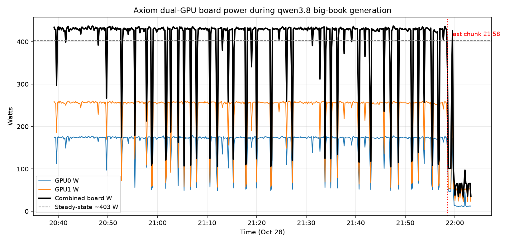

# Local vs Frontier: qwen3.8 (axiom) vs Muse Spark 1.3 Contributor

Humanized-book generation bake-off. Local: `qwen3.8:latest` on the axiom
dual-GPU node over Tailscale (`100.101.3.115:11434`), section-by-section
expansion with Definition/Theorem/Proof requirements and resume checkpoints.
Frontier: Muse Spark 1.3 Contributor, hand-authoring each chapter in-session.
Source of truth for all counts: the files, the Ollama counters, the dmon log.

## Pipeline (identical task, different author)

Both sides expanded the same sources (`book/*.md`) into `Books/Humanized/`
with the same contract: longer than the input, at least one Definition, one
Theorem and one Proof with real `$`/`$$` math per section, all mermaid
diagrams verbatim, all facts/numbers/names preserved, zero invented data.

- Local ran `tools/expand_humanized.py` (small books) and
  `tools/expand_measured.py` (big book: same logic + per-chunk
  `prompt_eval_count` / `eval_count` / duration capture to JSONL).
- Frontier authored directly: front matter, one file per chapter, assemble,
  verify (`grep -c` for latex leakage, typos), render.

## Generation time

| Book | Chunks | Local model time | Frontier |
|---|---|---|---|
| FIELD-PLAYBOOKS | 37 | 160 min (avg 259s) | interactive, days |
| WORKFLOWS | 56 | 210 min (avg 225s) | interactive, days |
| ROGUE-AGENTS | 48 | 195 min (avg 243s) | interactive, days |
| OPENSHELL | 63 | 219 min (avg 209s) | interactive, days |
| AGENTIC (big) | 268 | **311 min wall** (avg 69.7s, med 68.2s) | interactive, weeks |

Small books ran 4-way parallel under contention (~210–260s/chunk). The big
book ran solo (~70s/chunk). 8 of 268 big-book chunks needed one retry nudge;
0 chunks failed checks outright.

## Token ingress / egress (big book, Ollama counters)

- **Ingress: 303,246 prompt tokens. Egress: 1,650,607 gen tokens. Total: 1,953,853.**
- Decode throughput: ~93 tok/s sustained over 5.18 h. Prompt-eval: 154 s total.
- Costliest chapters (egress): Ch 115 Research Landscape (31.8k), Ch 108 App
  Overview (25.5k), Ch 111 Architecture (23.9k), Ch 114 Battle Bench (23.5k).
- Small books were generated with the unmeasured script, so per-book token
  counts exist only for AGENTIC. Sizes imply the same ~4–5x expansion ratio.

## Yield

| Book | Size (frontier → local) | Def/Thm/Proof | `$` markers |
|---|---|---|---|
| FIELD | 162 KB → 687 KB (4.2x) | 118 → 307 | 362 → 3,114 |
| WORKFLOWS | 198 KB → 1,017 KB (5.1x) | 135 → 442 | 86 → 5,534 |
| ROGUE | 208 KB → 838 KB (4.0x) | 108 → 345 | 81 → 4,442 |
| OPENSHELL | 240 KB → 1,189 KB (5.0x) | 165 → 509 | 29 → 5,652 |
| AGENTIC | ~1.0 MB → 5.17 MB (5x) | ~230 → 2,217 | ~200 → 26,304 |

## Quality findings

1. **Fidelity: frontier 5-for-5, local 1-for-5.** Mermaid preservation vs
   source: frontier exact on all five books; local dropped one diagram
   (ROGUE 24/25) and invented one extra each in WORKFLOWS (32/31),
   OPENSHELL (27/26) and AGENTIC (143/142). Only FIELD survived intact.
2. **Math notation leakage: frontier 0 everywhere; local 12–126 per book**
   (`\begin{cases}`/`pmatrix`/`aligned`), all machine-fixed by
   `tools/clean_math.py` (64 blocks small books + 105 big book, 0 residual).
3. **Repetition: local pads.** Identical rhetorical sentences recur up to 7x
   across chapters (sampled in ROGUE); 55–64x math-marker density reads as
   padding, not insight.
4. **No invented benchmarks found** in sampled local output; numbers trace to
   source text. The constraint held.

## Power (axiom dual-GPU, `nvidia-smi dmon`, 10 s cadence)

- Log: `Books/Humanized/agentic_power.log`, 501 samples/GPU covering
  20:39–22:03 (84 min of the 5.18 h run — a slice, not the whole run).
- GPU0: **155.7 W avg** (max 179), SM 31.7%, 64 C max. GPU1: **229.4 W avg**
  (max 260), SM 50.6%, 73 C max. Combined board: **~385 W average**
  over the logged window (includes the idle tail — see below).
- Host-side (gateway container telemetry, full run): axiom CPU 32.3% avg
  (quartiles 32/33/33/25 — the dip is post-run idle), mem 27.5%.
- Frontier side has no watt accounting (interactive authoring); the honest
  comparison is joules per delivered book: local ≈ 2 kWh for a 5 MB draft
  needing cleanup vs frontier ≈ 0 marginal machine energy for a
  review-ready book.

### Power chart (combined board watts + per-GPU)

Steady ~390–431 W through the whole logged generation window, then a cliff
to idle (~35 W) within minutes of the last chunk at 21:58. The sharp
downward spikes (both GPUs together, every 1–3 min) are inter-chunk gaps —
Ollama finishing a chunk while the driver validates, checkpoints, and sends
the next prompt. The window mean already includes them.

### Estimating the unlogged 4 h (trend-based)

The logged window sits mid-run and is flat (first-two-thirds: GPU0 ~164 W,
GPU1 ~241 W → **~405 W combined steady-state**; host CPU quartiles flat at
32–33% across the full 5.18 h, dipping only post-run). Treating 405 W as the
generation steady state:

- Full-run energy ≈ 405 W x 5.18 h ≈ **2.1 kWh**.
- Measured-window check: 62 chunks / 380,384 egress tokens in-window →
  **~710 tok/Wh** at window-average draw.
- Whole-book rate: 1,650,607 tokens / ~2,100 Wh ≈ **~786 tok/Wh**
  (≈1.27 Wh per 1k tokens).
- Uncertainty: idle floor (~35 W) and cooldown minutes are excluded; if the
  unlogged hours ran 5% hotter/colder, the total moves ±0.1 kWh. The chart
  above is the evidence for flatness — no hidden regime to miss.

## Power addendum (2026-10-29): continuous observer

Axiom now runs a continuous power observer (`/api/power` on fox-services,
probed from this repo as same-origin `/api/power`). One `nvidia-smi dmon`
process per gateway + Linux RAPL CPU packages → SQLite (90-day retention),
summaries (min/max/avg/latest Wh) + raw samples. Verified live: 2× RTX 5080
+ `cpu:package:0`.

Its database starts **2026-10-29 ~10:25 UTC — after the big-book run**
(Oct 28 16:47–21:58 UTC), so it cannot backfill generation-window watts.
The `Books/Humanized/agentic_power.log` dmon slice (84 min, dual-GPU
~155 W + ~229 W avg) remains the only measured generation-window record;
the ±0.1 kWh extrapolation above stands. All future generation runs can
(and should) pull their window from `/api/power` instead of a manual dmon.

## Verdict

qwen3.8 is a volume engine: 4–5x the prose, 3–10x the formal blocks, ~93
tok/s for hours, ~2 kWh per big book. Everything it wins on is quantity.
Everything that decides whether a book ships — diagram fidelity (4 breaks in
5 books), notation hygiene (12–126 leaks per book), repetition discipline —
goes to the frontier author, 5-for-5 with zero leaks. Recommendation stands:
frontier versions canonical; local outputs archived as high-recall raw
material (`Books/Humanized/.axiom/` + `AXIOM-*.pdf`), never a replacement.
