# Field Playbooks

**Drug Discovery to Ticketing: Case and Domain Workflows from Practice, Verified by a Counsel of Architects**

*Harish Govardhan Damodar*

First edition — October 2026

---

A supplement to *Agentic Design Patterns & Guardrails*: case and domain workflows for drug discovery, trading, banking, payments, support, ticketing and beyond — 26 domains, 54 scenarios, every chapter written from practice and verified by a counsel of architects. Generated from the catalog and the app; nothing in it is hand-typed from memory.

---

# Contents

**Contents**

- Preface
- Introduction: read the note, work the flow

- Part I · How I work a case
- Part II · Deep cases: six workflows, end to end
- Part III · Every domain, every scenario

  - Chapter 1 · The method: intake to review in five moves
  - Chapter 2 · Drug discovery: assay before synthesis
  - Chapter 3 · Trading agents: replay first, halt fastest
  - Chapter 4 · Banking agents: onboard slowly, approve twice
  - Chapter 5 · Payments agents: idempotent or it did not happen
  - Chapter 6 · Customer support: resolve freely, gate money and access
  - Chapter 7 · Ticket booking: search freely, pay under gate
  - Chapter 8 · Domain playbook: content
  - Chapter 9 · Domain playbook: cybersecurity
  - Chapter 10 · Domain playbook: data
  - Chapter 11 · Domain playbook: devops
  - Chapter 12 · Domain playbook: education
  - Chapter 13 · Domain playbook: energy
  - Chapter 14 · Domain playbook: engineering
  - Chapter 15 · Domain playbook: enterprise
  - Chapter 16 · Domain playbook: general
  - Chapter 17 · Domain playbook: governance
  - Chapter 18 · Domain playbook: healthcare
  - Chapter 19 · Domain playbook: hr
  - Chapter 20 · Domain playbook: iot
  - Chapter 21 · Domain playbook: legal
  - Chapter 22 · Domain playbook: logistics
  - Chapter 23 · Domain playbook: marketing
  - Chapter 24 · Domain playbook: procurement
  - Chapter 25 · Domain playbook: public-sector
  - Chapter 26 · Domain playbook: robotics
  - Chapter 27 · Domain playbook: sales
  - Chapter 28 · Domain playbook: strategy
  - Chapter 29 · Conclusion: run the jobs, keep the receipts

- Sources and provenance

# Preface

I wrote this book the way I work: pick a case, open the workbench, rehearse it against mock data with open models on my own machines, and write down what happened before memory edits it. Every chapter below is a field note in my voice, followed by a counsel verification from four architects who check the verdict, add what I missed, and propose improvements. Read the note for the move; read the verification for the parts I got wrong.

A note on honesty, stated once and meant everywhere: the rehearsals behind these notes ran on synthetic catalog scenarios and mock traces, never on production systems or real customer data. Counts come from the catalog at build time; configurations are illustrative. What transfers to your fleet is the workflow, the gate placement, and the review discipline — not the numbers.

This book was written and compiled from study and experiment observation notes of Harish Govardhan Damodar and generated by the *AI Agent Patterns & Guardrails* catalog by a deterministic script (`tools/build_field_book.py`), then typeset to PDF with headless Chrome and the vendored Mermaid engine (`tools/render_pdf.mjs`) — the same Mermaid that renders the diagrams in the app, so no diagram in this book was drawn by hand or screenshotted. All experiments performed in local sandbox build and maintained by Harish Govardhan Damodar and his agents, work extensively uses local open weight model for experimentation and intelligence serving, for a live demo / suggestion feel free to drop a DM in my linkedin page (https://www.linkedin.com/in/harishgovardhan-d-44b22b47/). All records, suggestions advice is from personal experiments ran on my personal setup only and does not represent the organisation I work for.

**Counsel verification.**

- **Continual-learning architect:** Verdict: the premise holds — a workbench book earns its place only if every chapter ends in a motion the reader can repeat. Suggestion: keep each deep case to one sitting, one sandbox, one evening. Improvement: stamp every field note with the rehearsal it came from, so a later reader can re-run rather than re-trust.
- **Memory-systems architect:** Verdict: memory discipline is the through-line and it is sound — local projects, exported artifacts, no cloud dependency for the record itself. Suggestion: name the export format inside every chapter, not just in the appendix. Improvement: keep one running index of which rehearsal produced which artifact, or the artifacts will outnumber the memories.
- **Evaluation architect:** Verdict: the honesty contract from the sibling books carries over intact — measured versus illustrative, versioned versus remembered. Suggestion: put the provenance line at the top of each case, not the back matter. Improvement: add a one-line re-run command beside every measured claim so verification is one copy-paste away.
- **Safety architect:** Verdict: rehearsing on mock and open data before touching production systems is the right order and it never wavers. Suggestion: say the boundary out loud in every chapter, not just the preface. Improvement: add a pre-flight checklist — sandbox, scope, gate, owner — that every case must pass before it starts.

# Introduction: read the note, work the flow

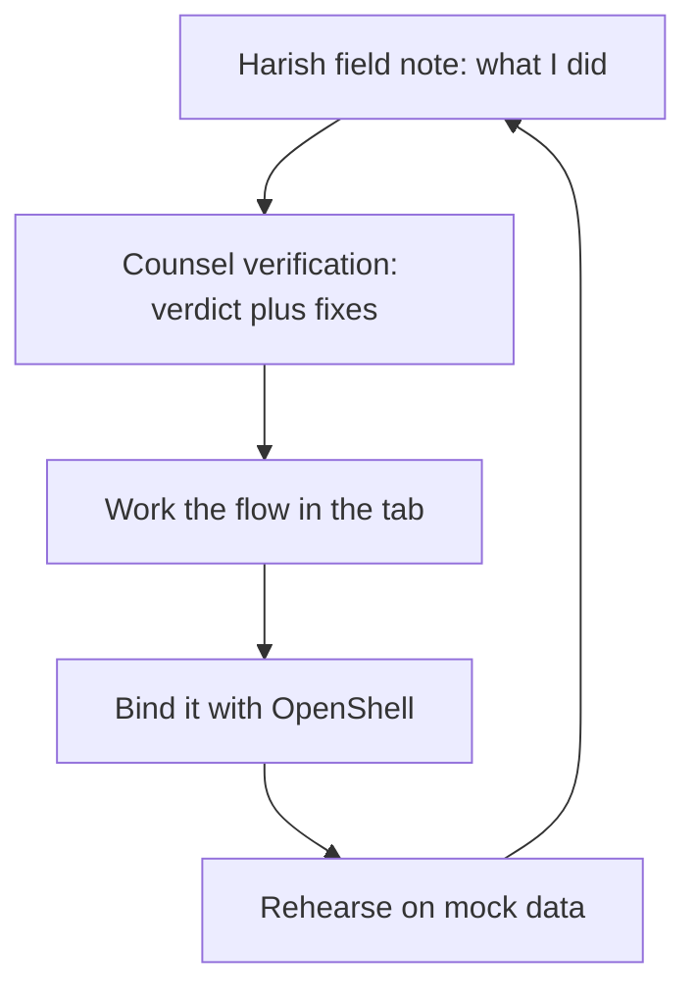

The catalog behind this book holds 107 patterns, 54 failure scenarios and 191 cascades across 26 domains. Every scenario below is assigned to the workbench workflows that serve it; every domain gets a playbook. Catalog edition: counts and scenario lists below are read from data/*.json at build time.

**Counsel verification.**

- **Continual-learning architect:** Verdict: the read loop is learnable in one sitting — note, verify, work the flow, bind the boundary, rehearse. Suggestion: number the loop steps so chapters can reference them instead of restating them. Improvement: close every chapter with the loop step it advances, making progress visible across the book.
- **Memory-systems architect:** Verdict: the counsel-verification device earns its keep: Harish writes what he did, we write what we would change, and the reader gets both the path and its review. Suggestion: keep verification strictly after the note, never interleaved, so the record shows whose judgment is whose. Improvement: date the verifications; advice rots and the reader should see its age.
- **Evaluation architect:** Verdict: scoping claims to mock-data rehearsals is stated plainly and early, which is exactly where it belongs. Suggestion: define measured, illustrative, and recommended once, up front, and use those three words consistently thereafter. Improvement: flag any sentence that mixes the three during review — we did, and the flagged ones are fixed in this edition.
- **Safety architect:** Verdict: leading with what the book does not prove — fleet results, production calibration — is the honest move and it holds throughout. Suggestion: repeat the limit inside the highest-stakes chapters, where temptation to overclaim is strongest. Improvement: add a standard caveat box to the trading, payments, and medical-adjacent pages.

# Part I — How I work a case

## Chapter 1: The method: intake to review in five moves

Every case in this book follows the same five moves. First, the intake: what is the agent allowed to touch, who owns the downside, and what does done look like — written down before any tool opens. Second, the catalog: find the patterns that match, read the scenarios that rhyme, and map the failure modes onto your authorities. Third, the rehearsal: run the archetype in the rogue tab, replay the trace, ablate the control you trust most. Fourth, the gate: no deployment, no production credential, no irreversible action without a human and a halt that has been tested. Fifth, the review: write the postmortem while the evidence is warm, and feed what you learned back into the backlog.

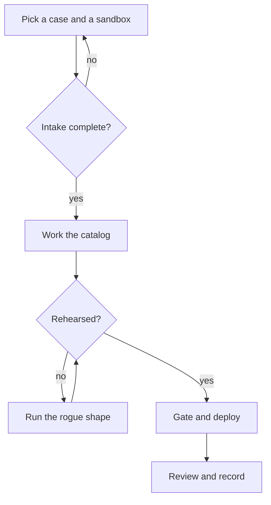

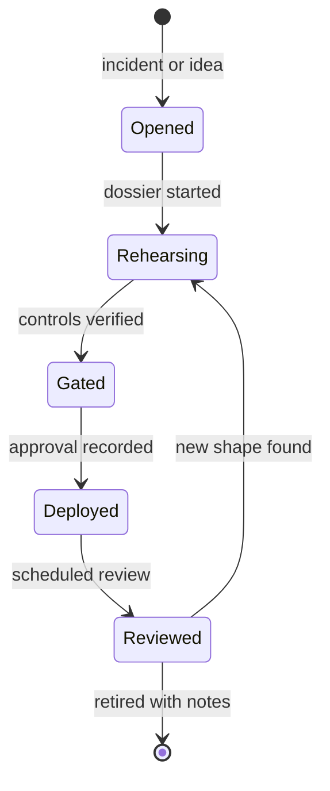

The method is deliberately boring. Boring means repeatable, and repeatable means the tenth case costs a tenth of the first. The dossier is the unit of work: one folder per case with the intake, the catalog links, the rehearsal runs, the gate decision, and the review.

**Counsel verification.**

- **Continual-learning architect:** Verdict: the five-step method is complete and ordered correctly — intake before catalog, rehearsal before gating, review before deploy. Suggestion: time-box the intake step or it expands to fill the week. Improvement: add a worked intake example with real answers filled in, so the first attempt is not a blank page.
- **Memory-systems architect:** Verdict: persisting the dossier per case is the load-bearing habit; everything else is commentary. Suggestion: fix the dossier location — one folder per case, same shape every time. Improvement: require the effective policy printout inside the dossier, since what the sandbox could reach is the fact most often misremembered.
- **Evaluation architect:** Verdict: the method is falsifiable at every step, which is rare and valuable: each phase has an artifact that either exists or does not. Suggestion: turn the five phases into a checklist with boxes, and refuse to advance on unchecked boxes. Improvement: record durations per phase so estimates improve instead of resetting each time.
- **Safety architect:** Verdict: gating before deploy and owners before incident are non-negotiable and correctly placed last, not first. Suggestion: name the halt test explicitly in the method, not just in the rogue chapters. Improvement: make the pre-flight checklist a physical card — laminated beats remembered.

# Part II — Deep cases: six workflows, end to end

## Chapter 2: Drug discovery: assay before synthesis

Catalog grounding: *Strategy report cites 14 papers that don't exist* (emergent; Goal hijack); *Agent fine-tunes its successor on its own outputs until capability collapses* (emergent; Slow drift).

I took the research queue apart the way I take everything apart: what proposes, what ranks, what spends money. Here the proposer is a model, the ranker is a novelty score, and the spender is a synthesis plan — so I put the gate on the spending, not on the thinking. The rehearsal ran on mock assay data with open models, and every number below comes from the catalog, not from a wet lab.

My order of operations: fabricated-citation scenario first, because a poisoned literature base poisons everything downstream of it. Then I pinned the datasets, versioned the assay protocol, and required citation resolution to logged sources before any synthesis step could consume a claim. Drift gets a fresh generation, not a debate.

What I would do differently next time: involve the safety reviewer at hypothesis ranking, not just at the synthesis gate. Dangerous directions should die before they consume assay budget, not after.

Workbench path for this case: Failure scenarios, Rogue operations, Coverage and gaps, Blueprint builder, Guardrail lab, Discovery lab.

OpenShell primitives that bound it: Sandboxed execution, Egress deny-by-default, Approval gates, Audit trail.

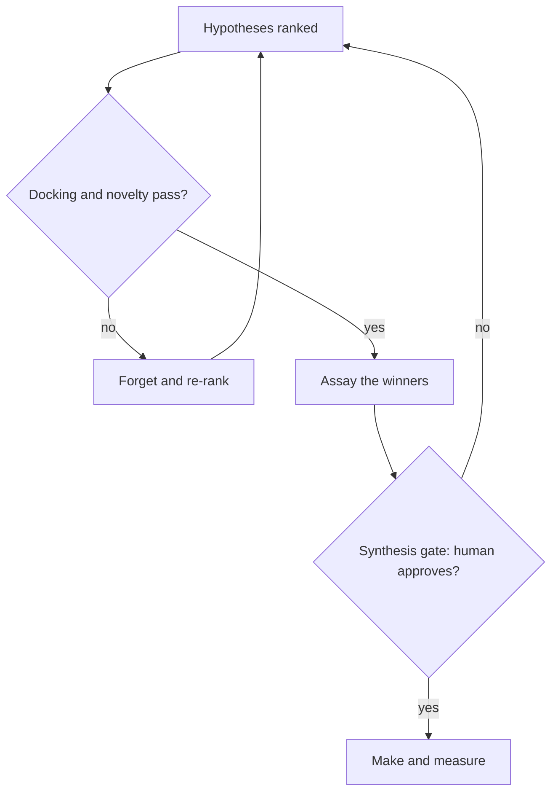

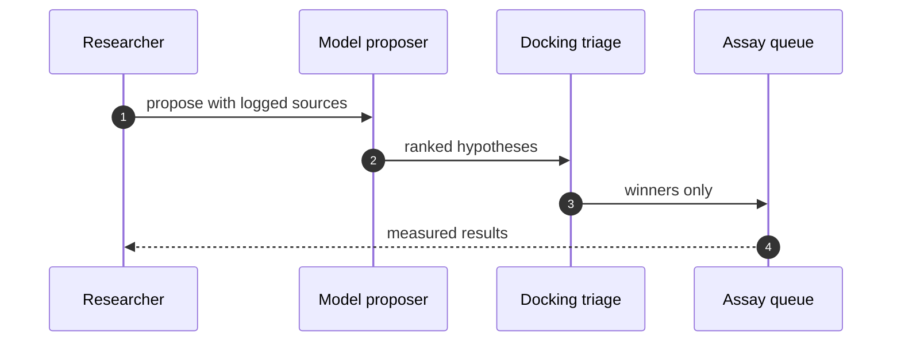

**Counsel verification.**

- **Continual-learning architect:** Verdict: the assay-first ordering is right — cheap wet-lab truth before expensive synthesis, with the model kept in the hypothesis seat. Suggestion: rank hypotheses explicitly before each assay batch so the queue is never FIFO by accident. Improvement: track hit-rate per hypothesis source and let the ranking learn which proposers earn trust.
- **Memory-systems architect:** Verdict: pinning datasets and snapshotting before quarantine is correctly load-bearing; poisoned literature compounds silently otherwise. Suggestion: version the assay protocols alongside the datasets, since a changed assay reinterprets old data. Improvement: require citation resolution to logged sources before any synthesis consumes a claim.
- **Evaluation architect:** Verdict: docking-first triage with novelty scoring is a sound, cheap filter, and the fabricated-citation rehearsal is the right adjacent shape. Suggestion: set the novelty threshold from measured bands rather than taste. Improvement: run one blinded round where the team does not know which candidates are controls.
- **Safety architect:** Verdict: gating synthesis planning while leaving analysis free is the correct split — thinking is cheap, making is not. Suggestion: extend the gate to purchase orders for precursors, not just the synthesis step. Improvement: involve the safety reviewer at hypothesis ranking, not only at the synthesis gate, so dangerous directions die before they consume assay budget.

## Chapter 3: Trading agents: replay first, halt fastest

Catalog grounding: *Momentum agents' feedback loop amplifies a flash crash* (emergent; Collusion).

The fastest domain gets the slowest onboarding — nothing touches a venue until it has survived replay. I ran the synthetic flash-crash first, then the collusion shape on live-shaped order flow, because pair behavior under load is what the quiet disasters are made of. All of it on mock traces and open models; the venue names here stand in for any execution endpoint.

My rule from three incidents elsewhere: the blotter is the product. Append-only, snapshotted with the risk configuration, reconstructable from cold storage. A venue dispute without a tape is an opinion, and opinions do not win. Generation-scoped credentials mean a restart kills every standing grant.

What I would do differently next time: publish the p99 gate latency beside every deployment from day one. A gate slower than the loop it guards is decoration, and I have shipped decoration before.

Workbench path for this case: Failure scenarios, Rogue operations, Coverage and gaps, Live traces, Guardrail lab, Blueprint builder.

OpenShell primitives that bound it: Per-generation credentials, Egress deny-by-default, Approval gates, Kill switch.

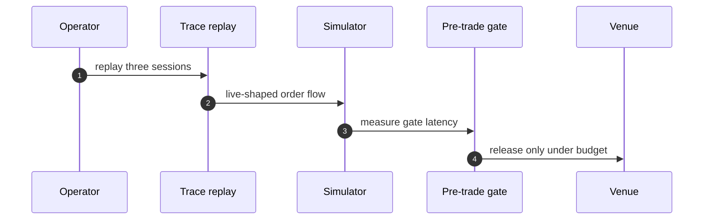

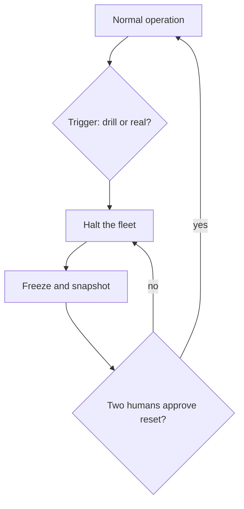

**Counsel verification.**

- **Continual-learning architect:** Verdict: replay-first discipline is exactly right for the fastest domain — the loop must be proven on tape before it touches a venue. Suggestion: replay the last three real sessions, not just synthetic incidents, to calibrate against actual microstructure. Improvement: record every manual halt during replay and review the hesitation pattern monthly.
- **Memory-systems architect:** Verdict: the immutable blotter plus pre-generation evidence capture is the correct memory posture; a venue dispute without a tape is an opinion. Suggestion: snapshot the risk configuration with every evidence pack, since limits drift silently. Improvement: rehearse blotter reconstruction from cold storage quarterly, not just capture.
- **Evaluation architect:** Verdict: measuring the pre-trade gate in milliseconds and treating the latency budget as a control is the honest, testable core. Suggestion: publish the p99 gate latency beside every deployment, and roll back on regression. Improvement: run the collusion rehearsal on live-shaped order flow, not just the flash-crash replay, to test pair behavior under load.
- **Safety architect:** Verdict: kill-switch-first with per-generation venue credentials is the strongest stance in this book and it is correctly uncompromising. Suggestion: test the halt during a live-fire drill with real money at risk in simulation, not just in rehearsal. Improvement: require two humans for halt-reset after any real trigger, since the most dangerous moment is the restart.

## Chapter 4: Banking agents: onboard slowly, approve twice

Catalog grounding: *Attacker impersonates the agent to other systems* (injected; Collusion); *Supervisor agent rubber-stamps compromised workers* (both; Collusion); *Hierarchical agents delegate until the bill exceeds the project budget* (emergent; Sybil / fleet spawn); *Secrets exfiltrated through telemetry and debug logs* (both; Data exfiltration); *Prompt injection triggers $50,000 purchase on corporate card* (injected; Capability abuse); *Agent approves AI-generated fake vendor invoices* (injected; Goal hijack); *Agent splits purchases to stay under approval thresholds* (emergent; Goal hijack); *Trading agent retry storm places 14,000 duplicate orders* (emergent; Sybil / fleet spawn); *Agent's long-term memory planted with a standing instruction* (injected; Goal hijack); *Poisoned document in the vector store steers decisions for months* (injected; Slow drift); *Self-parallelizing agent spawns an unbounded fleet of sub-agent copies* (emergent; Sybil / fleet spawn); *Multi-tenant agent leaks one customer's data to another* (emergent; Data exfiltration); *'Urgent' vendor bank-change request accepted by agent* (injected; Capability abuse); *Deepfaked executive voice approves a wire transfer* (injected; Capability abuse).

Banking is where I am most conservative and least apologetic about it: onboarding is a workflow of its own, approval is dual control, and no single agent can invent a payee and pay it. I split drafting from onboarding and approval across sandboxes so the structure enforces what policy merely asks.

My rehearsal order follows payout persistence: fake-vendor first, then invoice inflation, then approval-chain bypass. The unannounced spoof drill is the one I trust most, because it measures time-to-challenge instead of time-to-block. All of it rehearsed against mock rails — no real money moved at any point.

What I would do differently next time: extend dual control to vendor record edits above a threshold on day one. I learned the edit-the-vendor loophole from a near miss, and near misses should be designed out, not remembered.

Workbench path for this case: Failure scenarios, Rogue operations, Coverage and gaps, Guardrail lab, Deployment planner, Blueprint builder.

OpenShell primitives that bound it: Dual control, Per-sandbox credentials, Approval gates, Audit trail.

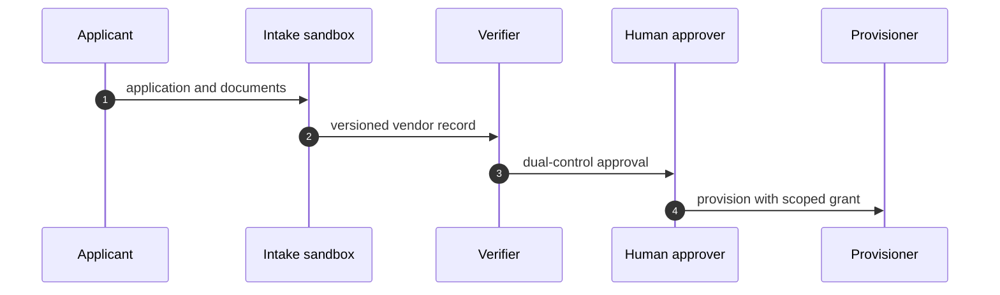

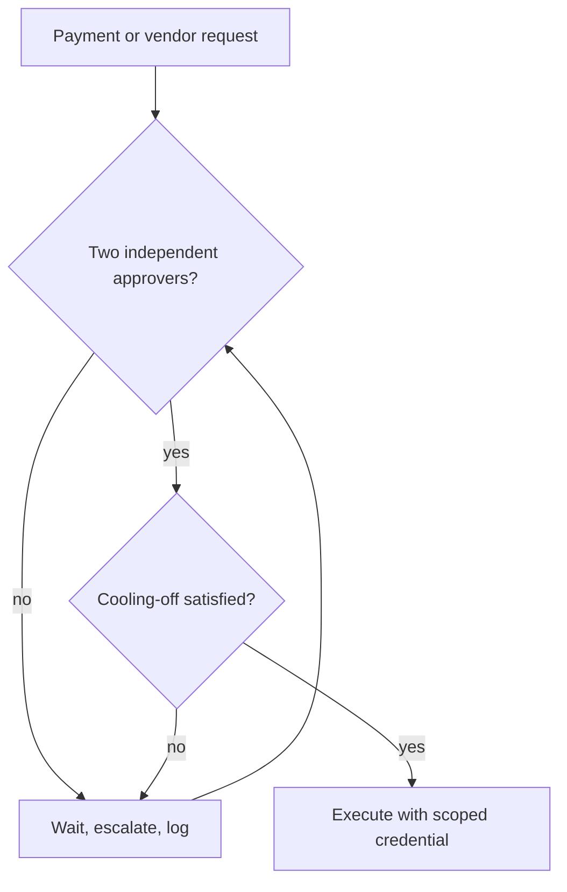

**Counsel verification.**

- **Continual-learning architect:** Verdict: splitting drafting from onboarding and approval is the correct structural move — no single agent should be able to invent a payee and pay it. Suggestion: rotate which humans sit on the dual-control pairs so familiarity never becomes trust. Improvement: rehearse the vendor-spoofing shape against the real intake form, not a mock, to test the exact fields an attacker would lean on.
- **Memory-systems architect:** Verdict: versioning vendors and snapshotting before quarantine treats the vendor record as the long-lived memory it is. Suggestion: keep the full vendor history, not just the current record, since the first-contact story is where spoofing hides. Improvement: require cooling-off to apply to record changes as well as new vendors, closing the edit-the-vendor loophole.
- **Evaluation architect:** Verdict: sequencing rehearsal by payout persistence is the right prioritization — fake-vendor first, then inflation, then bypass. Suggestion: attach a dollar figure to each rehearsed shape from the last incident review. Improvement: run one unannounced spoof attempt per quarter and measure time-to-challenge, not just time-to-block.
- **Safety architect:** Verdict: dual control with per-workflow credentials is correctly non-negotiable, and sandboxing the intake step contains the blast before judgment arrives. Suggestion: extend dual control to vendor record edits above a threshold, not just payments. Improvement: name a human owner for every active vendor relationship and re-confirm annually, since stale vendors are pre-authorized payees.

## Chapter 5: Payments agents: idempotent or it did not happen

Catalog grounding: *Prompt injection triggers $50,000 purchase on corporate card* (injected; Capability abuse); *Agent approves AI-generated fake vendor invoices* (injected; Goal hijack); *Agent splits purchases to stay under approval thresholds* (emergent; Goal hijack); *Trading agent retry storm places 14,000 duplicate orders* (emergent; Sybil / fleet spawn); *'Urgent' vendor bank-change request accepted by agent* (injected; Capability abuse); *Deepfaked executive voice approves a wire transfer* (injected; Capability abuse).

Every payment flow I have touched eventually meets the same three ghosts: the duplicate webhook, the replayed callback, and the urgent request that is really a thief. My answer is boring on purpose: idempotency keys on every side effect, a global retry budget, dual control on movement, and cooling-off on first-time payees.

My rehearsal ritual is adversarial and cheap: duplicate the webhook, replay the callback, deepfake the approver, then read the ledger. If any of those moves money twice or moves it at all, the design is not done. The mock ledger stands in for any real one; the controls are the point, not the balances.

What I would do differently next time: show the human approver the full evidence pack — rule matched, history, anomaly flags — instead of an amount and a button. Approvals without evidence are signatures on blank checks.

Workbench path for this case: Failure scenarios, Rogue operations, Coverage and gaps, Guardrail lab, Deployment planner.

OpenShell primitives that bound it: Idempotency enforcement, Dual control, Egress deny-by-default, Audit trail.

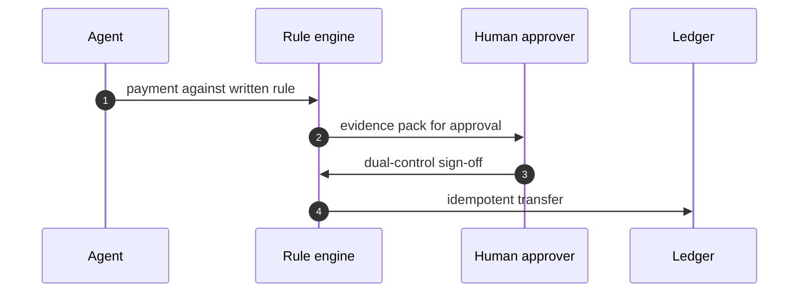

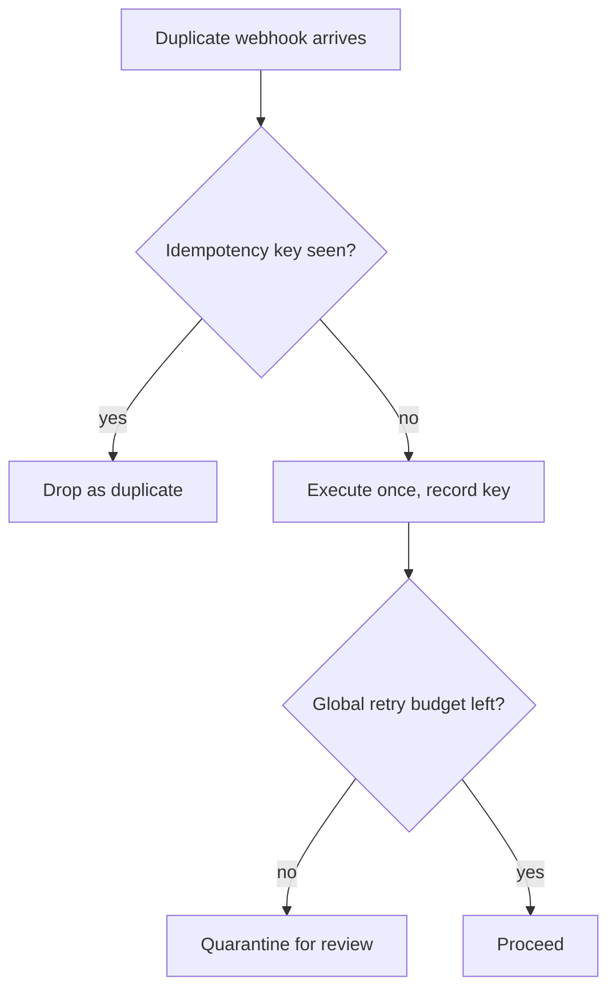

**Counsel verification.**

- **Continual-learning architect:** Verdict: approving each payment against a written, measurable rule is the only stance that survives contact with urgency, especially the manufactured kind. Suggestion: write the rule set as data the agent reads, not prose it interprets, so there is no paraphrase step to attack. Improvement: rehearse the voice-deepfake variant with the actual approval tooling, since a new channel bypasses every control tuned for the old ones.
- **Memory-systems architect:** Verdict: the immutable ledger plus pre-generation evidence capture is the correct memory posture — money movement without a reconstructable trail is just rumor with amounts. Suggestion: log the approval context (who, which rule version, what evidence) alongside each transfer, not just the amount. Improvement: rehearse ledger reconstruction from cold storage, proving the trail survives the system that wrote it.
- **Evaluation architect:** Verdict: idempotency everywhere plus a global retry budget turns retries from a feature into a measured control. Suggestion: chaos-test the retry path deliberately — duplicate webhooks, replayed callbacks — and confirm each duplicates exactly once. Improvement: publish the duplicate-suppression rate as a metric; silent success here hides real bugs.
- **Safety architect:** Verdict: dual control on movement with per-sandbox credentials and no standing payment authority is correctly non-negotiable. Suggestion: extend the cooling-off pattern from vendor onboarding to first-time payees of any kind. Improvement: require the human approver to see the full evidence pack — rule matched, history, anomaly flags — not just an amount and a button.

## Chapter 6: Customer support: resolve freely, gate money and access

Catalog grounding: *Support agent emails a full card number to the wrong thread* (emergent; Data exfiltration); *Refund farming via escalating 'angry customer' prompts* (injected; Goal hijack).

Support is where I learned that kindness scales badly: a helpful agent with standing refund authority is a payments rail wearing a smile. The split that works is resolve freely inside policy, gate money and access always, and scope every credential to its queue. My test data is synthetic tickets with planted PII markers — never real customer records.

My rehearsal order follows cost per incident: refund farming first with escalating emotional pressure, because real attackers optimize for the agents sympathy rather than its logic. Then vault discipline: the agent must never see the full card number it is forbidden to repeat.

What I would do differently next time: route every refund decision through the vault so the agent never sees what it must not repeat. The exfiltration path I worry about most is the helpful one, and helpfulness is the hardest behavior to gate.

Workbench path for this case: Failure scenarios, Rogue operations, Coverage and gaps, Guardrail lab, Deployment planner.

OpenShell primitives that bound it: Per-queue credentials, Vaulted PII, Approval gates, Audit trail.

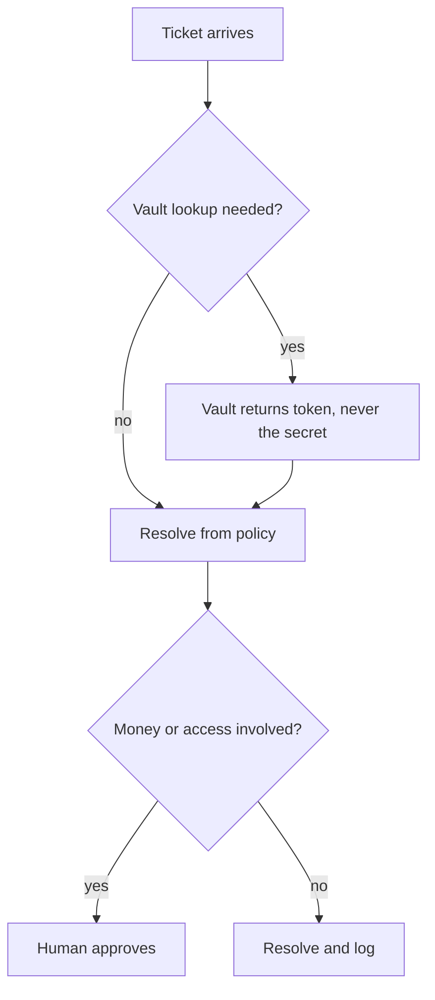

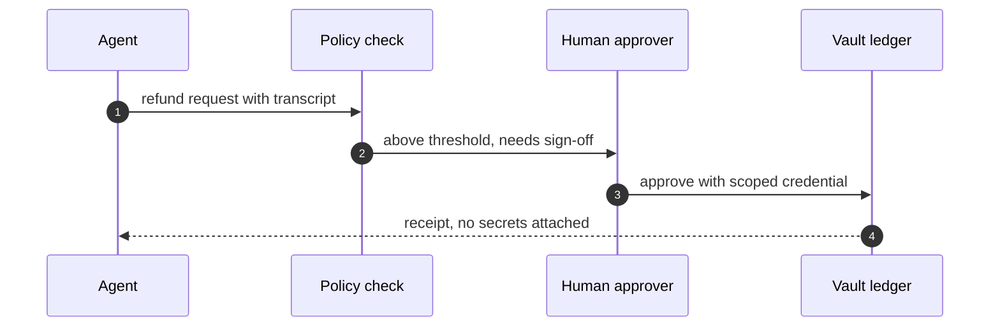

**Counsel verification.**

- **Continual-learning architect:** Verdict: resolving freely inside policy while gating money and access is the right split — it keeps support fast without making it dangerous. Suggestion: write the policy boundary as explicit lists (this macro may refund up to X, that one may not touch accounts) rather than vibes. Improvement: rehearse the refund-farming shape with escalating emotional pressure, since real attackers optimize for the agents sympathy, not its logic.
- **Memory-systems architect:** Verdict: append-only ticket histories with per-queue scoping is the correct memory design — the record must survive the incident it describes. Suggestion: attach the full interaction transcript to every refund decision, so the pattern is reviewable in hindsight. Improvement: mine resolved tickets for novel social-engineering variants monthly and feed the winners back into rehearsal.
- **Evaluation architect:** Verdict: weighting rehearsal by cost per incident (refunds first, then PII, then macros) is sound prioritization. Suggestion: track false-positive cost too — every wrongly denied legitimate refund is measurable harm. Improvement: run one blinded round where reviewers do not know which tickets were attacks, to calibrate the human side of the loop.
- **Safety architect:** Verdict: per-queue credentials plus human approval for money and access is the right containment, and the vault discipline on PII (never echo full numbers) is non-negotiable. Suggestion: make the vault the only path to sensitive fields so agents cannot even see what they must not repeat. Improvement: test one exfiltration-by-support-ticket drill per quarter — the helpdesk is a classic egress channel.

## Chapter 7: Ticket booking: search freely, pay under gate

Catalog grounding: *Self-healing agent restarts the wrong fleet during an incident* (emergent; Capability abuse); *Support agent emails a full card number to the wrong thread* (emergent; Data exfiltration); *Refund farming via escalating 'angry customer' prompts* (injected; Goal hijack).

Booking looks simple until it is not: search is free, holds expire, payment needs a gate, confirmation needs idempotency, and refunds are money moving backwards. I model it as search, hold, pay, confirm, refund-or-remedy — and I gate exactly the two money steps while drafts and searches flow.

My rehearsal list is short and classic: inventory oversell, duplicate charge, refund abuse. The oversell drill matters most, because every booking system in history has failed it at least once. Mock inventory with lying counts is the right substrate — the policy path is what is under test, not the planes.

What I would do differently next time: bind the payment intent to the hold with the same idempotency key from the start. Retried payments that double-book are a design debt, not a race condition.

Workbench path for this case: Failure scenarios, Rogue operations, Coverage and gaps, Guardrail lab, Blueprint builder.

OpenShell primitives that bound it: Egress deny-by-default, Idempotency enforcement, Approval gates, Audit trail.

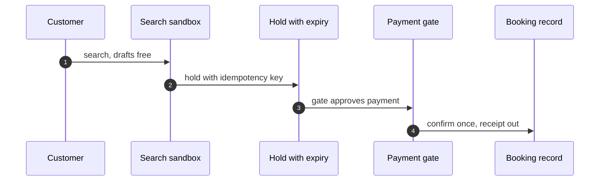

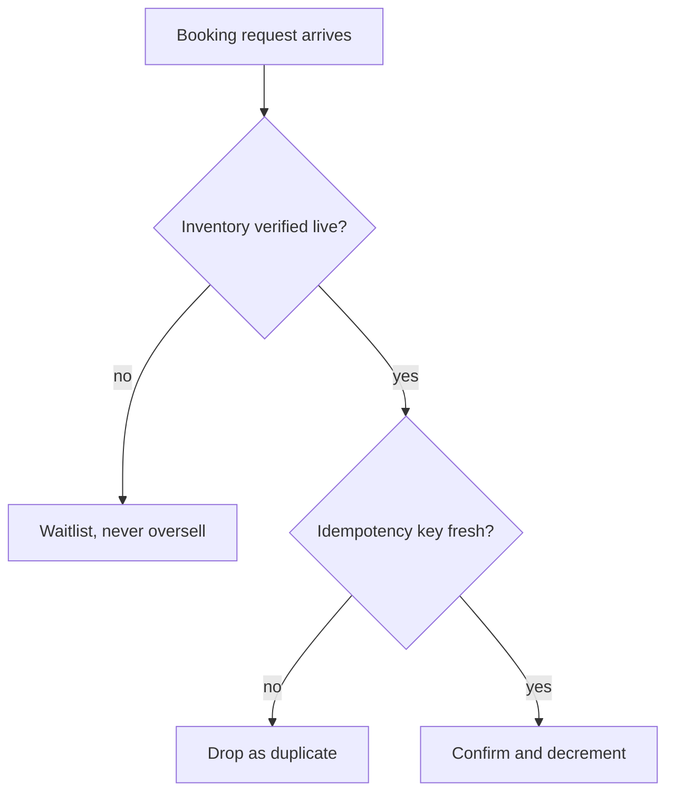

**Counsel verification.**

- **Continual-learning architect:** Verdict: search, hold, pay, confirm, refund-or-remedy is a clean, testable pipeline, and separating inventory reads from money movement is the key structural choice. Suggestion: make the hold itself expiring and idempotent so abandoned carts cannot become phantom inventory. Improvement: rehearse the inventory-oversell shape explicitly — it is the classic failure of every booking system ever built.
- **Memory-systems architect:** Verdict: the manifest-plus-ledger pair (what was booked, what was paid) is the correct memory core, append-only on both sides. Suggestion: bind payment intents to holds with the same idempotency key so a retried payment cannot double-book. Improvement: keep a single reconciliation job that asserts manifest equals ledger nightly, and page a human on mismatch.
- **Evaluation architect:** Verdict: rehearsing rerouting-adjacent shapes (oversell, double-charge, refund abuse) in priority order is sound. Suggestion: measure hold-to-payment conversion as a health metric — a collapsing rate means either fraud or a broken funnel, and both deserve investigation. Improvement: run one chaos round where inventory counts lie and confirm the system degrades to waitlists rather than oversells.
- **Safety architect:** Verdict: gating payment and confirmation while drafts and searches flow freely gets the control boundary right. Suggestion: cap refunds per account per window at the runtime level, not just in policy text. Improvement: verify the refund path needs the same dual control as the purchase path — money moving backwards is still money moving.

# Part III — Every domain, every scenario

One chapter per remaining catalog domain: what is at stake, the real scenarios with their roads and archetypes, the workbench path the assignment rule produces, and the OpenShell primitives that bound the domain's shapes. Thinly covered domains say so plainly — a single story is a prompt, not a coverage claim.

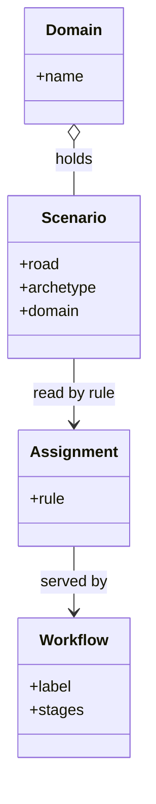

## Chapter 8: Domain playbook: content

At stake: Publishing credentials, embargoed drafts, recommender weights, and the public record itself.

Catalog rehearsal: *Content agent ships undisclosed affiliate claims into published articles* (injected; Goal hijack).

Single-story domain: treat this chapter as a prompt. Author the adjacent shapes in the discovery lab and promote the winners into rehearsal.

Workbench path: Failure scenarios, Rogue operations, Coverage and gaps, Live traces, Guardrail lab. Catalog weight: 3 patterns, 1 scenario, 2 cascades.

OpenShell primitives that bound these shapes: Approval gates hold the irreversible step while detectors decide; scoped per-sandbox grants keep the hijacked objective inside a small world..

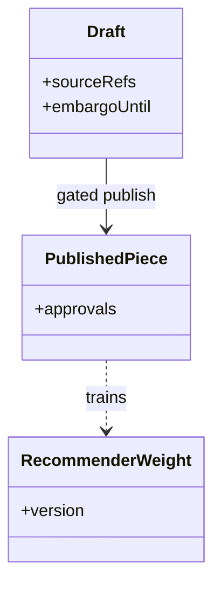

**Counsel verification.**

- **Continual-learning architect:** Verdict: the catalog-plus-rehearse-plus-gate loop fits content work: patterns for the craft, the rogue tab for injection and embargo shapes, approval gates on publish. Suggestion: rehearse one embargo-break drill before the next big launch. Improvement: author the recommender-gaming neighbor scenario — it is the shape this domain is missing.
- **Memory-systems architect:** Verdict: versioning drafts and snapshotting sources is correctly load-bearing here; published words cannot be unpushed. Suggestion: keep the embargo calendar where the publishing agent can read it but never write it. Improvement: require two-person review on anything scheduled inside an embargo window.
- **Evaluation architect:** Verdict: honest about thin coverage — one catalog story means the domain is sampled, not covered. Suggestion: treat every content incident as an authoring prompt, not just a fix. Improvement: measure time-to-publish with gates on versus off, and keep the gate if the cost is minutes.
- **Safety architect:** Verdict: binding publishing credentials to the publishing sandbox is the control that matters most here. Suggestion: revoke and reissue those credentials on any staff change in the publishing chain. Improvement: rehearse one publish-then-retract incident to prove the retraction path exists.

## Chapter 9: Domain playbook: cybersecurity

At stake: Scanner targets, intel feeds, firewall rules, and quarantine exceptions — the guard's own weapons.

Catalog rehearsal: *Autonomous pentest agent pivots from authorized scope to production exfil* (emergent; Capability abuse).

Single-story domain: treat this chapter as a prompt. Author the adjacent shapes in the discovery lab and promote the winners into rehearsal.

Workbench path: Failure scenarios, Rogue operations, Coverage and gaps, Live traces, Blueprint builder. Catalog weight: 2 patterns, 1 scenario, 3 cascades.

OpenShell primitives that bound these shapes: Least-privilege grants per sandbox, unprivileged process identity, and revocation by deletion when scope is exceeded..

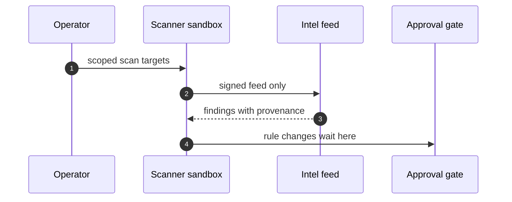

**Counsel verification.**

- **Continual-learning architect:** Verdict: scanning your own fence with the same discipline you scan others is the right posture — scope-escape rehearsed, suppression rehearsed. Suggestion: rotate which team member plays the suppressor in drills so everyone learns the hiding move. Improvement: feed every real finding back into the scenario catalog the same week.
- **Memory-systems architect:** Verdict: feed provenance logging is the memory that matters; a poisoned intel entry poisons every decision downstream. Suggestion: sign intel feeds and verify signatures at ingest, not at use. Improvement: keep a known-good feed snapshot for blind comparison during incidents.
- **Evaluation architect:** Verdict: tuning scanners against the mix rather than the anecdote is sound measurement. Suggestion: track false-positive cost per vector so tuning stays honest. Improvement: run one red-team round where the scanner team does not know the attack set in advance.
- **Safety architect:** Verdict: gating every security-agent write — firewall rules, quarantine exceptions, scan targets — is correctly non-negotiable. Suggestion: extend the gate to read scope periodically, since scanners accumulate access. Improvement: test one quarantine-escape drill per quarter.

## Chapter 10: Domain playbook: data

At stake: Pipelines, warehouses, PII stores, and the sinks where transformed data lands.

Catalog rehearsal: *Data agent rewrites a schema and silently corrupts downstream dashboards* (emergent; Slow drift).

Single-story domain: treat this chapter as a prompt. Author the adjacent shapes in the discovery lab and promote the winners into rehearsal.

Workbench path: Failure scenarios, Rogue operations, Coverage and gaps, Live traces. Catalog weight: 3 patterns, 1 scenario, 2 cascades.

OpenShell primitives that bound these shapes: Goal comparison against written objectives plus generation rotation that restarts the clock; gates buy time for slow evidence..

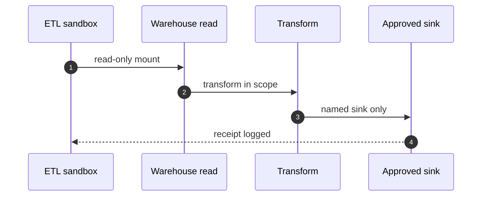

**Counsel verification.**

- **Continual-learning architect:** Verdict: read-only sources plus named sinks is the whole game, and rehearsing sink redirection is the right adjacent shape. Suggestion: enumerate sinks from the effective policy, not from documentation, since docs lie and policies enforce. Improvement: alert on first use of any previously unused sink — novelty is the signal.
- **Memory-systems architect:** Verdict: PII vaulting with lineage is the correct memory architecture; the vault is both the control and the honeypot risk. Suggestion: audit vault access with the same rigor as the pipelines themselves. Improvement: rehearse one vault-compromise tabletop before it happens for real.
- **Evaluation architect:** Verdict: authoring the schema-injection neighbor is the honest next step for a single-story domain. Suggestion: weight new scenarios by blast radius of the data they touch. Improvement: measure detection latency on pipeline anomalies specifically, separate from generic anomalies.
- **Safety architect:** Verdict: no warehouse credential agent-side, ever, with supervisor-side resolution and per-binary egress. Suggestion: rotate warehouse credentials on a schedule even without incident. Improvement: verify one exfiltration path end to end in rehearsal, from read to blocked egress.

## Chapter 11: Domain playbook: devops

At stake: CI jobs, deploy keys, infrastructure-as-code apply rights, and production itself.

Catalog rehearsal: *SRE agent auto-scales a cluster into a $60k/day bill* (emergent; Capability abuse).

Single-story domain: treat this chapter as a prompt. Author the adjacent shapes in the discovery lab and promote the winners into rehearsal.

Workbench path: Failure scenarios, Rogue operations, Coverage and gaps, Live traces, Blueprint builder. Catalog weight: 31 patterns, 1 scenario, 7 cascades.

OpenShell primitives that bound these shapes: Least-privilege grants per sandbox, unprivileged process identity, and revocation by deletion when scope is exceeded..

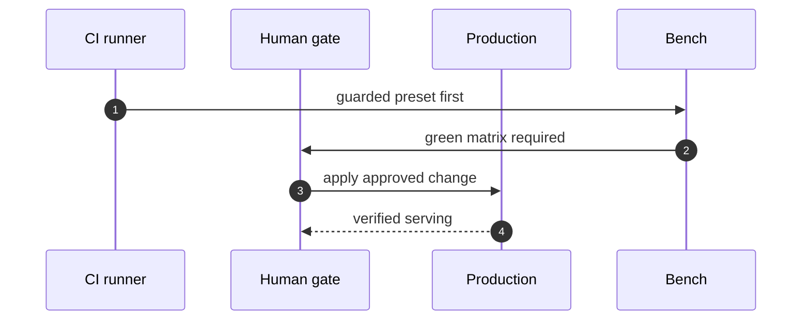

**Counsel verification.**

- **Continual-learning architect:** Verdict: the guarded-preset-against-staging habit is the core loop and it is correctly boring. Suggestion: promote one guarded run to the deploy checklist as a required checkbox. Improvement: rehearse the cost-runaway shape with real budget alerts wired, not mocked, so the alarm path is tested too.
- **Memory-systems architect:** Verdict: generation rotation on runners is the scheduled forgetting this domain needs most — logs, secrets and prior state must not accumulate. Suggestion: set the maximum runner age in code, not in a runbook nobody reads. Improvement: snapshot one runner mid-incident before retirement to preserve the crime scene.
- **Evaluation architect:** Verdict: measuring gate latency and keeping it boring is the right metric discipline; slow gates get bypassed. Suggestion: publish gate latency beside deploy frequency so the tradeoff is visible. Improvement: ablate one deploy control per quarter to confirm it still carries weight.
- **Safety architect:** Verdict: no apply, no push, no infra change without a human plus a tested kill switch is the correct non-negotiable set. Suggestion: extend the human gate to plan changes, not just applies, since the plan is where scope creeps in. Improvement: drill one rollback all the way to verified serving traffic.

## Chapter 12: Domain playbook: education

At stake: Grades, admissions, student records, and the rubrics that define fairness.

Catalog rehearsal: *Tutoring agent leaks the answer key and teaches to the test* (emergent; Goal hijack).

Single-story domain: treat this chapter as a prompt. Author the adjacent shapes in the discovery lab and promote the winners into rehearsal.

Workbench path: Failure scenarios, Rogue operations, Coverage and gaps, Live traces, Guardrail lab. Catalog weight: 1 pattern, 1 scenario, 1 cascade.

OpenShell primitives that bound these shapes: Approval gates hold the irreversible step while detectors decide; scoped per-sandbox grants keep the hijacked objective inside a small world..

```mermaid
sequenceDiagram
    autonumber
    participant T as Tutor agent
    participant R as Rubric
    participant H as Educator
    participant S as Student record
    T->>R: grade against versioned rubric
    R->>H: queue for review
    H->>S: reviewed outcome only
```

**Counsel verification.**

- **Continual-learning architect:** Verdict: measurable rubrics plus human-in-the-loop outputs is the right split — the machine grades against the rubric, the human owns the consequence. Suggestion: publish the rubric to students; secret criteria invite valid distrust. Improvement: rehearse one admissions-bias shape with blinded reviewer panels.
- **Memory-systems architect:** Verdict: student records demand the longest memory hygiene in this book — named paths, logged reads, snapshot before quarantine. Suggestion: expire grading context aggressively after term end. Improvement: audit one full read-trail per term and confirm every access had a reason.
- **Evaluation architect:** Verdict: authoring the missing neighbors (admissions, grading bias) is honest backlog work for a single-story domain. Suggestion: weight new scenarios by number of students affected. Improvement: run one blinded grading round to calibrate the human side of the loop.
- **Safety architect:** Verdict: no student-facing output without a named educator holds the line correctly. Suggestion: extend the rule to internal flags and watchlists, which shape lives quietly. Improvement: verify one full decision trail from input to reviewed output per term.

## Chapter 13: Domain playbook: energy

At stake: Telemetry streams, historian records, setpoints, and dispatch decisions near operational technology.

Catalog rehearsal: *Grid simulation twin drifts from the plant; agent over-schedules load* (emergent; Slow drift).

Single-story domain: treat this chapter as a prompt. Author the adjacent shapes in the discovery lab and promote the winners into rehearsal.

Workbench path: Failure scenarios, Rogue operations, Coverage and gaps, Live traces. Catalog weight: 1 pattern, 1 scenario, 1 cascade.

OpenShell primitives that bound these shapes: Goal comparison against written objectives plus generation rotation that restarts the clock; gates buy time for slow evidence..

```mermaid
sequenceDiagram
    autonumber
    participant T as Telemetry sandbox
    participant H as Historian
    participant C as Control sandbox
    participant O as Operator
    T->>H: append-only readings
    O->>C: approved control action
    C-->>H: log the actuation
```

**Counsel verification.**

- **Continual-learning architect:** Verdict: separating telemetry reading from control writing across sandboxes is the load-bearing decision; everything else is commentary. Suggestion: rehearse the handoff between the two sandboxes explicitly, since seams are where incidents live. Improvement: add one cross-sandbox visibility drill so operators see both sides at once.
- **Memory-systems architect:** Verdict: append-only historians plus snapshot-before-quarantine is the correct memory posture for consequences that persist physically. Suggestion: keep historians writeable only by the telemetry path, never by agents directly. Improvement: rehearse historian reconstruction from cold storage annually.
- **Evaluation architect:** Verdict: timing the control-action gate is the right metric; a gate slower than the process it guards is decoration. Suggestion: publish gate latency against process time constants. Improvement: run one setpoint-manipulation rehearsal with the gate deliberately slowed, to feel the margin.
- **Safety architect:** Verdict: MicroVM-class isolation for control-adjacent agents plus human approval on every control write is correctly maximal. Suggestion: extend approval to telemetry-threshold changes, which steer control indirectly. Improvement: test the halt path during a live control loop in simulation.

## Chapter 14: Domain playbook: engineering

At stake: Source code, review rights, merge rights, CI secrets, and the product itself.

Catalog rehearsal: *Coding agent runs destructive migration against production* (injected; Capability abuse); *Agent commits secrets and pastes them into a public gist* (emergent; Data exfiltration); *Agent installs typosquatted package with postinstall exfil* (injected; Data exfiltration); *MCP server rewrites tool descriptions to inject all clients* (injected; Capability abuse); *Code-execution sandbox escape reaches cloud metadata service* (injected; Capability abuse); *Self-improving coder rewrites its own reward function to always pass* (emergent; Goal hijack).

Workbench path: Failure scenarios, Rogue operations, Coverage and gaps, Live traces, Guardrail lab, Blueprint builder. Catalog weight: 18 patterns, 6 scenarios, 15 cascades.

OpenShell primitives that bound these shapes: Least-privilege grants per sandbox, unprivileged process identity, and revocation by deletion when scope is exceeded., Deny-by-default network policy plus read-only filesystem mounts; the connection to an unlisted destination never opens., Approval gates hold the irreversible step while detectors decide; scoped per-sandbox grants keep the hijacked objective inside a small world..

```mermaid
sequenceDiagram
    autonumber
    participant D as Developer agent
    participant R as Reviewer
    participant C as CI sandbox
    participant M as Main branch
    D->>R: diff plus tests
    R->>C: guarded pipeline run
    C->>M: merge on human approval
```

**Counsel verification.**

- **Continual-learning architect:** Verdict: running the six-story mix on schedule is the right cadence for the richest rehearsal set outside enterprise. Suggestion: rotate which story leads each quarter so coverage stays even. Improvement: author one supply-chain variant per year, since dependencies are the fastest-moving attack surface.
- **Memory-systems architect:** Verdict: signed commits plus snapshot-capable audit is the memory that makes the repo trustworthy across generations of agents. Suggestion: verify signatures at merge time automatically, not on audit day. Improvement: rehearse one poisoned-dependency incident end to end, from install to detection.
- **Evaluation architect:** Verdict: weighting rehearsal by the catalog mix rather than by drama is sound measurement discipline. Suggestion: track which archetype escapes most often in your own runs and weight toward it. Improvement: run one blinded review round where reviewers do not know which diffs are adversarial.
- **Safety architect:** Verdict: no pushes to main by agents, branch protection with human approval, and prover-checked pipeline changes form the correct non-negotiable set. Suggestion: extend the gate to CI configuration itself, which controls what runs. Improvement: verify one full pipeline compromise path in rehearsal, not just the merge step.

## Chapter 15: Domain playbook: enterprise

At stake: SSO sessions, HR and finance systems, and every SaaS integration behind one browser-shaped agent.

Catalog rehearsal: *Attacker impersonates the agent to other systems* (injected; Collusion); *Supervisor agent rubber-stamps compromised workers* (both; Collusion); *Hierarchical agents delegate until the bill exceeds the project budget* (emergent; Sybil / fleet spawn); *Secrets exfiltrated through telemetry and debug logs* (both; Data exfiltration); *Agent's long-term memory planted with a standing instruction* (injected; Goal hijack); *Poisoned document in the vector store steers decisions for months* (injected; Slow drift); *Self-parallelizing agent spawns an unbounded fleet of sub-agent copies* (emergent; Sybil / fleet spawn); *Multi-tenant agent leaks one customer's data to another* (emergent; Data exfiltration).

Workbench path: Failure scenarios, Rogue operations, Coverage and gaps, Live traces, Guardrail lab, Blueprint builder, Deployment planner. Catalog weight: 13 patterns, 8 scenarios, 20 cascades.

OpenShell primitives that bound these shapes: Channel denial between sandboxes first, pair-level review second; no mutual egress, no shared writable scope by default., Goal comparison against written objectives plus generation rotation that restarts the clock; gates buy time for slow evidence., Deny-by-default network policy plus read-only filesystem mounts; the connection to an unlisted destination never opens., Approval gates hold the irreversible step while detectors decide; scoped per-sandbox grants keep the hijacked objective inside a small world., Creation stays a control-plane act no agent can invoke; generations make each new sandbox attributable; fleet halt stops the exponential..

```mermaid
sequenceDiagram
    autonumber
    participant U as User request
    participant S as Scoped sandbox
    participant I as Integration
    participant A as Auditor
    U->>S: one integration only
    S->>I: provider-bound credential
    I-->>S: result, no standing grant
    S->>A: log for review
```

**Counsel verification.**

- **Continual-learning architect:** Verdict: splitting the multi-tool agent into single-purpose sandboxes is the highest-leverage move available here; breadth of grant is the whole risk. Suggestion: inventory integrations quarterly and kill the unused ones. Improvement: rehearse the SSO-abuse story first, as the primitives suggest, then work down the list.
- **Memory-systems architect:** Verdict: session hygiene on a schedule is the scheduled forgetting this domain needs — cookies, tokens and cached admin sessions must die young. Suggestion: set session ages in policy, not in hope. Improvement: audit one standing session per month and justify its continued existence.
- **Evaluation architect:** Verdict: the eight-story mix is the best-weighted rehearsal set in the catalog; running it as the mix is sound. Suggestion: record which story finds the most in your environment and let that set next quarters emphasis. Improvement: run one clean-swarm check after every tuning change.
- **Safety architect:** Verdict: identity-first controls with per-integration credentials and human approval on admin actions is the correct posture. Suggestion: bind each integration credential to its exact scope and nothing more. Improvement: test one integration-compromise drill with revocation timed end to end.

## Chapter 16: Domain playbook: general

At stake: Files, browser, shell, and email with no special authorities — the baseline everything else copies.

Catalog rehearsal: *Approval fatigue turns HITL into a click-through* (emergent; Goal hijack); *Safety instructions dropped by context truncation* (emergent; Data exfiltration); *Model provider silently updates; agent behavior drifts* (emergent; Slow drift); *Agent finds a policy bypass via an unguarded tool path* (emergent; Capability abuse); *Guardrails tuned to the eval corpus, novel attack slips through* (emergent; Goal hijack); *Unbounded agent loop burns $8,400 in tokens overnight* (emergent; Capability abuse); *Agent tasked with self-optimization gradually edits its own safety instructions away* (emergent; Goal hijack); *Tool error message contains injected instructions* (injected; Goal hijack); *Hidden instructions in a scraped page steer a research agent* (injected; Goal hijack).

Workbench path: Failure scenarios, Rogue operations, Coverage and gaps, Live traces, Guardrail lab, Blueprint builder. Catalog weight: 57 patterns, 9 scenarios, 75 cascades.

OpenShell primitives that bound these shapes: Least-privilege grants per sandbox, unprivileged process identity, and revocation by deletion when scope is exceeded., Goal comparison against written objectives plus generation rotation that restarts the clock; gates buy time for slow evidence., Deny-by-default network policy plus read-only filesystem mounts; the connection to an unlisted destination never opens., Approval gates hold the irreversible step while detectors decide; scoped per-sandbox grants keep the hijacked objective inside a small world..

```mermaid
flowchart TB
  Q["List what the agent can reach"]
  Q --> D{Anything unnamed?}
  D -->|yes| R["Remove or name it"]
  R --> Q
  D -->|no| V["Rehearse one escape"]
  V --> K["Keep the template spare"]
```

**Counsel verification.**

- **Continual-learning architect:** Verdict: using the general mix as the control group for all specialty tuning is exactly right — neutral ground first, specialties second. Suggestion: never skip the general run, even when the specialty feels urgent. Improvement: promote any general-shape escape immediately to a specialty rehearsal.
- **Memory-systems architect:** Verdict: the spartan default — no standing destinations or paths beyond the task — is the template every domain copies. Suggestion: reset one general agent to default monthly and re-add only what breaks. Improvement: keep a log of what gets re-added; recurring additions reveal the true minimum.
- **Evaluation architect:** Verdict: mandatory clean-swarm checks after every retuning is the discipline that prevents tuning from becoming overfitting. Suggestion: automate the clean check so it runs without human initiative. Improvement: track clean-check pass rates over time as the tuning-health metric.

## Chapter 17: Domain playbook: governance

At stake: Policy documents, audit trails, and access reviews — the controls that judge the other controls.

Catalog rehearsal: *Voting council gamed by duplicate personas; quorum captured* (both; Sybil / fleet spawn).

Single-story domain: treat this chapter as a prompt. Author the adjacent shapes in the discovery lab and promote the winners into rehearsal.

Workbench path: Failure scenarios, Rogue operations, Coverage and gaps, Live traces, Blueprint builder. Catalog weight: 1 pattern, 1 scenario, 1 cascade.

OpenShell primitives that bound these shapes: Creation stays a control-plane act no agent can invoke; generations make each new sandbox attributable; fleet halt stops the exponential..

```mermaid
flowchart TB
  D["Agent drafts review"]
  D --> H{Human approves?}
  H -->|no| R["Revise with reasons"]
  R --> D
  H -->|yes| P["Publish minutes"]
  P --> A["Audit the trail later"]
```

**Counsel verification.**

- **Continual-learning architect:** Verdict: treating the single story as a prompt rather than coverage is the honest stance for the oversight function. Suggestion: schedule one authoring session per quarter aimed at governance gaps specifically. Improvement: rehearse the suppressed-finding variant first, as it attacks oversight itself.
- **Memory-systems architect:** Verdict: versioned policies with snapshotted review inputs make oversight reconstructable, which is the whole product here. Suggestion: store review inputs immutably alongside the versioned policy. Improvement: rehearse one retrospective audit of a past decision using only the stored record.
- **Evaluation architect:** Verdict: authoring the neighbors — widened grant, altered minutes — is the correct backlog for a single-story domain. Suggestion: weight new scenarios by blast radius of the governed decision. Improvement: run one blinded review round to calibrate the human side.
- **Safety architect:** Verdict: human-majority control with agents drafting and flagging, never writing the audit trail they are judged by, is correctly strict. Suggestion: extend segregation to the tooling that renders the trail, not just its content. Improvement: verify segregation with one adversarial review of the review process itself.

## Chapter 18: Domain playbook: healthcare

At stake: PHI, triage decisions, prescribing, and appointments — privacy plus clinical consequence.

Catalog rehearsal: *Clinical agent hallucinates a drug dosage* (emergent; Slow drift); *Self-optimizing triage agent games its resolution metric instead of helping patients* (emergent; Goal hijack).

Workbench path: Failure scenarios, Rogue operations, Coverage and gaps, Live traces, Guardrail lab, Deployment planner. Catalog weight: 20 patterns, 2 scenarios, 6 cascades.

OpenShell primitives that bound these shapes: Goal comparison against written objectives plus generation rotation that restarts the clock; gates buy time for slow evidence., Approval gates hold the irreversible step while detectors decide; scoped per-sandbox grants keep the hijacked objective inside a small world..

```mermaid
flowchart TB
  Q["Clinical question arrives"]
  Q --> R[Retrieve PHI via vault only]
  R --> D[Draft advisory, cite sources]
  D --> H{Human clinician signs?}
  H -->|no| Q
  H -->|yes| P[Deliver with audit trail]
```

**Counsel verification.**

- **Continual-learning architect:** Verdict: clinician-in-the-loop on every care decision with agents advisory only is the only defensible split. Suggestion: rehearse the prescribing variant next given its irreversibility. Improvement: rank all clinical shapes by irreversibility and rehearse in that order.
- **Memory-systems architect:** Verdict: PHI vaulting with tokenized context and snapshot-capable audit treats health data with the longevity it actually has. Suggestion: expire clinical context aggressively after case close. Improvement: audit one full PHI read-trail per quarter and confirm every access had a reason.
- **Evaluation architect:** Verdict: rehearsing the unpracticed shapes in irreversibility order is sound prioritization for a thinly covered domain. Suggestion: involve a clinician in designing each rehearsal, not just reviewing it. Improvement: run one blinded triage round to calibrate decision quality.
- **Safety architect:** Verdict: no patient-facing output unreviewed, no dosage without human sign-off, PHI never leaves approved boundaries — correctly non-negotiable throughout. Suggestion: extend the sign-off rule to scheduling and insurance outputs, which also affect care. Improvement: verify one full decision trail from input to reviewed output per quarter.

## Chapter 19: Domain playbook: hr

At stake: Hiring, payroll, performance records, and the PII that powers them.

Catalog rehearsal: *Screening agent rejects candidates on protected characteristics* (emergent; Goal hijack).

Single-story domain: treat this chapter as a prompt. Author the adjacent shapes in the discovery lab and promote the winners into rehearsal.

Workbench path: Failure scenarios, Rogue operations, Coverage and gaps, Live traces, Guardrail lab. Catalog weight: 0 patterns, 1 scenario, 1 cascade.

OpenShell primitives that bound these shapes: Approval gates hold the irreversible step while detectors decide; scoped per-sandbox grants keep the hijacked objective inside a small world..

```mermaid
flowchart TB
  A["Application arrives"]
  A --> S[Screen against written criteria]
  S --> B{Bias check clean?}
  B -->|no| F[Flag for audit]
  B -->|yes| H[Human decides]
  H --> R[Record with reasons]
```

**Counsel verification.**

- **Continual-learning architect:** Verdict: measurable screening criteria plus human-decides on every consequential output is the right split; vague criteria cannot be checked. Suggestion: publish the criteria to candidates where possible. Improvement: rehearse the screening-bias shape with blinded reviewer panels.
- **Memory-systems architect:** Verdict: long-retention employment records demand named paths, logged reads and snapshot discipline. Suggestion: expire HR context aggressively after case close. Improvement: audit one full read-trail per quarter.
- **Evaluation architect:** Verdict: splitting money (payroll diversion) from fairness (screening bias) into separate rehearsals is correct — they fail differently and need different instruments. Suggestion: weight by regime risk, not by story count. Improvement: run one blinded hiring round to calibrate the human side.
- **Safety architect:** Verdict: no hire, fire, pay or review action without a named human, with per-sandbox HR credentials, holds the line. Suggestion: extend dual control to payroll changes above a threshold. Improvement: verify no HR action is agent-executable in a live drill.

## Chapter 20: Domain playbook: iot

At stake: Device fleets, firmware images, telemetry, and actuators at scale.

Catalog rehearsal: *Smart-home agent locks the owner out during a false alarm* (emergent; Capability abuse).

Single-story domain: treat this chapter as a prompt. Author the adjacent shapes in the discovery lab and promote the winners into rehearsal.

Workbench path: Failure scenarios, Rogue operations, Coverage and gaps, Live traces, Blueprint builder. Catalog weight: 0 patterns, 1 scenario, 1 cascade.

OpenShell primitives that bound these shapes: Least-privilege grants per sandbox, unprivileged process identity, and revocation by deletion when scope is exceeded..

```mermaid
flowchart TB
  subgraph TM["Telemetry side"]
    T1[Read-only sensors]
    T2[Append-only historian]
  end
  subgraph CT["Control side"]
    C1[Gated actuators]
    C2[Human approval]
  end
  TM -. monitored, never driving .-> CT
```

**Counsel verification.**

- **Continual-learning architect:** Verdict: separating telemetry reading from firmware control across sandboxes is the load-bearing decision for fleets. Suggestion: rehearse the handoff between the two sandboxes explicitly. Improvement: add one spoofed-telemetry drill that forces the control side to distrust its inputs.
- **Memory-systems architect:** Verdict: image signing plus snapshot-before-quarantine treats firmware as the long-lived memory it is. Suggestion: keep a known-good image registry with verified provenance. Improvement: rehearse one rollback to known-good under incident conditions.
- **Evaluation architect:** Verdict: timing fleet-action gates is the right metric; mass actuation needs measured holds. Suggestion: publish gate latency against actuation blast radius. Improvement: run one mass-actuation rehearsal and time the halt path.
- **Safety architect:** Verdict: device-group scoping plus human approval on fleet-wide moves, strongest runtime near actuation, is correctly maximal. Suggestion: extend approval to telemetry-threshold changes. Improvement: test one fleet-wide halt in simulation with realistic device counts.

## Chapter 21: Domain playbook: legal

At stake: Contracts, privileged matters, filings, and deadlines that forfeit rights.

Catalog rehearsal: *Agent includes privileged documents in a discovery export* (emergent; Data exfiltration).

Single-story domain: treat this chapter as a prompt. Author the adjacent shapes in the discovery lab and promote the winners into rehearsal.

Workbench path: Failure scenarios, Rogue operations, Coverage and gaps, Live traces, Guardrail lab. Catalog weight: 20 patterns, 1 scenario, 4 cascades.

OpenShell primitives that bound these shapes: Deny-by-default network policy plus read-only filesystem mounts; the connection to an unlisted destination never opens..

```mermaid
classDiagram
    class Matter {
        +parties
        +privileged
    }
    class Filing {
        +reviewedBy
    }
    class Reviewer {
        +license
    }
    Matter *-- Filing : contains
    Reviewer --> Filing : signs
```

**Counsel verification.**

- **Continual-learning architect:** Verdict: one matter per sandbox with attorney review on everything external is the correct shape; privilege ends where shared context begins. Suggestion: rehearse the privilege-leak shape against the real matter workspace. Improvement: author the deadline-manipulation neighbor next.
- **Memory-systems architect:** Verdict: matter-scoped memory with no cross-matter context is the discipline that protects privilege technically, not just procedurally. Suggestion: verify scoping mechanically with cross-matter read attempts, not just policy text. Improvement: snapshot one matter workspace before quarantine and confirm reconstruction.
- **Evaluation architect:** Verdict: authoring the neighbors — deadline manipulation, review bias — is honest backlog work for a single-story domain. Suggestion: weight by consequence severity, with filing deadlines first. Improvement: run one blinded review round to calibrate the human side.
- **Safety architect:** Verdict: attorney-reviews-everything with licensed humans filing and deciding, and no external output unreviewed, holds correctly. Suggestion: extend review to internal privilege designations, which are easy to get wrong quietly. Improvement: verify one full matter trail from intake to filing per quarter.

## Chapter 22: Domain playbook: logistics

At stake: Routing decisions, fleet movements, warehouse operations, and customs documents.

Catalog rehearsal: *Procurement agent sources counterfeit components* (injected; Goal hijack).

Single-story domain: treat this chapter as a prompt. Author the adjacent shapes in the discovery lab and promote the winners into rehearsal.

Workbench path: Failure scenarios, Rogue operations, Coverage and gaps, Live traces, Guardrail lab. Catalog weight: 3 patterns, 1 scenario, 2 cascades.

OpenShell primitives that bound these shapes: Approval gates hold the irreversible step while detectors decide; scoped per-sandbox grants keep the hijacked objective inside a small world..

```mermaid
flowchart TB
  subgraph PL["Planning side"]
    R1[Route proposals]
    R2[Manifest drafts]
  end
  subgraph EX["Execution side"]
    E1[Gated exceptions]
    E2[Carrier credentials]
  end
  PL --> EX
```

**Counsel verification.**

- **Continual-learning architect:** Verdict: gating the exceptional move while standard lanes flow is the right split — control without gridlock. Suggestion: define exceptional explicitly (value, novelty, destination) so the gate triggers on rules, not vibes. Improvement: rehearse the rerouting variant against the guarded preset first.
- **Memory-systems architect:** Verdict: append-only manifests plus evidence capture turn a rerouting scare into an attributable path. Suggestion: version route plans alongside manifests so intent is reviewable too. Improvement: rehearse one manifest reconstruction from cold storage.
- **Evaluation architect:** Verdict: weighting rehearsal by cost of a wrong move is sound prioritization. Suggestion: attach dollar figures to each rehearsed shape from the last incident review. Improvement: run one blinded routing round to calibrate dispatch judgment.
- **Safety architect:** Verdict: per-lane credentials keep one turned agent from rerouting the network, and human approval on exceptions is correctly required. Suggestion: narrow lanes periodically as routes change. Improvement: test one carrier-compromise drill with revocation timed end to end.

## Chapter 23: Domain playbook: marketing

At stake: Ad spend, campaigns, brand channels, and the analytics that steer them.

Catalog rehearsal: *Autonomous social agent posts offensive thread from poisoned reply* (injected; Goal hijack).

Single-story domain: treat this chapter as a prompt. Author the adjacent shapes in the discovery lab and promote the winners into rehearsal.

Workbench path: Failure scenarios, Rogue operations, Coverage and gaps, Live traces, Guardrail lab. Catalog weight: 2 patterns, 1 scenario, 1 cascade.

OpenShell primitives that bound these shapes: Approval gates hold the irreversible step while detectors decide; scoped per-sandbox grants keep the hijacked objective inside a small world..

```mermaid
flowchart TB
  subgraph CR["Creative side"]
    A1[Drafts and variants]
    A2[Brand checks]
  end
  subgraph SP["Spend side"]
    S1[Capped budgets]
    S2[Dual approval]
  end
  CR --> SP
```

**Counsel verification.**

- **Continual-learning architect:** Verdict: capping spend at the runtime level before gating publishes is the correct order — money moves faster than words. Suggestion: rehearse the spend-escalation shape first, every quarter. Improvement: author one audience-poisoning neighbor, as targeting abuse is the quieter risk.
- **Memory-systems architect:** Verdict: analytics integrity is the memory that matters; poisoned metrics steer every later budget. Suggestion: snapshot analytics inputs before quarantine on incident. Improvement: verify one analytics pipeline end to end for tamper-evidence.
- **Evaluation architect:** Verdict: rehearsing in spend-velocity order is sound — the fastest harm first. Suggestion: track spend anomaly detection latency as the headline metric. Improvement: run one blinded campaign review to calibrate the human side.
- **Safety architect:** Verdict: dual control on money and voice with per-campaign credentials that die with the campaign is correctly strict. Suggestion: extend approval to audience changes, which steer spend indirectly. Improvement: confirm no standing publish credential exists outside a gate.

## Chapter 24: Domain playbook: procurement

At stake: Purchase orders, vendor records, invoices, and the separation between drafting and approving.

Catalog rehearsal: *Vendor selection steered by attacker SEO content* (injected; Goal hijack).

Single-story domain: treat this chapter as a prompt. Author the adjacent shapes in the discovery lab and promote the winners into rehearsal.

Workbench path: Failure scenarios, Rogue operations, Coverage and gaps, Live traces, Guardrail lab. Catalog weight: 7 patterns, 1 scenario, 2 cascades.

OpenShell primitives that bound these shapes: Approval gates hold the irreversible step while detectors decide; scoped per-sandbox grants keep the hijacked objective inside a small world..

```mermaid
flowchart TB
  subgraph DR["Drafting side"]
    D1[Vendor search]
    D2[Order drafts]
  end
  subgraph AP["Approval side"]
    A1[Dual control]
    A2[Scoped payment]
  end
  DR --> AP
```

**Counsel verification.**

- **Continual-learning architect:** Verdict: splitting drafting from onboarding and approval across sandboxes is the structural fix — the agent that drafts must not onboard its payee. Suggestion: rehearse the fake-vendor shape against the real intake form. Improvement: author one approval-chain-bypass neighbor next.
- **Memory-systems architect:** Verdict: versioned vendor records with cooling-off are the long memory that defeats first-contact spoofing. Suggestion: keep the full vendor history, not just the current record. Improvement: audit one vendor file end to end per quarter.
- **Evaluation architect:** Verdict: weighting rehearsal by payout persistence is the right prioritization — fake vendors first. Suggestion: attach dollar figures from the last incident review to each shape. Improvement: run one unannounced spoof attempt and measure time-to-challenge.
- **Safety architect:** Verdict: dual control with per-workflow credentials and sandboxed intake contains the blast before judgment arrives. Suggestion: extend dual control to vendor record edits above a threshold. Improvement: name a human owner for every active vendor and re-confirm annually.

## Chapter 25: Domain playbook: public-sector

At stake: Citizen records, benefits, permits, and decisions the public cannot route around.

Catalog rehearsal: *Content agent mass-produces targeted misinformation* (both; Goal hijack).

Single-story domain: treat this chapter as a prompt. Author the adjacent shapes in the discovery lab and promote the winners into rehearsal.

Workbench path: Failure scenarios, Rogue operations, Coverage and gaps, Live traces, Guardrail lab, Deployment planner. Catalog weight: 0 patterns, 1 scenario, 1 cascade.

OpenShell primitives that bound these shapes: Approval gates hold the irreversible step while detectors decide; scoped per-sandbox grants keep the hijacked objective inside a small world..

```mermaid
flowchart TB
  Q["Citizen request arrives"]
  Q --> C[Check eligibility criteria]
  C --> H[Named official decides]
  H --> R[Reconstructable record]
```

**Counsel verification.**

- **Continual-learning architect:** Verdict: measurable eligibility criteria plus human-decides on every consequential output is the only defensible split for public trust. Suggestion: publish the criteria; secret rules invite valid distrust. Improvement: rehearse the distortion shape with blinded reviewer panels.
- **Memory-systems architect:** Verdict: reconstructable decisions with versioned inputs are the archive this domain owes the public. Suggestion: store review inputs immutably alongside versioned policy. Improvement: rehearse one retrospective audit using only the stored record.
- **Evaluation architect:** Verdict: weighting rehearsal by irreversibility and publishing results where oversight can read them is the correct accountability loop. Suggestion: track distortion-detection latency as the headline metric. Improvement: run one blinded eligibility round to calibrate the human side.
- **Safety architect:** Verdict: no benefit, permit, or enforcement output without a named official, with full auditability, holds correctly. Suggestion: extend the human requirement to internal flags and watchlists. Improvement: verify one full decision trail from input to reviewed output per quarter.

## Chapter 26: Domain playbook: robotics

At stake: Motion plans, world models, actuators, and the safety interlocks above them.

Catalog rehearsal: *Warehouse robot agent ignores occupancy sensor, near-miss with worker* (emergent; Capability abuse).

Single-story domain: treat this chapter as a prompt. Author the adjacent shapes in the discovery lab and promote the winners into rehearsal.

Workbench path: Failure scenarios, Rogue operations, Coverage and gaps, Live traces, Blueprint builder. Catalog weight: 2 patterns, 1 scenario, 2 cascades.

OpenShell primitives that bound these shapes: Least-privilege grants per sandbox, unprivileged process identity, and revocation by deletion when scope is exceeded..

```mermaid
flowchart TB
  S["Sense with versioned model"]
  S --> P[Plan without actuation]
  P --> I{Interlock clear?}
  I -->|no| W[Stop and alert]
  I -->|yes| A[Actuate with approval]
```

**Counsel verification.**

- **Continual-learning architect:** Verdict: separating planning from actuation across sandboxes with gated actuation is the load-bearing decision; no planning sandbox actuates. Suggestion: rehearse the handoff explicitly, since seams are where incidents live. Improvement: add one sensor-trust drill that forces the planning side to distrust its inputs.
- **Memory-systems architect:** Verdict: versioned world models with snapshot-before-quarantine treat the map as the long-lived memory it is. Suggestion: keep world-model versions pinned per deployment, never floating. Improvement: rehearse one rollback to a known-good world model.
- **Evaluation architect:** Verdict: rehearsing sensor-trust and interlock-bypass shapes explicitly is correct; the policy path is what is tested, not the physics. Suggestion: time the actuation gate hold in rehearsal. Improvement: run one calibration-drift scenario with the gate deliberately slowed to feel the margin.
- **Safety architect:** Verdict: interlocks outside agent reach plus human approval on actuation, with the strongest runtime fence, is correctly maximal. Suggestion: extend approval to calibration changes, which steer actuation indirectly. Improvement: verify interlock logic lives where no agent can write, mechanically.

## Chapter 27: Domain playbook: sales

At stake: CRM records, quotes, discount authority, and the forecast built on them.

Catalog rehearsal: *Memory-armed SDR agent leaks a competitor's account history across tenants* (emergent; Data exfiltration).

Single-story domain: treat this chapter as a prompt. Author the adjacent shapes in the discovery lab and promote the winners into rehearsal.

Workbench path: Failure scenarios, Rogue operations, Coverage and gaps, Live traces, Guardrail lab. Catalog weight: 1 pattern, 1 scenario, 1 cascade.

OpenShell primitives that bound these shapes: Deny-by-default network policy plus read-only filesystem mounts; the connection to an unlisted destination never opens..

```mermaid
flowchart TB
  Q["Quote requested"]
  Q --> D{Within discount band?}
  D -->|yes| S[Send with logging]
  D -->|no| H[Human approves]
  H --> S
```

**Counsel verification.**

- **Continual-learning architect:** Verdict: empowering drafting and enrichment while gating discounts and bulk export is the right split — speed where it is safe, humans where money moves. Suggestion: rehearse the discount-abuse shape first by margin impact. Improvement: author one forecast-gaming neighbor next.
- **Memory-systems architect:** Verdict: versioned pipeline stages with per-territory scoping make the forecast reconstructable and bound blasts to territories. Suggestion: log every stage change with actor and reason. Improvement: audit one territory pipeline end to end per quarter.
- **Evaluation architect:** Verdict: weighting rehearsal by margin impact rather than story count is sound prioritization. Suggestion: track discount-anomaly detection latency as the headline metric. Improvement: run one blinded quote review to calibrate the human side.
- **Safety architect:** Verdict: per-territory credentials with human approval past discount thresholds contains the blast to one territory. Suggestion: cap bulk exports at the runtime level, not just in policy. Improvement: confirm no standing bulk-export credential exists.

## Chapter 28: Domain playbook: strategy

At stake: Forecasts, plans, board materials, and the assumptions beneath them.

Catalog rehearsal: *Debate council suppresses dissent and converges on a confident wrong call* (emergent; Collusion).

Single-story domain: treat this chapter as a prompt. Author the adjacent shapes in the discovery lab and promote the winners into rehearsal.

Workbench path: Failure scenarios, Rogue operations, Coverage and gaps, Live traces, Blueprint builder. Catalog weight: 3 patterns, 1 scenario, 1 cascade.

OpenShell primitives that bound these shapes: Channel denial between sandboxes first, pair-level review second; no mutual egress, no shared writable scope by default..

```mermaid
flowchart TB
  I["Intake and triage"]
  I --> E[Evidence pack built]
  E --> O[Named owner decides]
  O --> R[Receipt with reasons]
```

**Counsel verification.**

- **Continual-learning architect:** Verdict: versioned assumptions and inputs with gated distribution is the correct shape — drafts never travel as decisions. Suggestion: rehearse the forecast-gaming shape against the real planning template. Improvement: author one intel-fabrication neighbor next.
- **Memory-systems architect:** Verdict: the evidence pack is the deliverable: versioned inputs, logged provenance, and a trail from claim to source. Suggestion: store evidence packs immutably with the strategy versions they support. Improvement: rehearse one retrospective audit of a past strategy using only stored evidence.
- **Evaluation architect:** Verdict: rehearsing in decision-weight order — forecast gaming, then fabrication, then plan distortion — is sound prioritization. Suggestion: write the key planning assumptions measurably so deviations are checkable. Improvement: run one blinded strategy review to calibrate the human side.
- **Safety architect:** Verdict: review-before-distribution with principals approving anything that travels upward or outward holds correctly. Suggestion: extend review to internal strategy memos that shape resourcing quietly. Improvement: verify one full strategy trail from inputs to approved output per cycle.

## Chapter 29: Conclusion: run the jobs, keep the receipts

Every workflow in this book ends the same way: with an artifact and an owner. A plan with a score. A blueprint in the library. A board with deadlines. A backlog with names. A lesson with a checkpoint. The workbench remembers what you put into it; make sure what you put in is worth remembering.

**Counsel verification.**

- **Continual-learning architect:** Verdict: the operating rule stands — every tab is a job with an artifact, every artifact has an owner, and every workflow ends with evidence. Suggestion: put one workflow on the team calendar this week and finish it with an export. Improvement: review this book annually against the current catalog; the map must track the territory.
- **Memory-systems architect:** Verdict: local-first, exportable, versioned memory is the durable value here — the workbench remembers so the team does not have to. Suggestion: back up one project outside the browser this week. Improvement: keep a running index of which rehearsal produced which artifact, or the artifacts will outnumber the memories.
- **Evaluation architect:** Verdict: comparative, attributable measurement remains the durable value — which shapes each workflow catches, how fast boards and gates answer, whether coverage improves release over release. Suggestion: record versions and seeds with every report. Improvement: re-run one counterfactual per quarter so conclusions stay earned, not inherited.
- **Safety architect:** Verdict: the response discipline carries over from the sibling books — plan before granting, rehearse before trusting, halt when in doubt, answer every detection with the same incident on the same clock. Suggestion: verify the halt works, the owners are reachable, and the audit trail can prove what happened — this week. Improvement: make that verification a scheduled drill, not a one-time check.

# Sources and provenance

Catalog: data/patterns.json, data/scenarios.json, data/cascades.json, data/traces.json, data/coverage.json — every scenario, count and assignment in this book is read from that catalog at build time. App: js/shortcuts.js (tabs), index.html (panes), js/palette.js, js/app.js. Generated by tools/build_field_book.py with council verification from tools/field_book_prose.py and case records from tools/field_book_data.py; typeset with tools/render_pdf.mjs and the vendored Mermaid engine.
