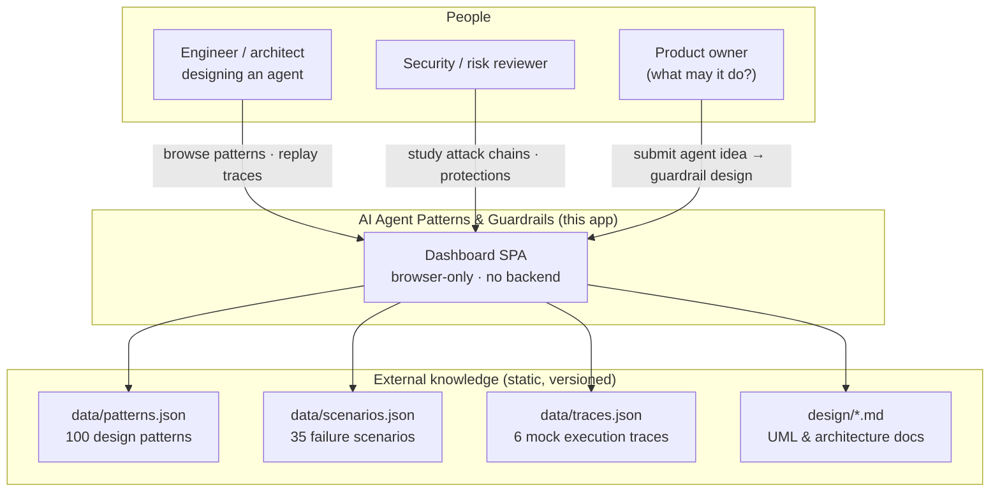
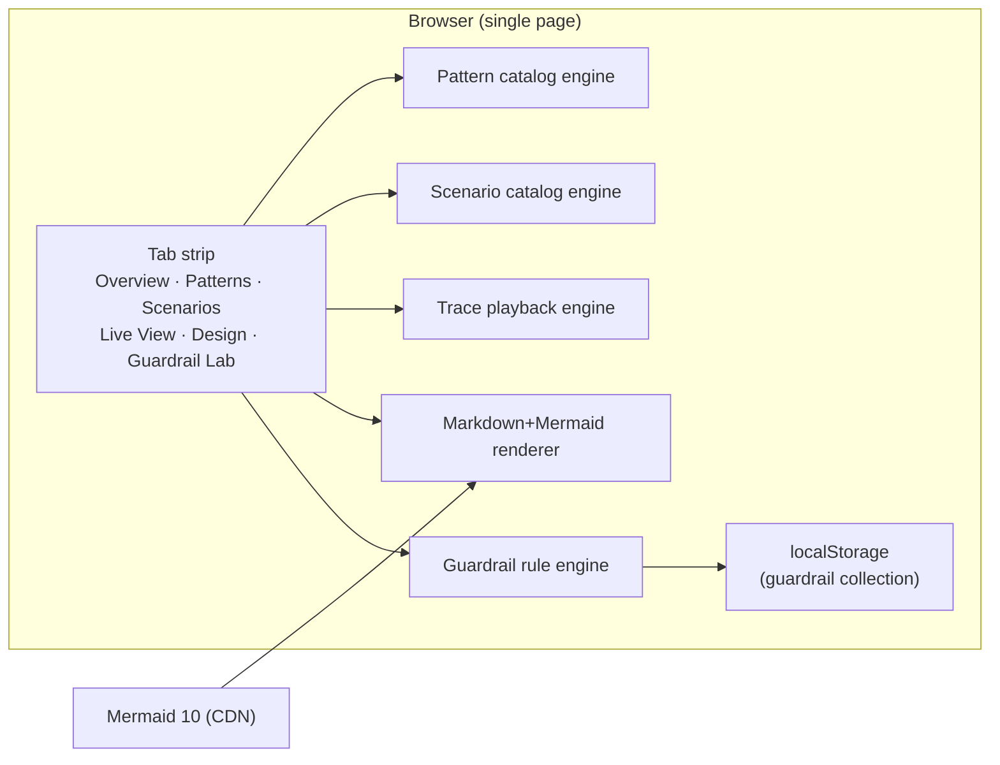
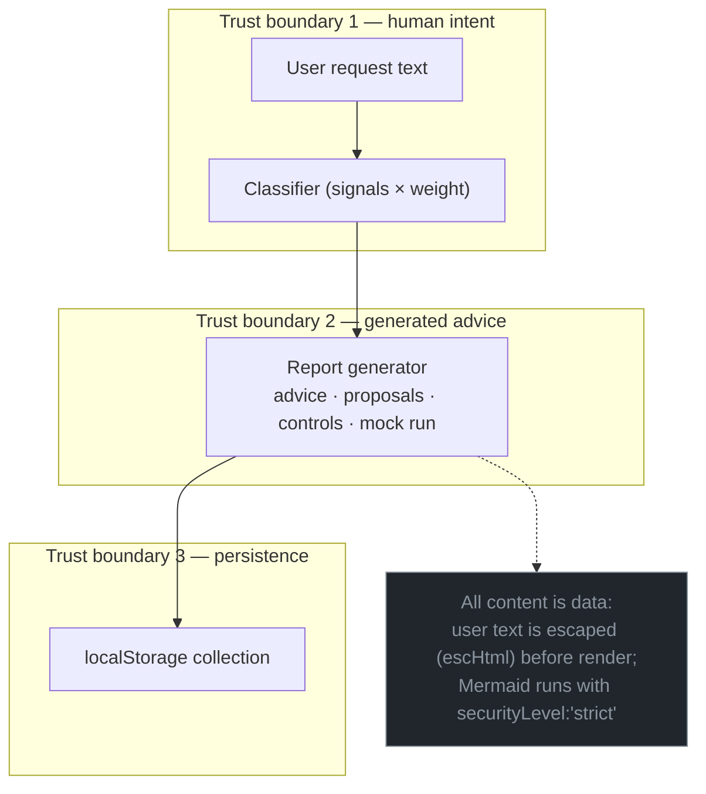

# System Context

**What this system is:** a no-build, browser-only dashboard for studying AI-agent design patterns, their failure modes, and the guardrail architectures that contain them. It is deliberately modeled on the *Agentic Knowledge Mapper* classic GUI: a single-page vanilla-JS app with a tab strip, CSS-variable theming, and a Design & Architecture tab that renders markdown+Mermaid documents live.

## Purpose & principles

- **Nothing is a screenshot.** Every diagram is Mermaid source stored in `design/*.md`, rendered at view time — a diagram that has changed cannot be mistaken for a correct one.
- **Guardrails outside the model.** The catalog's central thesis, applied to itself: deterministic behavior is enforced by the runtime, not by instructions.
- **Everything is inspectable.** Mock traces, attack chains, and control sets are plain data; export the whole collection as JSON.

## Context diagram

## Container overview

There is **no server-side agent**. The Guardrail Lab's "agent" is a deterministic rule engine (`js/guardrail.js`) that classifies the request, scores risk, selects controls, and synthesizes a mock run — chosen so the demo is auditable and reproducible: an un-auditable analyzer would undercut the very thesis the tool teaches.

## Trust boundaries

## Deployment

The app ships as static files. `serve.py` is a thin `http.server` wrapper (needed only because the Design tab fetches `design/*.md`; `file://` would block that fetch). Docker is unnecessary; any static host works.

| Component | Technology | Rationale |
|---|---|---|
| UI shell | Vanilla JS + CSS custom properties | Zero build step; every behavior inspectable in one place |
| Diagrams | Mermaid 10 via CDN, sequential render queue | Same engine the AKM project uses; queue avoids label-measurement races |
| Data | Static JSON, loaded once at boot | Trivially versionable, diffable, exportable |
| Persistence | localStorage (Guardrail Lab collection) | No backend, no data leaves the page |
