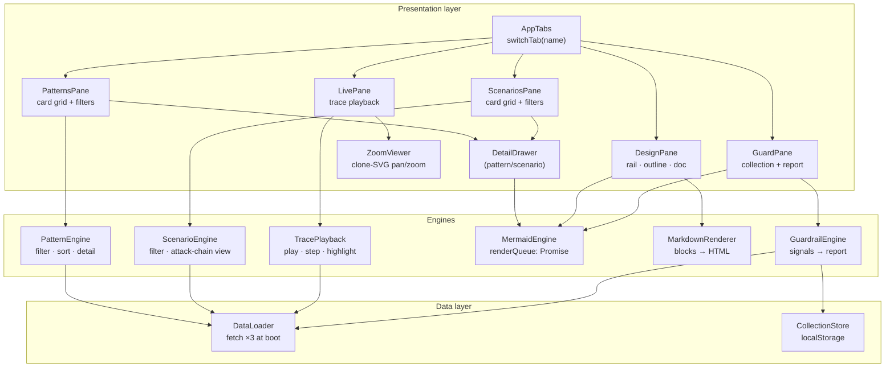
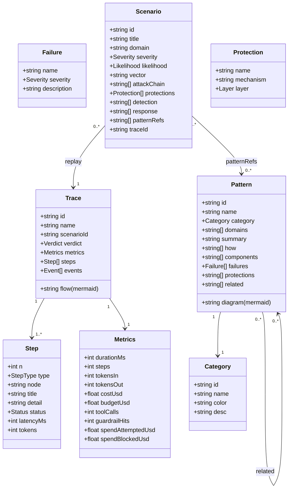
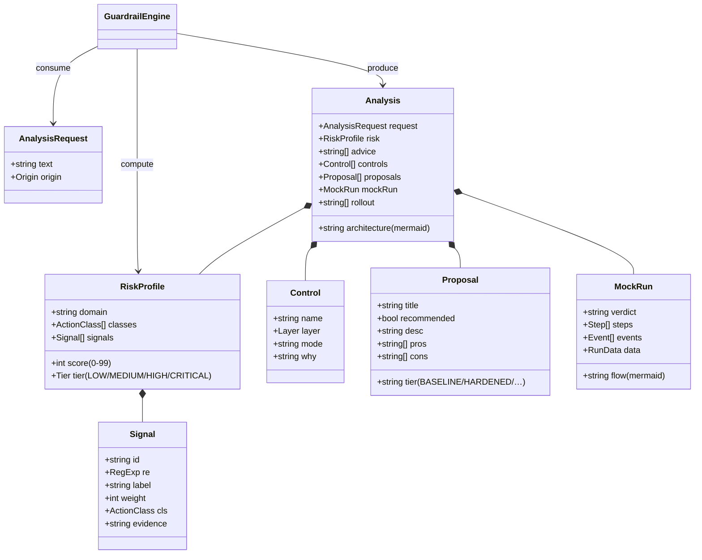
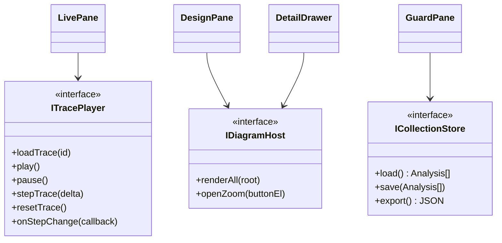

# UML — Components & Classes

Static structure of the dashboard. Four diagrams: a component view, the core data classes, the guardrail-lab rule engine classes, and the interface sketch of the pattern/scenario domain model.

## Component diagram

## Core domain classes

`Trace.node` on each `Step` references a node id in the trace's Mermaid `flow` — this is the join key the playback engine uses to highlight the live control-flow node (see *Control Flow & Runtime*).

## Guardrail Lab engine classes

## Interfaces (what each pane requires of the engines)

All interfaces are satisfied by plain functions/objects — TypeScript-free by design, but the contracts are kept explicit here so behavior stays swappable.
