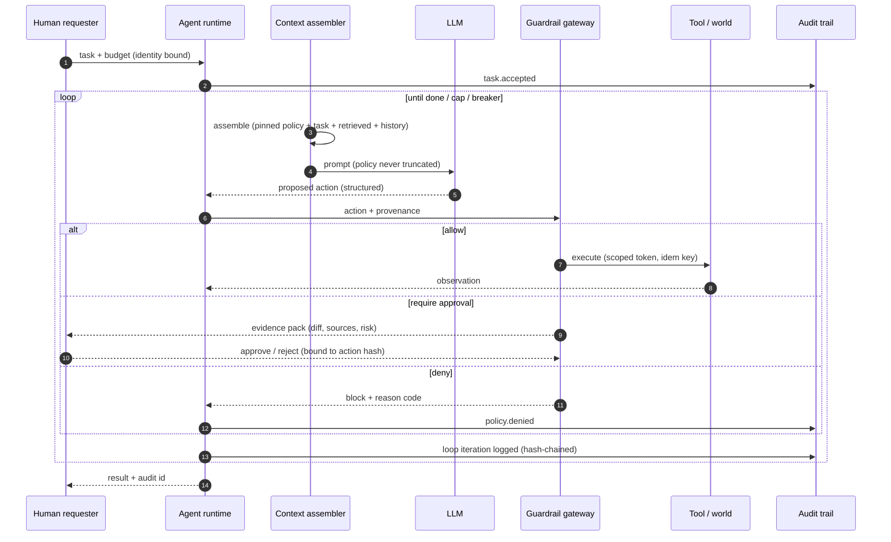
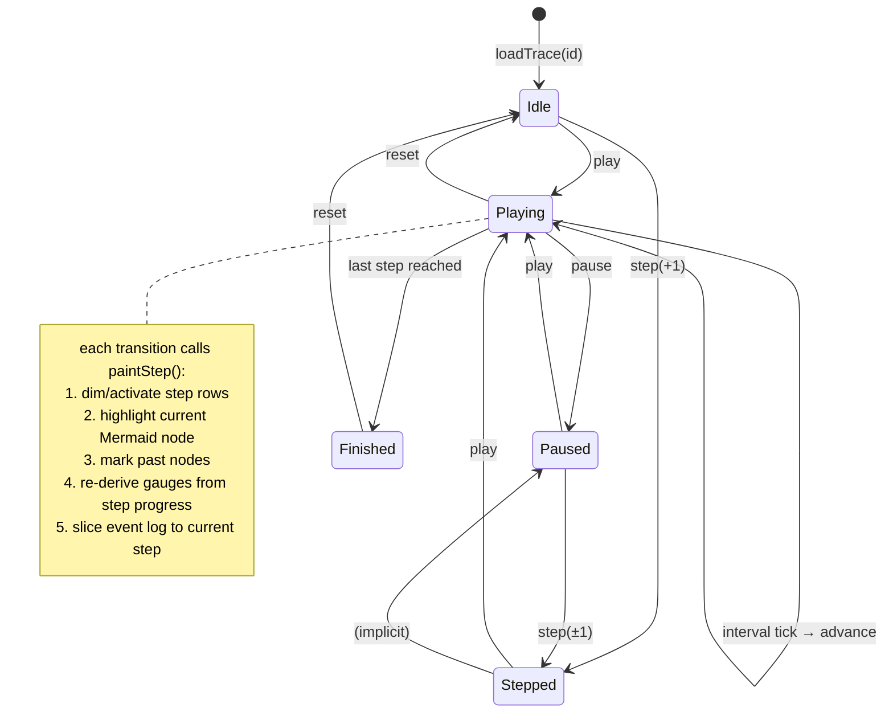
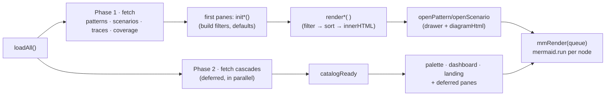
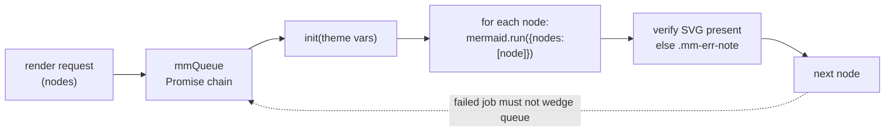

# Control Flow & Runtime

How the dashboard executes: the canonical agent loop it documents, the trace playback state machine, and the Mermaid render pipeline.

## The canonical agent loop (the pattern the whole catalog describes)

Key property: **the guardrail gateway sits between intent and effect.** The model proposes; the runtime disposes. Injection can influence the *proposal* but never the *rules*.

## Trace playback state machine (Live View)

## Data flow: JSON → tab → view

Every render is a pure function of filter state — no hidden caches, so the same filters always produce the same view (the dashboard's own form of idempotency).

### Boot is phased, and any pane can jump the queue

Only the first paint path (overview, patterns, scenarios, plus whatever pane the hash names) is awaited up front; `cascades.json` — the largest dataset — loads in parallel and gates `catalogReady`, which the remaining panes wait on. A tab visit runs a not-yet-built pane's `init` immediately instead of waiting for the idle pump. The full boot sequence, the offline read path and the service worker are in *Runtime, Offline & Delivery*.

## Mermaid render queue (why sequential)

Mermaid measures label widths in shared global state; concurrent `run()` calls corrupt each other's layout. The library is vendored (`js/vendor/mermaid.min.js`, CDN only as a fallback); all renders pass through a single promise chain:

Theme variables are recomputed from the light/dark CSS class at each batch, and every `pre.mermaid` keeps its source in `data-src` so a theme toggle re-renders without re-fetching.
