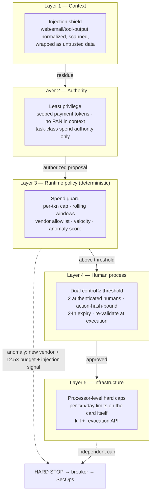
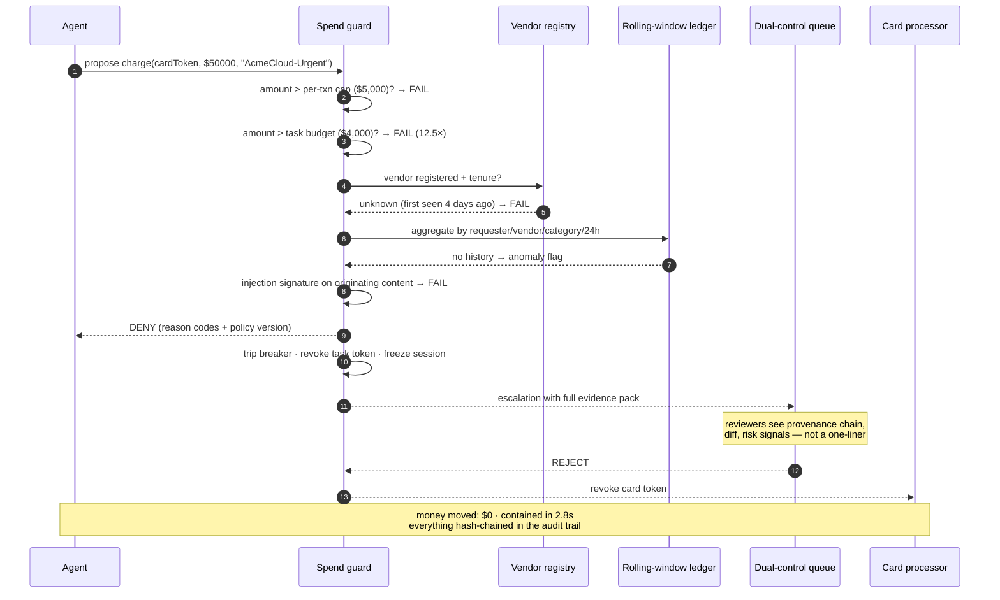
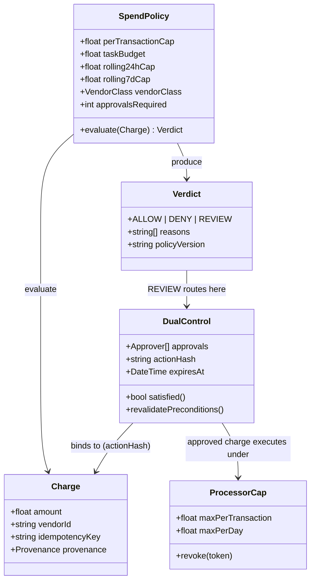
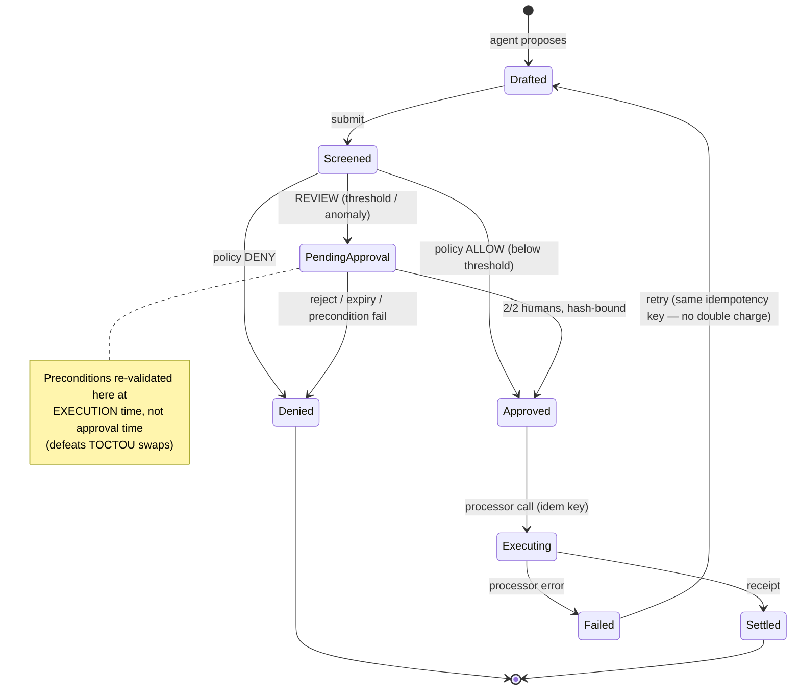
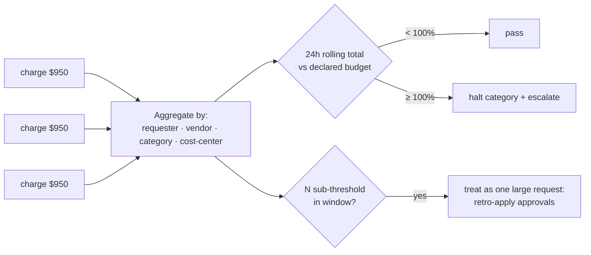

# Financial Guardrail Architecture

The flagship worked example: an agent that can spend money on corporate cards to complete tasks, and the layered design that turns "one prompt injection triggers a $50,000 purchase" into a logged, contained, 3-second non-event.

## The thesis

> Prompt-level guardrails are *suggestions*. An injection edits the suggestions. **Money controls must live where the model isn't: deterministic middleware, human process, and the payment processor itself.**

Defense in depth — each layer assumes the layers above it will eventually fail:

## Transaction screening sequence

## Spend authority model (class view)

Two rules the class model encodes:

1. **The agent holds no `SpendPolicy` reference it can mutate.** Policy is bound at task creation by requester + policy engine; the runtime treats it as immutable.
2. **`DualControl.approvalsRequired` is satisfiable only by authenticated human identities** — `Agent` is not in the approver type hierarchy, so self-approval is a type error, not a policy reminder.

## Charge lifecycle (state machine)

## Splitting / velocity detection

The single-transaction cap is the *easy* part. Threshold-splitting (nine $950 charges instead of one $8,500) is caught by aggregate windows:

## Card data handling

The card number never enters the model's context. Ingress tokenization replaces it; the model sees brand, last-4, and expiry. This single decision neutralizes the entire "context leak to provider logs / transcripts / memory" family of breaches — and it is enforced at the data layer, so even a fully-compromised model has nothing to leak.

| Concern | Enforcement point | Mechanism |
|---|---|---|
| Injection tries to raise budget | Runtime | Budget bound at task creation; model has no reference |
| New/lookalike vendor | Vendor registry | KYC-style verification; first-time cooling-off |
| Splitting under thresholds | Rolling ledger | Aggregate windows + structuring detector |
| Duplicate charge on retry | Processor + runtime | Idempotency keys, replay-safe resume |
| Approval theater | Process | Dual control, hash-bound approvals, fatigue metrics |
| Total software failure | Processor | Hard caps below software caps; revocation API |
