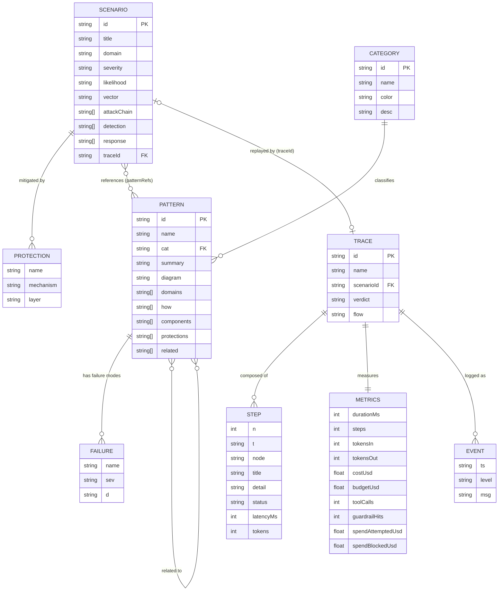
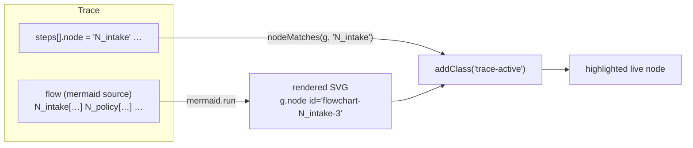
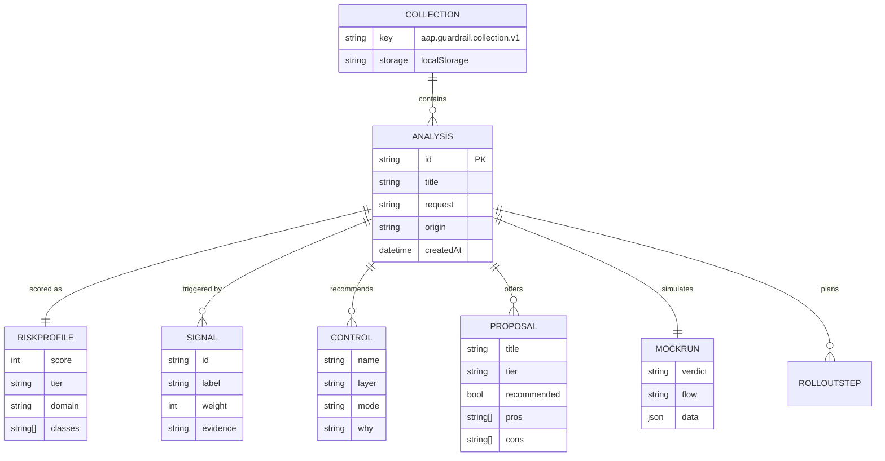

# Data Model

Entity-relationship view of the dashboard's datasets and the persisted Guardrail Lab collection.

## ER diagram (static datasets)



## Relationships & cardinalities

| Relationship | Cardinality | Meaning |
|---|---|---|
| Category → Pattern | 1..N | Each pattern belongs to exactly one category; categories carry a color used in the overview bars |
| Pattern → Failure | 0..N | Failure modes are inline (not a separate file); a pattern with zero failures is a pure-workflow pattern |
| Pattern ↔ Pattern (`related`) | M..N | Cross-links powering "read next" navigation in the detail drawer |
| Scenario → Protection | 0..N | Protections carry a `layer` used to build the "defense in depth" chart on Overview |
| Scenario ↔ Pattern (`patternRefs`) | M..N | Ties the "what can go wrong" catalog to the "how to build it" catalog |
| Scenario → Trace (`traceId`) | 0..1 | Only scenarios with a replayable mock run link to a trace; others show "no mock run" |
| Trace → Step | 1..N | Ordered; each step's `node` joins to a Mermaid node id in `flow` |

## The join that makes the Live View work



`nodeMatches` uses substring matching on the SVG group id because Mermaid appends a suffix. If a node id collides as a substring with another, highlights mis-target — so trace authors keep node ids unique and non-overlapping (e.g. `N1`, `N2` … `N14`, never `N1` and `N10` alongside plain `N1…`) — see the naming convention below.

### Node naming convention for traces

- Prefix `N_` for semantic ids in hand-authored flows (`N_intake`, `N_spend2`).
- The engine's generated mock runs use `N1..Nn` (simple ordinal).
- Never create one id that is a strict substring of another in the same flow. The checklist in `analyzeRequest`'s `buildMockRun` uses plain ordinals to guarantee this.

## Guardrail Lab persistence



## Storage format & schema versioning

```json
{
  "version": 1,
  "exported": "2026-10-18T…",
  "items": [
    {
      "id": "ga-…", "title": "…", "request": "…", "origin": "user|seed",
      "createdAt": "…",
      "meta": { "domain": "Financial services", "domainId": "finance", "riskScore": 96, "tier": "CRITICAL" },
      "signals": [ { "id": "spend", "label": "…", "weight": 24, "evidence": "spend" } ],
      "classes": ["effect.value", "threat.injection"],
      "advice": ["…"], "controls": [ { "name": "…", "layer": "policy", "mode": "hard-stop", "why": "…" } ],
      "proposals": [ { "title": "…", "tier": "HARDENED", "recommended": true, "pros": ["…"], "cons": ["…"] } ],
      "architecture": "flowchart TB…",
      "mockRun": { "verdict": "blocked-then-approved", "flow": "…", "steps": ["…"], "events": ["…"], "data": {} },
      "rollout": ["…"]
    }
  ]
}
```

Missing values are `null`/absent, never silently defaulted — mirroring the AKM project's dataset convention. The `version` field is the migration key: a future v2 loader reads v1 and upgrades on read.

## Retention & privacy

The collection is browser-local; nothing is transmitted. The seed example (`origin: "seed"`) exists solely to demonstrate the flow on first load and can be deleted like any other item. Exports are user-initiated only.
