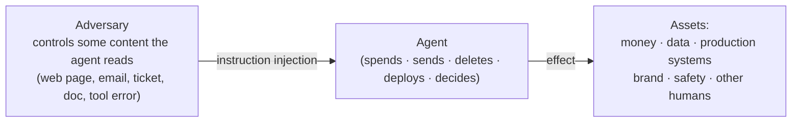
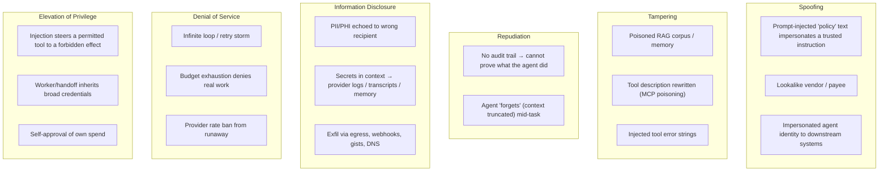
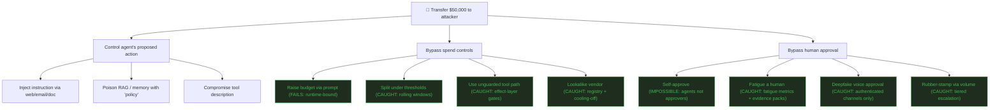
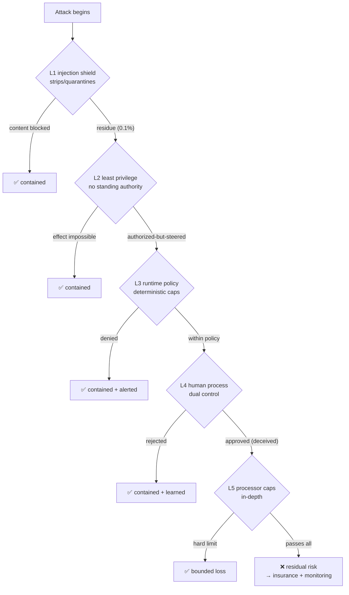
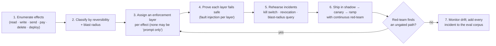

# Threat Model & Protections Map

A STRIDE-style view of what agents (as described in this catalog) get wrong, plus the defense-in-depth map that ties scenarios to the layers that stop them.

## Asset & actor model

The single most important modeling decision: **the adversary does not need to compromise the agent.** Any content channel the agent consumes is an attack surface. This is why "input sanitization" is never the last line.

## STRIDE applied to agents

## Attack tree: the $50k card purchase

Every leaf marked *caught* is a place the design deliberately fails safe. The attack tree is the design's own regression suite: add a test for each node.

## Defense-in-depth map

Which scenario class each layer stops, and what happens when a layer fails:

The last box matters: **a design that claims zero residual risk is lying.** Name the residual, bound it (processor caps limit worst-case loss), and monitor for it (drift + anomaly detection).

## Protections registry (by layer)

| Layer | Representative controls | Scenarios primarily stopped |
|---|---|---|
| `context` | Injection shield, data/instruction separation, pinned policy block | Hidden web injection, tool-error injection, memory poisoning |
| `identity` | Scoped short-lived tokens, workload identity, caller propagation | Confused deputy, agent impersonation, standing-authority abuse |
| `policy` | Deterministic allow/deny, spend caps, vendor registry, effect-layer gates | $50k purchase, threshold splitting, escalation bypass |
| `process` | Approval gates, dual control, cooling-off, review queues | Approval fatigue, deepfake approval, payee-change fraud |
| `infrastructure` | Sandboxes, default-deny egress, metadata-service block | Sandbox escape, code execution, secrets exfil |
| `data` | Tokenization/vault, trust tiers, row-level tenancy scoping | PII echo, cross-tenant leak, RAG poisoning |
| `dlp` | Output shields, secret scanning, destination reputation | Card/PII egress, secret-in-log, exfil via artifacts |
| `observability` | Hash-chained audit, drift monitoring, spend dashboards | Silent drift, budget runaway, undetected abuse (detection, not prevention) |

## Governance checklist (pre-deployment)

## Residual-risk register (worked, for the card agent)

| Residual risk | Bound applied | Monitoring |
|---|---|---|
| Novel injection defeats classifier | Least privilege means no card in context; worst case is a within-policy charge | Block-rate canary probes; quarterly external red-team |
| Human approves a cleverly disguised charge | Processor hard cap limits single loss; evidence packs raise detection odds | Override sampling + canary (seeded malicious) approvals |
| Insider abuse of agent access | Effect-layer caps + dual control apply equally to insiders | Insider-risk monitoring on agent usage patterns |
| Third-party model/provider incident | Model pinned + eval-gated upgrades; no sensitive data in context | Behavioral drift alerts; shadow-parity checks |

Each row names an owner, a bound, and a monitor — the minimum bar for accepting residual risk rather than ignoring it.
