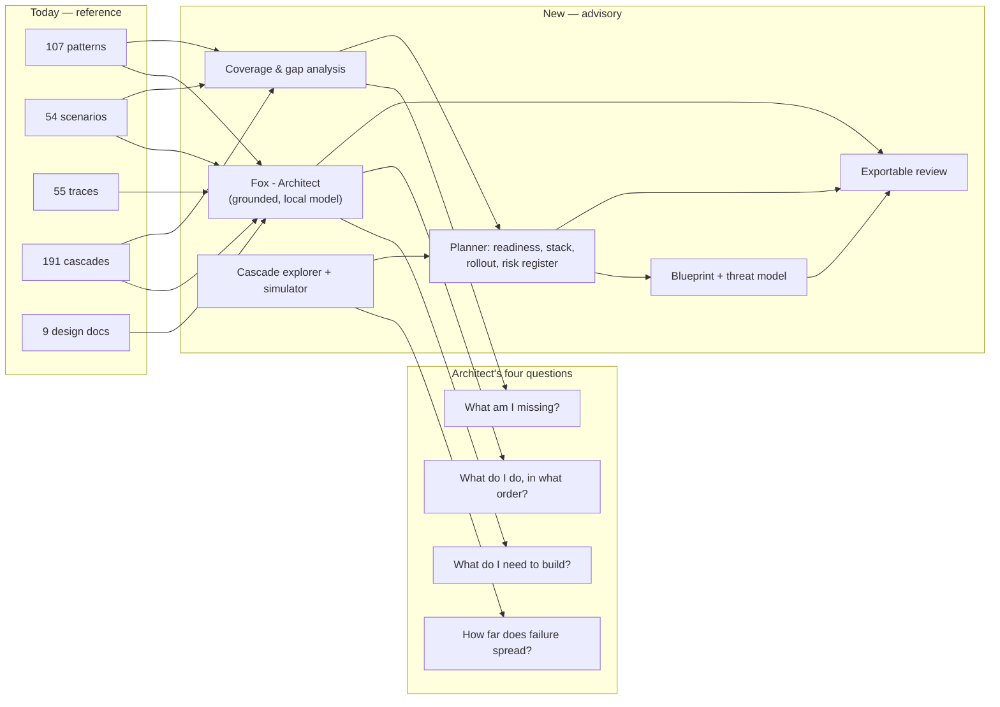
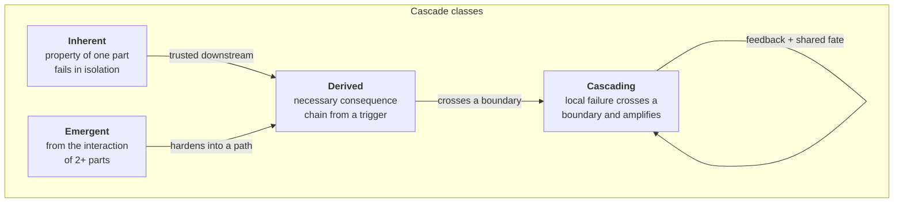
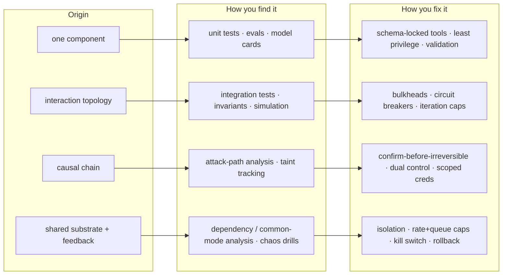
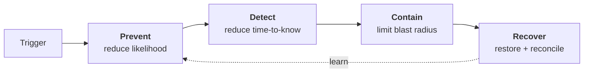
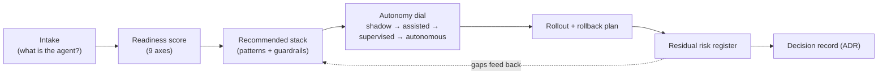
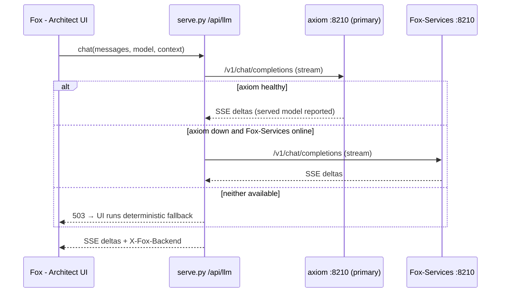

# Architect Value Map & Cascade Taxonomy

This document is the design rationale for the architect-facing upgrade: what the
dashboard knew, what an architect needs, and the four-class cascade model that
connects them. It is the reference behind the **Fox - Architect**, **Cascades**,
**Coverage**, **Planner** and **Discovery Lab** tabs.

## 1. From catalog to advisory system

## 2. The four cascade classes

Cascades are not one thing. They have different origins, so they are found by
different methods and fixed by different controls.

## 3. Mitigation must cover four control functions

Every cascade gets controls across all four NIST-style functions; a plan that
only *prevents* is a plan that cannot survive a detection miss.

## 4. Deployment lifecycle the Planner encodes

## 5. Where the local model sits

The model is an accelerator, never a dependency: retrieval, scoring, coverage,
cascade simulation, and the risk register are all computed locally and work with
the model switched off.
