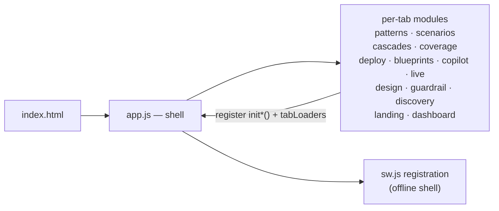
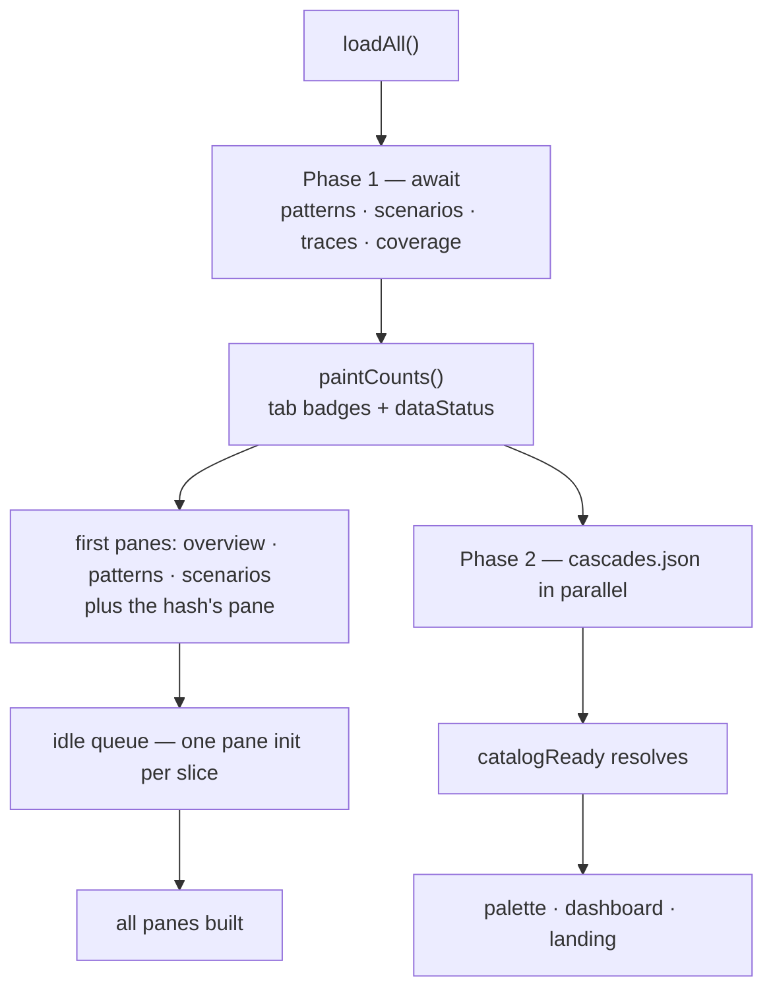
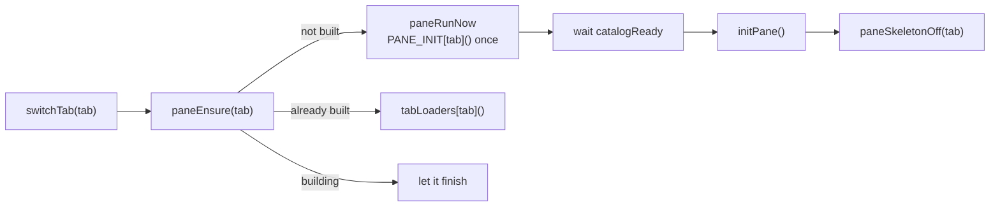
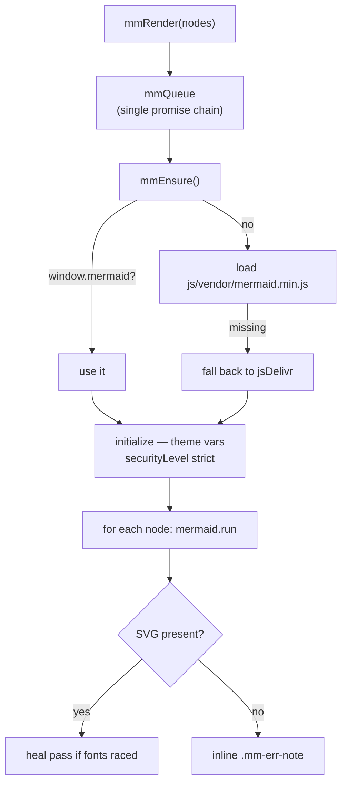
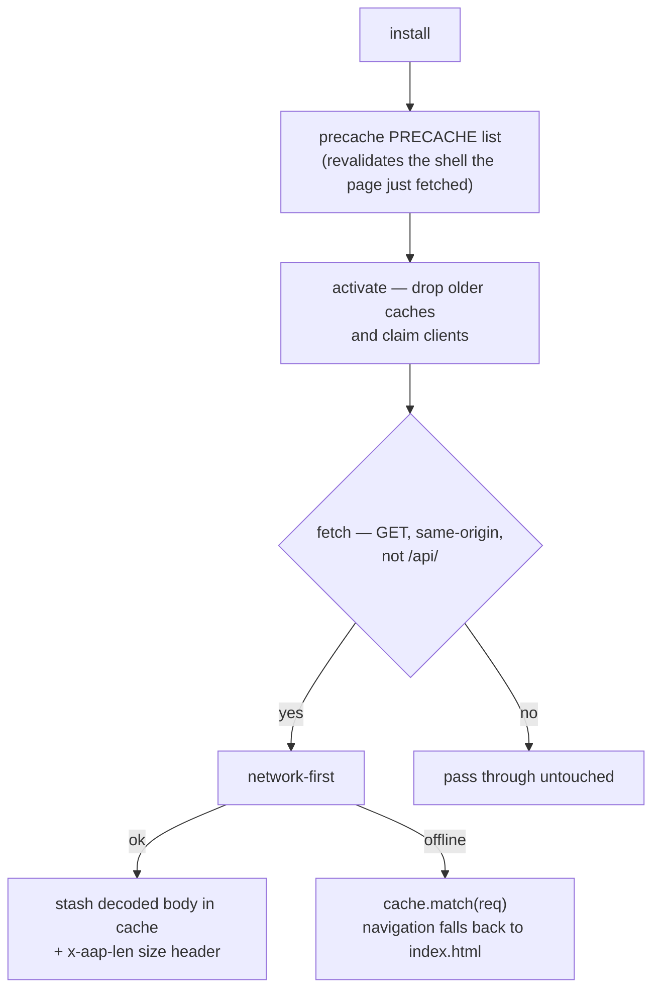
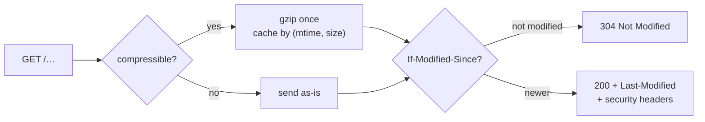
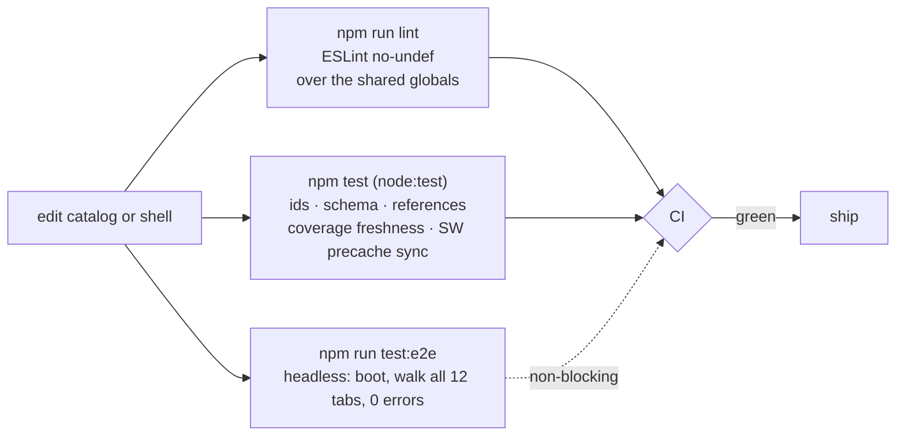

# Runtime, Offline & Delivery

How the app actually runs: a no-build shell that paints the panes you opened before the heavy datasets land, renders diagrams through one vendored queue, keeps working with no network at all, and is delivered with compression, caching and defensive headers — plus the tests that keep all of it honest.

## The shell is one global namespace, loaded in order

`index.html` loads classic scripts — no modules, no bundler, no build step. `app.js` defines the shell (`switchTab`, `mmRender`, `openDetail`, `openZoom`, the `tabLoaders` registry and the `PANE_INIT` bookkeeping); each tab module then registers its `init*()` and its `tabLoaders` entry. Cross-module calls are guarded with `typeof … === "function"`, so any single module can fail without blanking the app.

## Phased boot: first paint never waits for the whole catalog

`loadAll()` awaits only what the first paint and the first panes read — patterns, scenarios, traces and coverage — paints the count badges, and kicks off `cascades.json` in parallel. Cascades (the largest dataset, ~423 KB) is awaited only by the panes that need it, so the tab a user actually opened renders before it lands. Traces stay eager because the Overview stat cards read their count.

### Any pane can jump the queue

`switchTab` calls `paneEnsure`, which runs a not-yet-built pane's init immediately (through `catalogReady`) instead of waiting for the idle pump. A JS-built pane shows a skeleton until its init finishes, so a slow pane can never look blank.

## Diagrams: vendored first, one queue

Mermaid ships under `js/vendor/mermaid.min.js`, so diagrams render on a LAN-only or air-gapped host; the CDN is loaded **only if the vendored copy is missing**. Every render — including `mermaid.initialize`, which resets shared global state — passes through a single promise chain (`mmQueue`), because concurrent `run()` calls corrupt each other's label measurement. A node whose SVG is absent gets an inline `.mm-err-note` instead of a silent blank, and a heal pass re-runs only nodes whose layout raced the fonts.

## Offline app shell (service worker)

`sw.js` precaches the whole shell — `index.html`, the stylesheet, every script, the vendored Mermaid, and all of `data/*.json` and `design/*.md` — then serves same-origin GETs network-first with a cache fallback. It never touches `/api/*` (the LLM proxy and the diagnostics beacon), so model calls and telemetry always reach the network. After one visit the app works with no network at all; the offline chip reads *Offline · cached*.

`VERSION` in `sw.js` is bumped whenever the shell changes; `activate()` deletes every cache that is not the current version, so clients re-precache rather than serve a stale shell.

## Delivery: compression, caching, headers

`serve.py` is the whole server: a thin static host plus the same-origin LLM proxy. It compresses compressible responses once and caches the result per `(path, mtime, size)`, serves the vendored Mermaid as `immutable`, revalidates everything else with `If-Modified-Since`/`Last-Modified` (cheap 304s), and adds defensive headers to every response.

| Header | Value | Purpose |
|---|---|---|
| `Content-Security-Policy` | `default-src 'self'`; inline script + style; Mermaid CDN allowed; `connect-src 'self'`; `object-src 'none'`; `frame-ancestors 'none'` | No third-party script, no exfil channel, no framing |
| `X-Content-Type-Options` | `nosniff` | No MIME confusion |
| `X-Frame-Options` | `DENY` | No clickjacking frame |
| `Referrer-Policy` | `no-referrer` | No referrer leakage |
| `Server` | suppressed (`server_version = "aap"`) | No build/version banner |

## Making the wins visible, not claims

The Display panel (⛭ display) prints a live perf budget: requests this session, how many were answered locally, bytes actually pulled over the wire (from the `x-aap-len` sizes the worker recorded), and the size of the offline cache. First load is ~1.37 MB compressed rather than ~4.9 MB raw; a repeat visit transfers ~0.02 MB.

## Guardrails for the app itself

The catalog's thesis — deterministic enforcement outside the model — applies to the project too. There is no build step, but there is a gate.

`npm test` fails when a catalog reference dangles, a record gains an unexpected key (how the misspelled `proteations` was caught), `data/coverage.json` is stale, or a shell file is missing from `sw.js`'s precache list. CI gates on lint + data integrity, with the headless smoke test as a non-blocking job.
