# Rogue Agents — Simulation, Detection & Quarantine

A compromised agent is not a bug in one tool call. It is a member of the swarm that works, correctly and diligently, toward the wrong objective — or toward no objective at all, while its tools reach further than its grant allows. This document describes the Rogue Agents tab (`js/rogue.js`): a deterministic swarm simulation with deliberately injected rogues, three behavioural detectors, an automated isolation workflow with remediation SLAs, and a guardrail derivation loop that turns measured results into runtime enforcement. The same thesis as the rest of the app, pointed at the insider: enforcement outside the model, in readable code.

The tab's honest caveat, printed in its own report: a passing synthetic run proves the *controls are wired*, not that any agent is safe.

## Context: where the tab sits

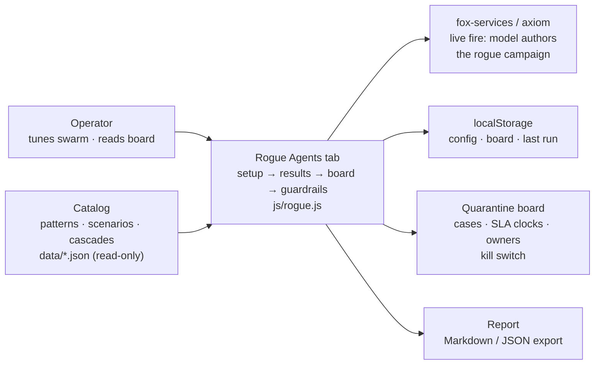

The tab reads the catalog (control-to-pattern mappings, scenario records for the book) and writes only to `localStorage` and to exported reports. The model backends are optional and fenced: they author attack campaigns in live-fire mode, nothing else. Detection, quarantine and the SLA math never call the model.

## Modules: one file, four stages

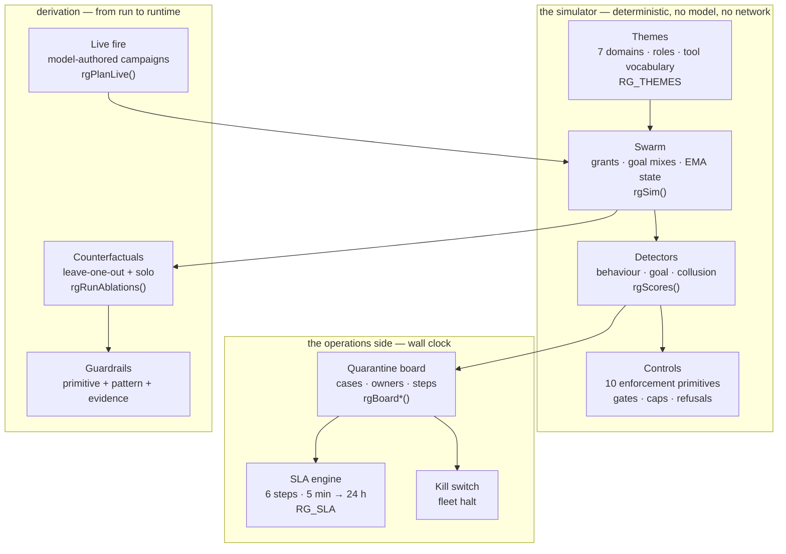

Setup owns the left column, Results owns the simulator column, the board owns the operations column, Guardrails owns derivation. Live fire feeds the simulator but never bypasses it: a model-authored campaign is still executed tick by tick by the same engine, against the same detectors and controls.

## Static structure: what a rogue is, in code

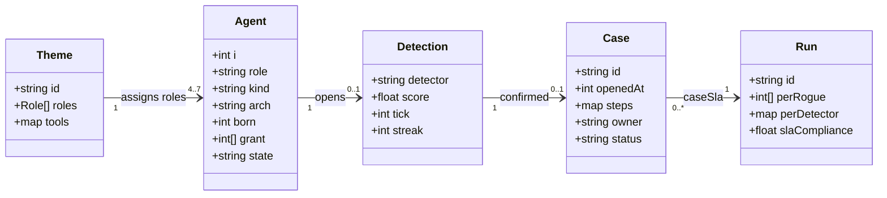

A rogue is an `Agent` with `kind = "rogue"`, an archetype, and an activation tick — nothing more. There is no separate rogue class at runtime, which is the point: until activation a rogue behaves exactly like everyone else, and the detectors cannot see the future, only the deviation.

## Activity: one tick of the swarm

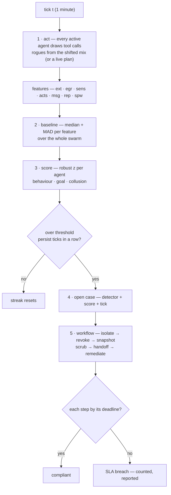

The baseline is recomputed every tick from the live swarm, with median + MAD so a handful of rogues cannot drag it. Persistence (`persist` consecutive ticks, default 2) is what turns a spike into an alert: a single noisy tick is never a detection.

## Sequence: the quarantine workflow and its deadlines

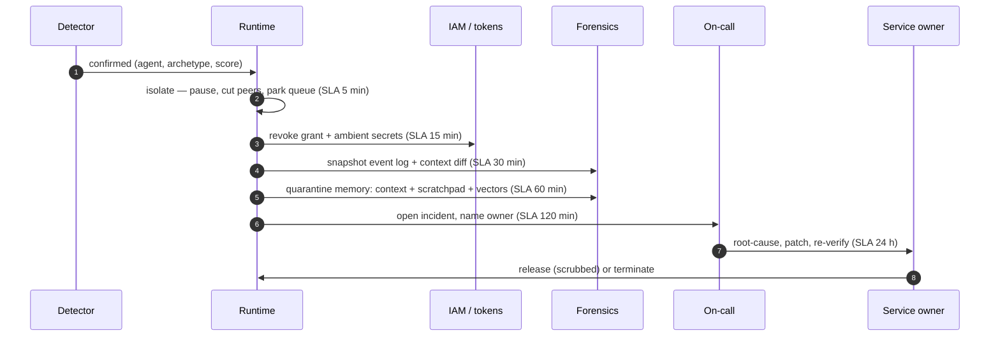

Six steps, six deadlines, three owners. The simulation runs the same workflow on the same deadlines, so a breach in the simulation is a breach on the board — the report's SLA compliance is the share of counted steps met on time, excluding steps whose deadlines fall outside the run horizon and false-positive cases, which have no incident to work.

## Lifecycle: an agent, from healthy to released

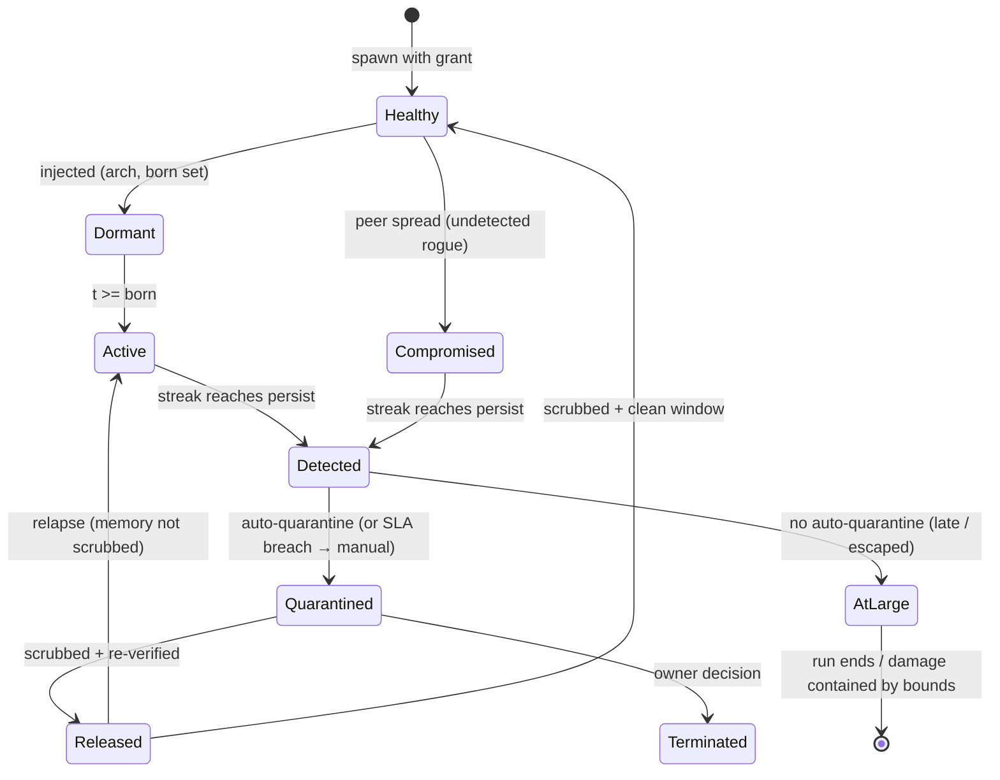

Release without a memory scrub returns to `Active`, not `Healthy` — the context that turned is still the context it runs. The relapse edge is measured, not assumed: long runs with the scrub off end with most contained rogues relapsing.

## Live fire: the model writes the attack, the engine grades it

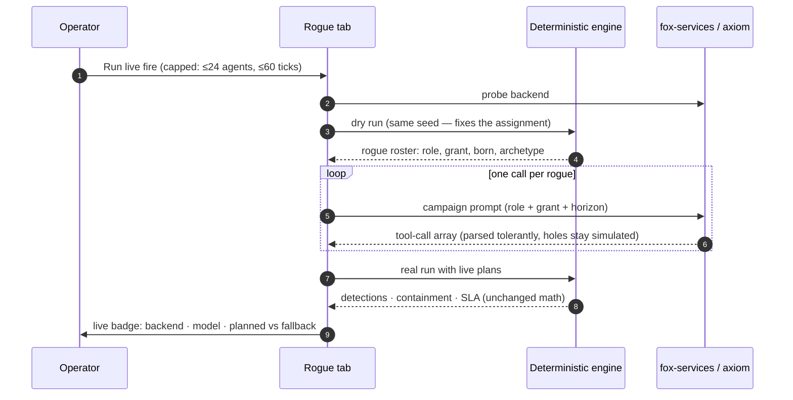

One call per rogue, not per tick — the campaign is open-loop, and the tab says so. Parsing is tolerant (names, theme labels, 1-based numbers; unknown labels become holes the engine fills by drawing), and a rogue the model never answers for stays simulated and is flagged. If every call fails, no run starts: a fully simulated run must never wear a live badge.

## Themes and archetypes: the coverage matrix

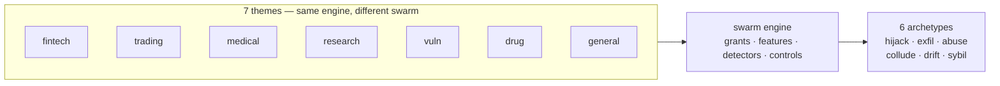

A theme changes roles and tool vocabulary, never mechanics — the six tool classes underneath are fixed, only their names change. That is what keeps results comparable across domains and what lets the book below read all 54 catalog scenarios through one rogue lens: every scenario is a (theme, archetype, road) triple, and every triple is executable.

## Archetype impact chains: how each shape turns into harm

One chain per archetype, each small enough to fit a page. Every chain ends the same way — the workflow from the quarantine section — because detection without the incident is observation, and the incident without enforcement is theater.

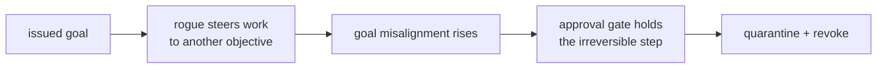

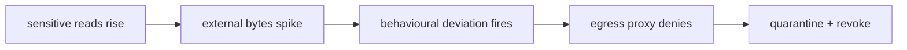

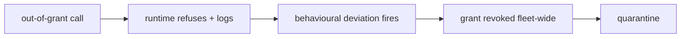

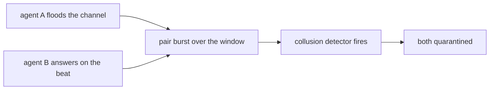

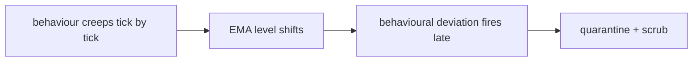

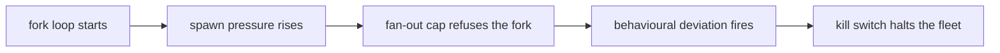
