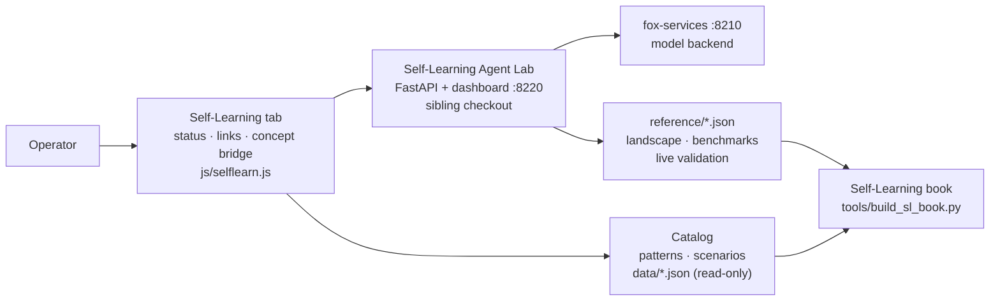
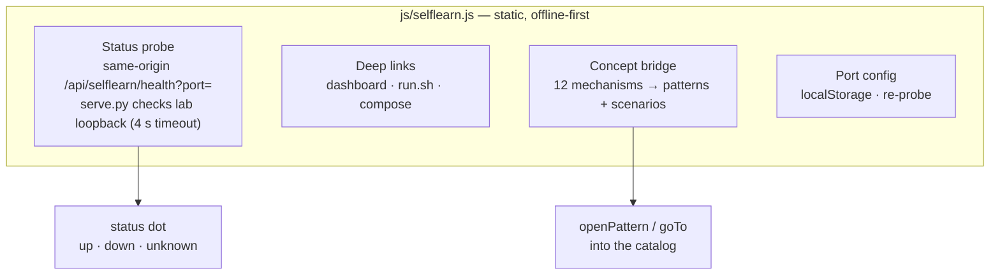
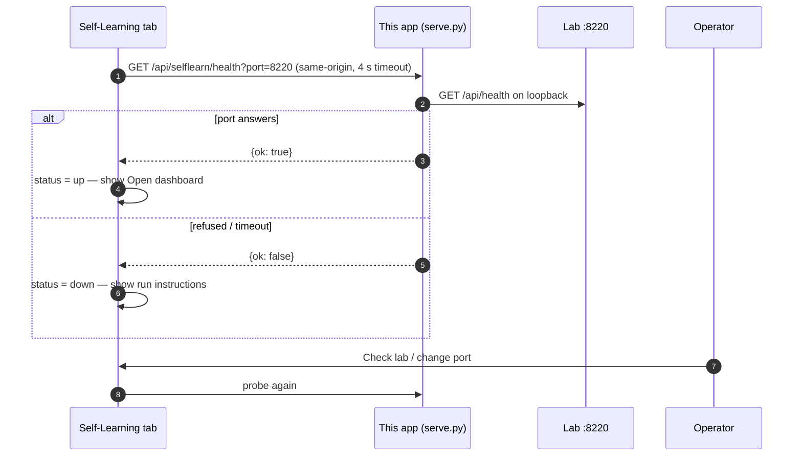
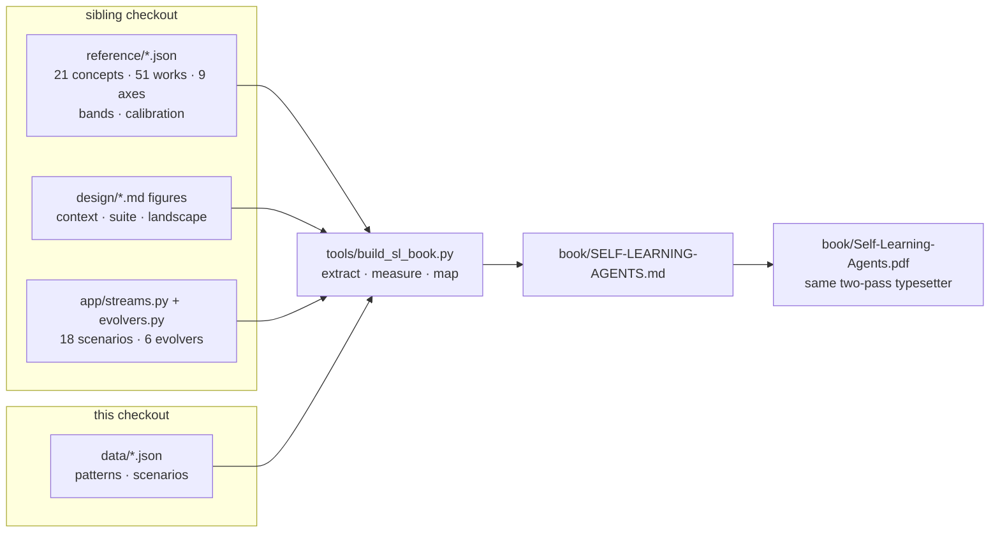

# Self-Learning Add-on — Bridging the Lab

The Self-Learning Agent Lab is a separate service: a FastAPI backend plus dashboard on `:8220`, backed by fox-services on `:8210`, developed in the sibling checkout `../self-learning-agents`. This app does not execute the lab — it bridges to it. The Self-Learning tab (`js/selflearn.js`) carries reachability status, deep links, run instructions, and a concept map from the lab's mechanisms to this catalog's patterns and scenarios. The companion book (`tools/build_sl_book.py`) carries the lab's reference data and evaluation results. Everything in the tab works with the lab stopped; only the status dot needs it running.

## Context: two checkouts, one operator

The arrow from the tab to the lab is deliberately thin: a reachability probe and outbound links. No lab state is read into the app, no app state is written into the lab. The thick arrow is the build-time one: the book generator reads the lab's reference data and this catalog together, so the supplement cannot disagree with either.

## Modules: what the tab owns

## Sequence: the probe that cannot read

The lab ships no CORS headers, so the browser never contacts it directly — and the tab never tries. The same-origin proxy proves the port answers from the server's loopback; anything else proves nothing except that the lab is not there right now. Richer live embedding (run lists, metric tables inside this tab) waits on a one-line CORS allowance on the lab side; until then the dashboard link is the integration.

## Data flow: the book reads both repos

The generator fails loudly when the sibling checkout is absent — a supplement built without its sources would be fiction, and the build refuses to ship fiction. Scenario and evolver inventories are imported from the lab's own modules at build time, never retyped, so a renamed stream breaks the build instead of silently aging the book.
