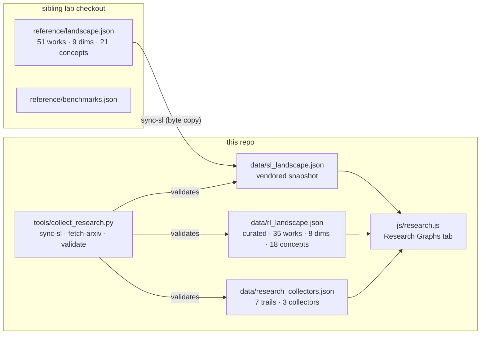
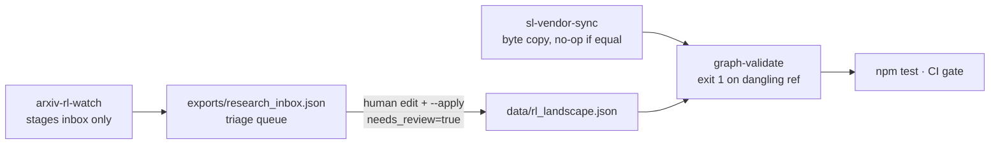
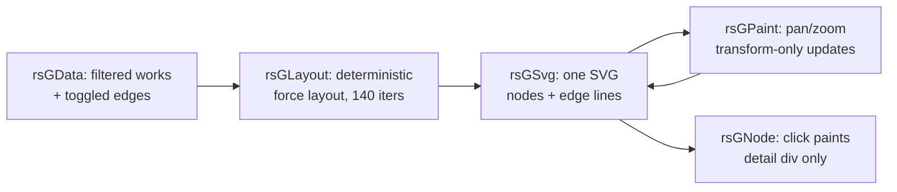

# Design 12 — Research Graphs: Self-Learning × RL

Two knowledge graphs, one tab, three collectors. This doc records why the
graphs are shaped the way they are and where each byte comes from.

## What lives where

## Why two graphs instead of one

The self-learning graph belongs to the sibling lab: its works, dimensions
and concepts are that lab's curation, and this repo must never edit them —
only snapshot them. The RL graph belongs here: it spans Bellman (1957) to
RLVR (2025), territory the lab never claimed. Merging them into one file
would let a local edit silently fork the lab's curation. Two files, one
validator, zero ambiguity about ownership.

## How they interlink (three mechanisms, strongest first)

1. **Shared concept ids.** Five concepts exist in both graphs with identical
   ids: `credit-assignment`, `memory-policy-learning`, `experience-evolution`,
   `continual-learning`, `verifier-feedback`. Filtering either graph by one
   of these shows the same intellectual thread from both sides.
2. **Explicit work links.** Every RL work carries `sl_links` (ids into the
   SL snapshot) and `rl_links` (builds-on edges inside the RL graph). The
   tab renders both as jump buttons; the validator fails on a dangling id.
3. **Addressed trails.** `research_collectors.json` trails reference works
   as `rl:<id>` / `sl:<id>`, so a trail is a cross-graph path, not a list.

## The collectors (human-gated by design)

- `sync-sl` copies bytes; it cannot curate. Drift between the snapshot and
  the checkout is visible as a diff, not a silent merge.
- `fetch-arxiv` writes the inbox, never the graph. With `--apply --ids`
  it merges drafts flagged `needs_review=true`, which the tab badges and
  the validator reports until a human replaces the staged summary.
- `validate` is the same check `npm test` runs: RL patterns resolve in
  `data/patterns.json`, every `rl_link`/`sl_link`/trail ref resolves, no
  self-links, no duplicate ids.

## UI decisions

- The tab lazy-loads its three JSONs on first visit: the boot path never
  waits on ~80 KB of research data, and everything still works offline
  because `sw.js` precaches all three files.
- Search re-renders the pane, so the caret is restored explicitly after
  each keystroke render (`_refocus`) — the same focus-loss class of bug
  the static sidebars of the catalog tabs never hit.
- Detail pages reuse the catalog drawer actions (`openPattern`) for
  pattern chips, so the graphs read *into* the catalog instead of
  duplicating it.
- Sequence diagrams in this doc carry no semicolons inside messages
  (Mermaid 10.9 fails the whole diagram on those); flowchart labels may.

## The graph view

## Freshness contract

| Artefact | Fresh when | Checked by |
|---|---|---|
| `sl_landscape.json` | byte-equal to sibling `reference/landscape.json` | `sync-sl` no-op message; diff on change |
| `rl_landscape.json` | every ref resolves; no unreviewed drafts claimed as curated | `validate` + `npm test` |
| `research_collectors.json` | every trail ref resolves | `validate` + `npm test` |
| offline shell | all three data files + `js/research.js` + this doc precached | `npm test` precache check |
